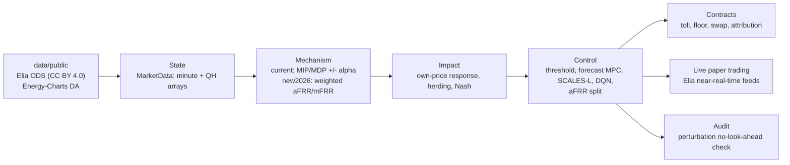
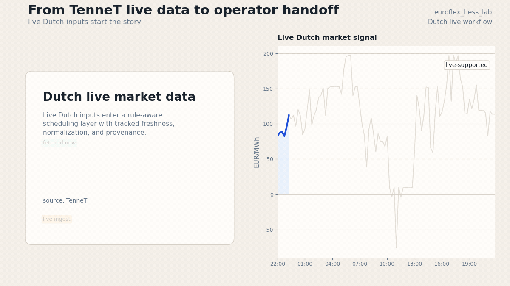
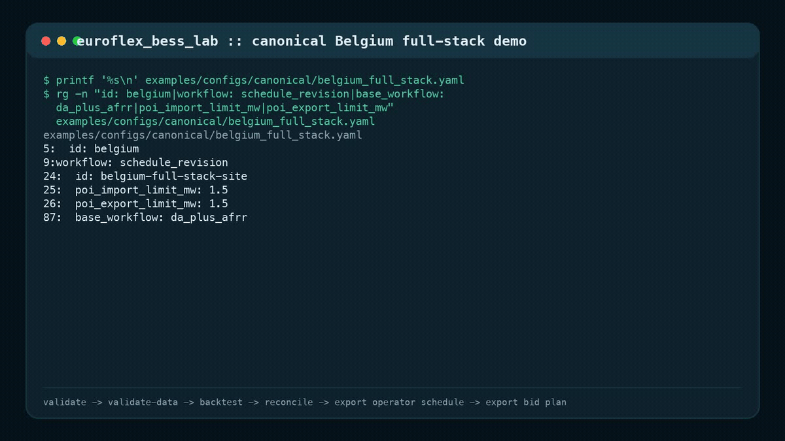

# euroflex_bess_lab


[](https://pypi.org/project/euroflex-bess-lab/)

`euroflex_bess_lab` is a real-data trading lab for European battery storage. Version 2 adds the layer where the
money is made: minute-level Belgian implicit balancing under both of Elia's imbalance-price formulas (the current
one and the one planned for 24 Nov 2026), aFRR reserve stacking, the price impact of large fleets and herding,
contract pricing for tolls and floors, continuous-intraday re-trading, and revenue stacks for Germany, Denmark, Sweden,
Finland and Great Britain, plus a live paper-trading loop with deployment templates and a forward track record. Every headline number
below is regenerated by a committed script from the committed public data set in `data/public` (Elia Open Data and
Energy-Charts, CC BY 4.0), and every tradable strategy passes a perturbation audit that proves it never looked ahead.

The v1 scheduling, revision, reconciliation and operator-handoff framework (narrow GA promise: Belgium portfolio
`schedule_revision` on `da_plus_afrr`) is unchanged and documented further down.

Simulated money on public data, not trading advice. Nothing in this repository submits orders to any market.

## Headline results on real data

Battery 1 MW / 2 MWh, efficiency 0.95 each way, SOC 5-95 %, degradation 8 EUR per MWh discharged, minute data usable
1 minute after the minute ends, final quarter-hour prices 5 minutes after the quarter-hour. EUR/MW/yr is annualised
net P&L.

### Belgium real-time implicit balancing ([report](reports/realtime_belgium.md))

| Period | Formula | Reactive threshold | Best learned strategy | EUR/MW/yr | Capture vs perfect foresight |
| --- | --- | ---: | --- | ---: | ---: |
| Jun 2024 - Dec 2025 | current | 195,403 | SCALES-L | 283,915 | 53 % |
| Jan - Jul 2026 | current | 70,929 | forecast MPC, risk filter | 83,771 | 33 % |
| Jan - Jul 2026 | new 2026 | 70,126 | SCALES-L + live running price | 81,350 | 31 % |
| Aug - Oct 2026 | current | 88,024 | SCALES-L, risk filter | 95,324 | 40 % |

SCALES-L forecasts the mechanism-invariant market state and prices it through an explicit settlement operator, so
it can trade a new formula before that formula has produced a single price. On Apr-Jul 2026 settled at the new
price it earns 86 % of what a model trained on three months of new-formula prices earns (80 % without the live
price), versus 50 % for the naive transfer of a current-formula model. All 138 look-ahead audits of tradable strategies pass (the
perfect-foresight oracle fails them, as designed), and SCALES-L and forecast MPC outperform a DQN baseline trained on
Apple `mps`.

### Elia's 2026 imbalance-price reform as a natural experiment ([report](reports/mechanism_natural_experiment.md))

- Both formulas are reproduced from Elia's published components: current formula 99.999 % of 75,936 quarter-hours,
  new formula 100 % of Elia's 20,352 simulated quarter-hours (the incentive enters as max/min, the weights use net
  aFRR/mFRR volumes).
- Same days, two prices (Jan-Jul 2026): standard deviation 253 -> 123 EUR/MWh, negative quarter-hours 9.0 % ->
  6.3 %, evening-minus-midday 84 -> 51 EUR/MWh; perfect-foresight value 252k -> 264k EUR/MW/yr. The value does not
  vanish, it moves: the short-minus-long spread a battery monetises falls from 96 to 58 EUR/MWh.
- A [pre-registered prediction](reports/preregistration_new_formula.md) for the first post-reform weeks
  (24 Nov 2026 - 31 Jan 2027) is frozen in git before go-live and will be tested on real data.

### Fleet size, own price impact and herding ([report](reports/impact.md))

| Implicitly reacting fleet (Jan-Jul 2026, current formula) | 1 MW | 100 MW | 200 MW | 400 MW | 1,600 MW |
| --- | ---: | ---: | ---: | ---: | ---: |
| Price taker replicated (herding), kEUR/MW/yr | 70.6 | 37.6 | 10.6 | -27.2 | -305.6 |
| Impact-aware policy, kEUR/MW/yr | 70.6 | 49.1 | 37.8 | 24.8 | 8.7 |

Most of the loss is overshoot: the fleet flips the system imbalance and the price turns against it. With four fleets,
the new 2026 formula pays more per MW but weakens the market's own penalty on herding; at 3.2 GW of herding fleets
the residual system imbalance grows by 152 %.

### aFRR + implicit balancing stack ([report](reports/reserve_belgium.md))

| Period | Implicit only | 100 % aFRR | Causal per-block split | Ex-post best split |
| --- | ---: | ---: | ---: | ---: |
| Jul - Dec 2024 (high capacity prices) | 346.5 | 720.1 | 695.2 | 789.7 |
| 2025 (capacity-price collapse) | 108.7 | 282.1 | 271.4 | 278.7 |
| 2026 to date | 76.2 | 198.0 | 181.9 | 190.4 |

kEUR/MW/yr, current formula, threshold implicit layer. aFRR energy grew from 10 % to 39 % of reserve revenue: the
value moved from capacity to energy.

### Contract pricing ([implicit only](reports/valuation_belgium.md), [stack](reports/valuation_belgium_stack.md))

Seven-year tenor from 2027, latest 12 months as the base, saturation from the Nash fleet curve, 90 % weight on the
new formula:

- full aFRR + implicit stack: fair flat toll 109,217 EUR/MW/yr (deal zone 95,387 - 109,217), risk-neutral
  break-even 123,046;
- implicit balancing alone: fair toll 49,474 EUR/MW/yr; the attribution waterfall goes from 251k (perfect foresight)
  to 81k contractable, and splits the formula change into repricing (-33k) and re-optimisation (+31k);
- a full-history sensitivity (Jun 2024 onwards, including the 2024 scarcity period) is in
  [valuation_belgium_full_history](reports/valuation_belgium_full_history.md).

### Germany, day-ahead + FCR + aFRR capacity ([report](reports/germany.md), experimental)

| Latest 12 months (Oct 2025 - Sep 2026) | DA only | DA + FCR | DA + aFRR capacity |
| --- | ---: | ---: | ---: |
| Persistence forecast, EUR/MW/yr | 71,425 | 154,897 | 209,980 |
| Capture vs perfect foresight | 79 % | 90 % | 93 % |

German balance groups must stay balanced, so implicit balancing is rejected for Germany by design.

### Live paper trading ([session](reports/live_paper_trading.md))

The live loop runs the same `Strategy` objects against Elia's near-real-time feeds; replays of 4,320 real minutes
reproduce the backtest decisions and ledger exactly. Measured publication latency: per-minute imbalance price median
17 s, system imbalance 28 s, quarter-hour price 73 s, which calibrates the 1-minute lag used in every backtest.

### Frozen models keep their value out of sample ([report](reports/out_of_sample.md))

Models trained once on data up to a cutoff and never updated afterwards (SCALES-L, risk filter, current formula):

| Trained up to | Traded afterwards | EUR/MW/yr | vs monthly retraining | vs best reactive rule (95 % CI) |
| --- | --- | ---: | ---: | --- |
| 30 Jun 2025 | 16 months | 89,454 | 97 % | +16 % (+10 % to +23 %) |
| 31 Dec 2025 | 10 months | 84,724 | 98 % | +11 % (+3 % to +19 %) |
| 31 Mar 2026 | 7 months | 94,111 | 101 % | +11 % (+3 % to +20 %) |
| 31 Dec 2025, new formula, no new-formula price ever seen (+ live price) | Jan - Jul 2026 | 80,007 | 98 % | +14 % (+4 % to +25 %) |

120 out of 120 real-data look-ahead audits pass, and the fitted models are bit-identical when every value published
after the cutoff is replaced by noise.

### Continuous-intraday re-trading, Germany ([report](reports/intraday.md))

Day-ahead schedule at D-1 12:00, then rolling intraday re-optimisation executed at the TSOs' quarter-hour intraday
index (ID AEP, volume-weighted continuous-intraday trades), with exchange fees and slippage:

| Latest 12 months (Oct 2025 - Sep 2026) | Day-ahead only | Day-ahead + intraday |
| --- | ---: | ---: |
| EUR/MW/yr | 71,150 | 85,512 (+20 %) |

The uplift stays positive across slippage from 0 to 10 EUR/MWh; 120 out of 120 causality audits pass.

### Nordic markets ([report](reports/nordics.md))

Day-ahead co-optimised with FCR-N / FCR-D, aFRR and mFRR capacity at the real gate closures (latest 12 months):

| Zone | DK1 | DK2 | SE3 | SE4 | FI |
| --- | ---: | ---: | ---: | ---: | ---: |
| EUR/MW/yr | 203,047 | 196,362 | 237,936 | 274,900 | 113,114 |
| Capture vs perfect foresight | 78 % | 72 % | 77 % | 75 % | 80 % |

### Great Britain ([report](reports/great_britain.md))

Wholesale on the market index, NIV chasing on the single cash-out price, and Dynamic Containment / Moderation /
Regulation stacked with a causal day-ahead allocation: 51,400 GBP/MW/yr (59,552 EUR) over the latest 12 months, 80 %
of the Modo GB 2-hour index (excluding capacity) in 2024 and 92 % in 2025, before any Balancing Mechanism revenue.

### Deployment and forward track record ([deployment](docs/deployment.md), [track record](reports/track_record/README.md))

The live paper-trading engine ships as a non-root container with health checks, plus docker-compose, Kubernetes,
AWS ECS / CloudFormation, systemd and launchd templates. Forecast models rebuild byte-for-byte from a pinned
manifest. A forward track record runs the frozen strategies on each new day of Elia data, out of sample by
construction.

## The five questions this repository answers

1. **What does Elia's new imbalance formula do to battery revenue?** Explicit mechanism operators, a same-day natural
   experiment, strategies under both formulas, and a pre-registered test on post-reform data.
2. **What happens when a large optimiser's own fleet moves the price?** Data-driven impact operators, capacity-value
   curves, herding versus Nash equilibria.
3. **What is a fair toll or floor?** Revenue scenarios with formula and saturation risk, toll / floor / partial-toll /
   swap pricing from both counterparties' views, and value attribution.
4. **Does it work beyond Belgium?** Germany (day-ahead, FCR, aFRR and continuous-intraday re-trading), Denmark,
   Sweden, Finland and Great Britain on real public data, next to Belgium and the Netherlands.
5. **Can the numbers be trusted?** Committed public data with checksums, scripts for every number, a perturbation
   audit against look-ahead, and a live loop that reproduces the backtest.

## Architecture



| Layer | Package | Docs |
| --- | --- | --- |
| Public data | `euroflex_bess_lab.public_data` | [Public datasets](docs/public_datasets.md) |
| Real-time engine | `euroflex_bess_lab.realtime` | [Real-time engine](docs/realtime_engine.md) |
| Strategies and forecasting | `realtime.strategies`, `realtime.forecasting` | [Strategies](docs/realtime_strategies.md) |
| Impact and herding | `realtime.impact` | [Impact and herding](docs/impact_and_herding.md) |
| aFRR reserves | `realtime.reserve` | [Reserves](docs/realtime_reserves.md) |
| Live paper trading | `realtime.live` | [Live paper trading](docs/live_paper_trading.md) |
| Contract valuation | `euroflex_bess_lab.valuation` | [Valuation](docs/valuation.md) |
| Germany | `markets.adapters.germany` | [Germany](docs/germany.md) |
| Intraday re-trading | `markets.intraday`, `public_data.intraday` | [Intraday](docs/intraday.md) |
| Nordic markets | `markets.nordic`, `public_data.nordic` | [Nordics](docs/nordics.md) |
| Great Britain | `markets.gb`, `public_data.gb` | [Great Britain](docs/great_britain.md) |
| Out-of-sample | `realtime.forecasting.holdout` | [Out of sample](docs/out_of_sample.md) |
| Deployment | `deploy/`, `scripts/ops/` | [Deployment](docs/deployment.md), [Track record](docs/track_record.md) |

## Install

```bash
python -m pip install euroflex-bess-lab
euroflex --version
```

PyPI installs the CLI and library surface. The public data set, research scripts, promoted configs, notebooks and
reports live in this repository, so clone it to reproduce the numbers:

```bash
git clone https://github.com/bozliu/euroflex-bess-lab.git
cd euroflex-bess-lab
python -m pip install -e '.[dev,ml,rl]'
```

`ml` (scikit-learn) is needed by the forecasting strategies, `rl` (PyTorch, uses Apple `mps` when available) by the
DQN baseline. The core engine needs neither.

## Reproduce the numbers

```bash
euroflex data verify
euroflex rt validate-mechanisms
euroflex rt backtest --start 2026-01-01T00:00:00Z --end 2026-02-01T00:00:00Z --strategy threshold
python scripts/research/mechanism_natural_experiment.py
python scripts/research/realtime_backtest.py
python scripts/research/reserve_study.py
python scripts/research/impact_study.py
python scripts/research/valuation_belgium.py
python scripts/research/germany_backtest.py --end 2026-10-25
python scripts/research/preregistration_new_formula.py
python scripts/research/out_of_sample.py
python scripts/research/intraday_backtest.py
python scripts/research/nordic_backtest.py
python scripts/research/gb_backtest.py
python scripts/ops/track_record.py update
euroflex live run --strategy threshold --max-minutes 30
```

The full strategy backtest trains walk-forward forecasters and a DQN and takes about an hour on a laptop; the other
scripts take seconds to minutes.

## Data Provenance & Sample Datasets

`data/public` holds 52 normalized parquet files (about 129 MB): Belgian minute and quarter-hour imbalance data from
May 2024, quarter-hour history from 2019, Elia's simulation of the new formula (Jan-Jul 2026, removed upstream on
17 Nov 2026), Elia system-imbalance forecasts, aFRR/mFRR capacity awards, wind/PV/load, merit-order curves, and
Belgian and German day-ahead prices. Every file has a sidecar with source, licence, coverage and sha256;
`euroflex data verify` checks them and `scripts/data/fetch_all_public.py` rebuilds the tree from the upstream APIs.
Nordic data come from Energinet's Energi Data Service and Svenska kraftnät (CC BY 4.0), British data from Elexon
BMRS, the NESO data portal and ECB reference rates. Licences and attribution for every file are in
`data/public/LICENSES.md`. German reserve results (regelleistung.net) and the German intraday index (netztransparenz.de)
are fetched by the included code but not redistributed, as their terms require written consent.

The small frozen samples in `examples/data/` keep the v1 quickstart, docs and CI deterministic without API keys.
Neither set is a live operational feed or a settlement statement.

See [Data provenance](docs/data_provenance.md) and [Public datasets](docs/public_datasets.md).

## Who This Is For

- battery optimisers, traders and quant teams working on Belgian, Dutch or German flexibility markets
- BESS owners, investors and lenders who need contract prices (tolls, floors) with explicit regime and saturation risk
- TSO, regulator and market-design analysts studying implicit balancing and the 2026 Belgian reform
- researchers who need a reproducible, no-look-ahead benchmark on real public data
- operators and VPP teams using the v1 scheduling, revision and operator-handoff workflow

## Why It Matters

- the money in Belgian batteries moved from capacity markets to real-time energy, where minute-level control,
  knowledge of the settlement rule and one's own price impact decide the P&L
- a formula change, a growing fleet and a long-dated toll are the same question asked at different horizons; one
  state-mechanism-impact model answers all three
- results are auditable: public data with checksums, scripts for every number, and an audit that fails any strategy
  that peeks at unpublished data
- the v1 layer still turns forecasts into operator-ready schedules, revisions, reconciliations and bid-planning
  exports

## Scheduling, revision and audit framework (v1 surface)



From TenneT live data to operator handoff: live Dutch inputs, provenance-aware normalization, revision-aware
scheduling, and operator-facing exports on a stable secondary Netherlands surface.



The Belgium canonical path remains the narrow GA promise: forecast inputs turn into checkpoint revisions, asset SoC
movement, expected-versus-realized value bridges, and the final operator plus bid-planning handoff artifacts.

- **Narrow GA:** Belgium, portfolio / shared POI, `schedule_revision`, `base_workflow: da_plus_afrr`, forecast paths
  `persistence` and `csv`
- **Stable secondary surface:** Belgium and Netherlands `da_only`, `da_plus_fcr`, `da_plus_afrr`, and
  `schedule_revision` where the adapter support is explicit
- **Experimental:** Germany `da_only`, `da_plus_fcr`, `da_plus_afrr` (capacity-only)
- **Live Dutch connector surface:** TenneT-backed settlement prices, merit-order data, FRR activations, and derived
  Dutch aFRR activation price / ratio series
- **Integration point:** `custom_python` for trusted local forecast logic
- **Oracle only:** `perfect_foresight`

Operator path of the GA promise:
`validate-config -> validate-data -> backtest -> reconcile -> export-schedule --profile operator -> export-bids --profile bid_planning`,
canonical config [`examples/configs/canonical/belgium_full_stack.yaml`](examples/configs/canonical/belgium_full_stack.yaml).

```bash
euroflex validate-config examples/configs/canonical/belgium_full_stack.yaml
euroflex validate-data examples/configs/canonical/belgium_full_stack.yaml
euroflex backtest examples/configs/canonical/belgium_full_stack.yaml --market belgium --workflow schedule_revision
euroflex reconcile artifacts/examples/<run_id> examples/configs/canonical/belgium_full_stack.yaml
euroflex export-schedule artifacts/examples/<run_id> --profile operator
euroflex export-bids artifacts/examples/<run_id> --profile bid_planning
```

Curated examples:

- [`examples/configs/canonical/belgium_full_stack.yaml`](examples/configs/canonical/belgium_full_stack.yaml)
- [`examples/configs/canonical/netherlands_full_stack.yaml`](examples/configs/canonical/netherlands_full_stack.yaml)
- [`examples/configs/reserve/belgium_da_plus_afrr_base.yaml`](examples/configs/reserve/belgium_da_plus_afrr_base.yaml)
- [`examples/configs/reserve/netherlands_da_plus_afrr_base.yaml`](examples/configs/reserve/netherlands_da_plus_afrr_base.yaml)
- [`examples/configs/custom/belgium_full_stack_custom_python.yaml`](examples/configs/custom/belgium_full_stack_custom_python.yaml)
- [`examples/configs/basic/netherlands_da_only_base.yaml`](examples/configs/basic/netherlands_da_only_base.yaml)
- [`examples/configs/basic/netherlands_da_only_live_inputs.yaml`](examples/configs/basic/netherlands_da_only_live_inputs.yaml)
- [`examples/configs/basic/germany_da_plus_fcr_base.yaml`](examples/configs/basic/germany_da_plus_fcr_base.yaml)
- [`examples/batches/canonical_belgium_full_stack.yaml`](examples/batches/canonical_belgium_full_stack.yaml)

## Scope

- Decision engine and paper trading: the live loop produces decisions and set-points on Elia's real-time feeds;
  routing them to a market needs a BRP/BSP and exchange access, which plug in through the execution adapters.
- Results are simulations on public data at published prices; fleet-scale results come from the impact layer, and
  each report states its battery, costs, lags and data window.
- Contract prices are model outputs under the stated scenario inputs, not investment advice.

## Docs

- [Real-time engine](docs/realtime_engine.md), [strategies](docs/realtime_strategies.md),
  [impact and herding](docs/impact_and_herding.md), [reserves](docs/realtime_reserves.md),
  [live paper trading](docs/live_paper_trading.md), [valuation](docs/valuation.md), [Germany](docs/germany.md),
  [public datasets](docs/public_datasets.md)
- [Quickstart](docs/quickstart.md), [Data provenance](docs/data_provenance.md),
  [Commercial positioning](docs/commercial_positioning.md), [Capability matrix](docs/capability_matrix.md)
- [Operator runbook](docs/operator_runbook.md), [Execution handoff](docs/execution_handoff.md),
  [Using TenneT live inputs](docs/using_tennet_live_inputs.md), [Service API](docs/service_api.md),
  [Run registry](docs/run_registry.md), [Export profiles](docs/export_profiles.md)
- [Known limitations](docs/known_limitations.md), [BYO-ML forecast provider](docs/byo_ml_forecast_provider.md),
  [Compatibility and deprecation policy](docs/compatibility_and_deprecation_policy.md)
