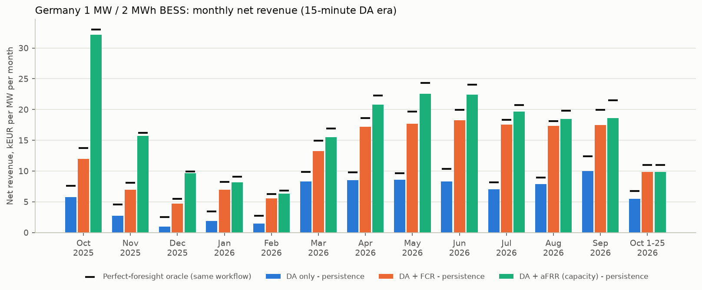
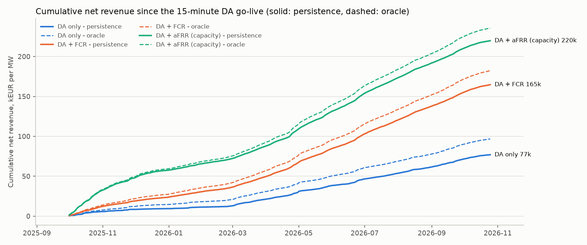
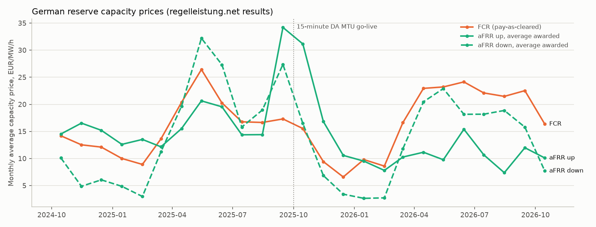

# Germany (DE-LU) BESS backtest: day-ahead, FCR and aFRR capacity on real data

Every number on this page is produced by `scripts/research/germany_backtest.py` (`.venv/bin/python scripts/research/germany_backtest.py --end 2026-10-25`). Market model and its limits: [docs/germany.md](../docs/germany.md).

**Setup.** 1 MW / 2 MWh battery, SOC window 5-95 % (0.1-1.9 MWh), start and end every delivery day at 50 %, charge and discharge efficiency 0.95 / 0.95, degradation 8 EUR per MWh discharged, no activation energy. Walk-forward per delivery day D: the FCR decision is taken at D-1 08:00, aFRR at D-1 09:00 and day-ahead-only at D-1 12:00 (Europe/Berlin). Forecasts come from the repository's `PersistenceForecastProvider` (previous local day, same clock time); `PerfectForesightForecastProvider` gives the oracle (upper bound, not tradable). Each day is a Pyomo + HiGHS MILP (`solve_germany_day`) with reserve volumes constant over the German 4-hour products and the PQ energy buffers for limited-energy reservoirs (FCR 0.415 MWh per MW and direction, aFRR 60 minutes per MW and direction). Settlement: day-ahead at realised DA prices; FCR at the realised German pay-as-cleared price; aFRR capacity at the published German **average awarded price** (a benchmark for a pay-as-bid auction, see the pay-as-bid sensitivity below). EUR/MW/yr = period net revenue x 365 / evaluated days / 1 MW. Cycles/day = MWh discharged / 2 MWh / day. Capture = persistence net / oracle net for the same workflow.

## Key findings

- **Latest 12 full months (Oct 2025 - Sep 2026)**: persistence walk-forward earns 71,425 EUR/MW/yr with day-ahead only (79.4 % of the oracle), 154,897 with FCR and 209,980 with capacity-only aFRR valued at the published average awarded price.
- **The aFRR number depends on the pay-as-bid convention.** Over the 15-minute era the average-price benchmark gives 205,724 EUR/MW/yr; bidding the persistence price and being paid the own bid gives 135,724 (rejections when the bid exceeds the marginal price), and shading bids to 70 % gives 146,718. With simple bidding rules aFRR capacity is therefore close to DA + FCR (154,192).
- **4-hour product blocks matter.** Letting reserve change every quarter-hour (the framework engine formulation) overstates FCR value by 7.2 % and aFRR value by 5.8 %.
- **FCR energy rule.** If the pending ACER decision set the alert-state duration to 30 instead of 15 minutes, DA + FCR would change by -3.1 % for this 2-hour battery.
- **15-minute day-ahead products.** Day-ahead-only value in the latest 12 months is +14.8 % versus the previous 12 months (Oct 2024 - Sep 2025, hourly products), but the two periods also differ in price level and spread (see market context), so this is not a clean MTU effect.
- **Forecastability.** In the latest 12 months persistence captures 79.4 % for DA only, 90.4 % for DA + FCR, 93.4 % for DA + aFRR capacity of the oracle: reserve-heavy schedules depend on block capacity prices, which persist from one day to the next more than the intraday shape of day-ahead prices does.

## Latest 12 full months (Oct 2025 - Sep 2026)

Data coverage: 365 of 365 delivery days evaluated (100.0 %).

| Workflow | Persistence EUR/MW/yr | Oracle EUR/MW/yr | Capture vs oracle | DA / reserve / degradation (persistence, EUR/MW/yr) | Cycles/day (persistence) | Avg reserved MW |
| --- | ---: | ---: | ---: | --- | ---: | --- |
| DA only | 71,425 | 89,965 | 79.4 % | 81,761 / 0 / -10,336 | 1.77 | - |
| DA + FCR | 154,897 | 171,362 | 90.4 % | 36,380 / 122,283 / -3,767 | 0.65 | FCR 0.83 |
| DA + aFRR (capacity) | 209,980 | 224,756 | 93.4 % | 27,576 / 185,543 / -3,140 | 0.54 | up 0.74 / down 0.71 |

## 15-minute DA era to latest (01 Oct 2025 - 25 Oct 2026)

Data coverage: 390 of 390 delivery days evaluated (100.0 %).

| Workflow | Persistence EUR/MW/yr | Oracle EUR/MW/yr | Capture vs oracle | DA / reserve / degradation (persistence, EUR/MW/yr) | Cycles/day (persistence) | Avg reserved MW |
| --- | ---: | ---: | ---: | --- | ---: | --- |
| DA only | 71,979 | 90,494 | 79.5 % | 82,362 / 0 / -10,383 | 1.78 | - |
| DA + FCR | 154,192 | 170,636 | 90.4 % | 36,186 / 121,816 / -3,811 | 0.65 | FCR 0.83 |
| DA + aFRR (capacity) | 205,724 | 220,601 | 93.3 % | 28,376 / 180,627 / -3,279 | 0.56 | up 0.74 / down 0.70 |

## Previous 12 months, hourly DA era (Oct 2024 - Sep 2025)

Data coverage: 365 of 365 delivery days evaluated (100.0 %).

| Workflow | Persistence EUR/MW/yr | Oracle EUR/MW/yr | Capture vs oracle | DA / reserve / degradation (persistence, EUR/MW/yr) | Cycles/day (persistence) | Avg reserved MW |
| --- | ---: | ---: | ---: | --- | ---: | --- |
| DA only | 62,238 | 75,739 | 82.2 % | 70,989 / 0 / -8,750 | 1.50 | - |
| DA + FCR | 146,042 | 158,515 | 92.1 % | 31,290 / 117,949 / -3,198 | 0.55 | FCR 0.85 |
| DA + aFRR (capacity) | 255,693 | 264,803 | 96.6 % | 12,857 / 244,376 / -1,540 | 0.26 | up 0.84 / down 0.80 |

The oracle knows realised day-ahead and reserve prices when deciding; it is an upper bound for this battery and market model, not an achievable revenue.

## Monthly breakdown (15-minute DA era to latest (01 Oct 2025 - 25 Oct 2026))

Net revenue in EUR per MW for the month (persistence, with capture vs oracle in brackets).

| Month | Days | DA only | DA + FCR | DA + aFRR (capacity) |
| --- | ---: | ---: | ---: | ---: |
| 2025-10 | 31 | 5,761 (75.8 %) | 12,010 (87.5 %) | 32,174 (97.4 %) |
| 2025-11 | 30 | 2,740 (60.4 %) | 6,935 (85.7 %) | 15,696 (96.8 %) |
| 2025-12 | 31 | 978 (38.7 %) | 4,674 (85.1 %) | 9,620 (96.6 %) |
| 2026-01 | 31 | 1,858 (54.1 %) | 6,942 (84.6 %) | 8,156 (89.8 %) |
| 2026-02 | 28 | 1,484 (54.8 %) | 5,556 (89.1 %) | 6,350 (92.7 %) |
| 2026-03 | 31 | 8,273 (83.8 %) | 13,244 (88.8 %) | 15,474 (91.5 %) |
| 2026-04 | 30 | 8,525 (86.8 %) | 17,176 (92.4 %) | 20,792 (93.4 %) |
| 2026-05 | 31 | 8,566 (89.0 %) | 17,721 (89.9 %) | 22,587 (92.8 %) |
| 2026-06 | 30 | 8,281 (80.1 %) | 18,286 (91.5 %) | 22,399 (93.2 %) |
| 2026-07 | 31 | 7,050 (86.5 %) | 17,524 (95.6 %) | 19,645 (94.7 %) |
| 2026-08 | 31 | 7,901 (88.5 %) | 17,324 (95.5 %) | 18,497 (93.5 %) |
| 2026-09 | 30 | 10,007 (80.5 %) | 17,504 (87.8 %) | 18,591 (86.4 %) |
| 2026-10 | 25 | 5,484 (81.5 %) | 9,856 (89.9 %) | 9,836 (89.8 %) |

## Sensitivities

Same days as the 15-minute DA era to latest period; EUR/MW/yr, persistence unless stated.

| Case | Workflow | Persistence EUR/MW/yr | Oracle EUR/MW/yr | Change vs base (persistence) |
| --- | --- | ---: | ---: | ---: |
| Reserve may change every quarter-hour, SOC buffer checked at interval start (framework engine formulation) | DA + FCR | 165,289 | 184,001 | 7.2 % |
| Reserve may change every quarter-hour, SOC buffer checked at interval start (framework engine formulation) | DA + aFRR (capacity) | 217,565 | 238,664 | 5.8 % |
| FCR buffer 0.665 h per direction (alert-state duration 30 min instead of 15 min; ACER decision pending) | DA + FCR | 149,374 | 164,523 | -3.1 % |
| aFRR pay-as-bid: bid = persistence price, accepted only if <= realised marginal price, paid own bid; DA re-optimised after the award; 64.0 % of offered MW accepted | DA + aFRR (capacity) | 135,724 | n/a | -34.0 % |
| aFRR pay-as-bid with bids shaded to 70 % of the persistence price (same acceptance rule); 98.0 % of offered MW accepted | DA + aFRR (capacity) | 146,718 | n/a | -28.7 % |

## Framework consistency check

The framework engine (`run_walk_forward` through the Germany adapter, persistence, 2025-11-03 to 2025-11-16) and `solve_germany_day` in replication mode (per-quarter-hour reserve, buffer checked at interval start, FCR buffer 30 min, aFRR 60 min, 4 EUR/MWh throughput degradation) solve the same problem:

| Workflow | Days | Engine objective EUR | Research LP objective EUR | Max daily gap EUR | Engine realised EUR | Research LP realised EUR |
| --- | ---: | ---: | ---: | ---: | ---: | ---: |
| DA only | 14 | 1,944.85 | 1,944.84 | 0.0022 | 1,235.34 | 1,237.77 |
| DA + FCR | 14 | 3,907.72 | 3,907.72 | 0.0000 | 3,313.64 | 3,313.91 |
| DA + aFRR (capacity) | 14 | 8,865.59 | 8,865.59 | 0.0000 | 8,367.98 | 8,367.98 |

Objectives match, so the headline differences against the engine come only from the German product rules switched on in the research LP. Realised revenue can differ slightly where the MILP has several optimal schedules.

## Market context

| Period | Mean DA price EUR/MWh | Mean daily DA spread (max-min) EUR/MWh | Share of negative DA quarter-hours | FCR EUR/MW/h | aFRR up EUR/MW/h | aFRR down EUR/MW/h |
| --- | ---: | ---: | ---: | ---: | ---: | ---: |
| Latest 12 full months (Oct 2025 - Sep 2026) | 104.0 | 164.4 | 5.9 % | 16.95 | 12.74 | 13.26 |
| 15-minute DA era to latest (01 Oct 2025 - 25 Oct 2026) | 107.4 | 164.5 | 5.5 % | 16.91 | 12.57 | 12.90 |
| Previous 12 months, hourly DA era (Oct 2024 - Sep 2025) | 91.7 | 132.5 | 6.5 % | 15.80 | 16.91 | 15.17 |

Reserve prices are time-weighted over the 4-hour products; aFRR prices are the German average awarded capacity prices.

## Data and coverage

- Day-ahead prices: data/public/energy_charts/da_prices_DE-LU.parquet via euroflex_bess_lab.public_data. Licence CC BY 4.0, attribution Bundesnetzagentur | SMARD.de (via Energy-Charts, Fraunhofer ISE). Hourly SDAC products before 2025-10-01 are expanded to four flat quarter-hours (`expanded_from_60m`).
- FCR and aFRR capacity results: regelleistung.net via euroflex_bess_lab.public_data.load_germany_reserve (built locally under data/raw, not redistributed). The regelleistung.net imprint requires prior written consent for reproduction, so these files are not committed; the script re-downloads them with `--fetch`. FCR prices are published per MW and 4-hour product and are divided by the product length (3 or 5 hours on DST days).
- Evaluated delivery days: 755 of 755 requested (2024-10-01 to 2026-10-25); a day is used only if day-ahead, FCR and both aFRR directions are complete, so all workflows share the same days.
- Skipped days: none.
- Persistence fallback days (used only when the previous local day is incomplete; the provider handles DST days): none.
- Runtime of this script run: 2.3 minutes.

## Assumptions and limitations

- **Schedule-based, day-ahead only.** No intraday trading (continuous or IDA auctions) and no re-optimisation after gate closure; German BESS revenue in practice includes a large intraday share, so these numbers understate a merchant battery and are not comparable with all-market revenue indices.
- **No imbalance trading.** Deliberate imbalance positions are not permitted in Germany (Bilanzkreistreue); reBAP is not used. Any physical deviation would have to be balanced by the BRP.
- **Price taker.** Bids never move clearing prices; awarded volumes are always accepted, except in the pay-as-bid sensitivity. Minimum bid size and 1 MW increments are assumed to be met by pooling (results are per MW of a pooled fleet).
- **FCR.** Symmetric, 4-hour blocks, pay-as-cleared at the German settlement price; activation energy is not remunerated in Germany and is assumed to net to zero over a block. The PQ buffer (0.415 MWh per MW and direction) is held for the whole block; storage-management trades and SOC drift from frequency deviations are not modelled.
- **aFRR.** Capacity only. The German average awarded price is a benchmark for a pay-as-bid auction (an individual bidder earns its own bid); activation energy (PICASSO, pay-as-cleared) and the SOC impact of activations are not modelled - expected activation is zero, while the 60-minute PQ buffer is reserved in both directions. The obligation to submit energy bids for awarded capacity is not modelled.
- **Forecasts.** Persistence (previous day, same clock time) for both day-ahead and reserve prices; the joint decision is taken once at the reserve gate closure. No forecast model is tuned on the test period.
- **Battery.** Daily 50 % to 50 % SOC boundary, linear efficiency, no auxiliary consumption, no availability losses, degradation as a linear cost per MWh discharged; no grid fees, levies or taxes.
- **Engine path.** The framework engine (example configs) lets reserve volumes change every quarter-hour; the sensitivity above shows how much that relaxation overstates value.

## External reference points

Cross-check of the parsed reserve data against published Q1 figures (average capacity revenue of 1 MW offered in every block, EUR per MW and month; published values: https://my-se.de/magazin/regelenergie-mit-batteriespeichern-erlose-und-anforderungen):

| Product | Q1 2026, this data | Q1 2026, published | Change vs Q1 2025, this data | Change, published |
| --- | ---: | ---: | ---: | ---: |
| FCR | 8,476 | 8,476 | 8.0 % | 8.0 % |
| aFRR up | 6,651 | 6,652 | -27.4 % | -27.0 % |
| aFRR down | 4,194 | 4,194 | -10.0 % | -10.0 % |

- ISEA Battery Revenue Index (RWTH Aachen, https://battery-charts.de/revenue-index/): the Q1 2026 average is reported at about 132,000 EUR/MW/yr by https://my-se.de/magazin/regelenergie-mit-batteriespeichern-erlose-und-anforderungen. The index covers cross-market operation including intraday trading and its own asset definition, so it is a scale reference only and not comparable one-to-one with the day-ahead schedule modelled here.

