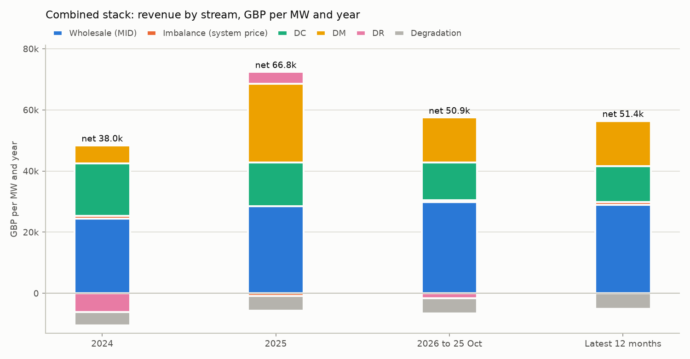
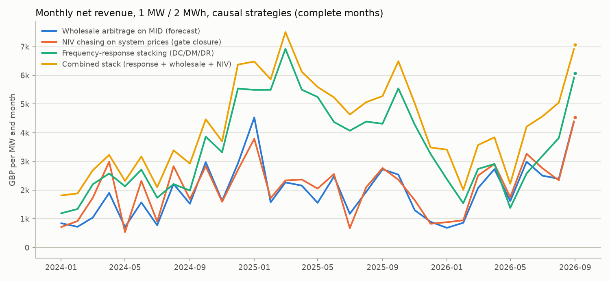
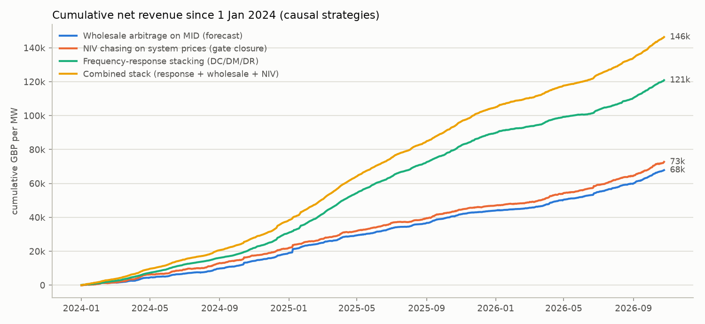
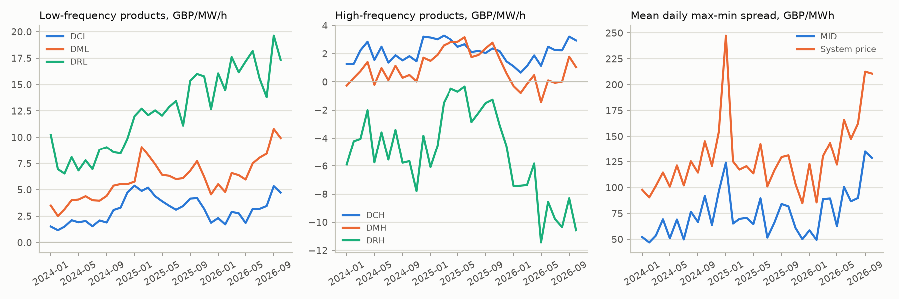

# Great Britain BESS backtest: wholesale, NIV chasing and DC/DM/DR stacking on real data

Every number on this page is produced by `scripts/research/gb_backtest.py` (`.venv/bin/python scripts/research/gb_backtest.py`) from the committed GB tables in `data/public/gb` (Elexon BMRS, NESO data portal, ECB). Market rules and model: [docs/great_britain.md](../docs/great_britain.md).

**Setup.** 1 MW / 2 MWh battery, SOC window 5-95 % (0.1-1.9 MWh), start at 50 %, charge/discharge efficiency 0.95 / 0.95, degradation 8 EUR per MWh discharged (converted to GBP at the ECB rate of each delivery day; 6.84 GBP/MWh on average). 30-minute settlement periods, single imbalance price. Wholesale energy is priced at the BMRS Market Index Price (MID) as a **traded-price proxy** for within-day trading. Dynamic response (DC/DM/DR, low and high) is paid its EAC pay-as-clear clearing price per MW and hour of availability; delivered response energy is not paid (ABSVD) but moves the SOC, which is modelled from 15-second BMRS frequency. Money is GBP; EUR columns use the daily ECB rate. Reporting period 2024-01-01 to 2026-10-25 (simulation starts 2023-12-01 as warm-up). GBP/MW/yr = period net revenue x 365 / days. Cycles/day = MWh discharged (baseline and response) / 2 MWh / day. Capture = causal strategy / its perfect-foresight oracle.

## Key findings

- **Combined stack: 51,400 GBP/MW/yr over the latest 12 months** (59,552 EUR/MW/yr), from public data and decisions that only use published information: 66,775 GBP/MW/yr in 2025 and 37,952 in 2024.
- **Scale check against the market:** that is 80 % (2024) and 92 % (2025) of the published Modo Energy GB BESS index excluding capacity payments, although the simulated battery does not use the Balancing Mechanism (see External reference points).
- **Frequency-response stacking alone** earns 39,995 GBP/MW/yr (latest 12 months) with the State of Energy requirement met in 99 % / 98 % of contracted low / high SPs; the day-ahead allocation uses only the previous day's clearing prices.
- **NIV chasing on published system prices** (position fixed at gate closure, 60 minutes ahead) earns 28,712 GBP/MW/yr, more than wholesale arbitrage on MID (26,699, 63 % of its perfect-foresight value): the single cash-out price has wider daily spreads than MID (140 vs 83 GBP/MWh).
- **Stacking pays:** in the latest 12 months the combined stack beats the best single workflow by 11,405 GBP/MW/yr while cycling 1.00 times per day.

## 2024

366 days.

| Strategy | GBP/MW/yr | EUR/MW/yr | Capture vs oracle | Wholesale | Imbalance | DC | DM | DR | Degradation | Cycles/day |
| --- | ---: | ---: | ---: | ---: | ---: | ---: | ---: | ---: | ---: | ---: |
| Wholesale arbitrage on MID (forecast) | 18,789 | 22,276 | 57 % | 24,418 | 0 | 0 | 0 | 0 | -5,629 | 1.14 |
| NIV chasing on system prices (gate closure) | 21,705 | 25,691 | 20 % | 0 | 28,236 | 0 | 0 | 0 | -6,531 | 1.32 |
| Frequency-response stacking (DC/DM/DR) | 30,722 | 36,447 | 65 % | 0 | 7,913 | 20,343 | 7,372 | -2,052 | -2,853 | 0.58 |
| Combined stack (response + wholesale + NIV) | 37,952 | 44,995 | 30 % | 24,362 | 1,027 | 17,183 | 5,855 | -6,182 | -4,293 | 0.87 |
| Wholesale arbitrage on MID (perfect foresight) | 33,137 | 39,206 | - | 40,474 | 0 | 0 | 0 | 0 | -7,338 | 1.48 |
| System-price arbitrage (perfect foresight) | 105,894 | 125,223 | - | 0 | 120,468 | 0 | 0 | 0 | -14,574 | 2.95 |
| Frequency-response allocation (perfect foresight of clearing prices) | 47,129 | 55,834 | - | 0 | 21,792 | 17,574 | 12,596 | -869 | -3,964 | 0.80 |
| Combined stack (perfect foresight) | 125,048 | 147,907 | - | 4,181 | 130,995 | 6,491 | 4,786 | -6,138 | -15,266 | 3.09 |

## 2025

365 days.

| Strategy | GBP/MW/yr | EUR/MW/yr | Capture vs oracle | Wholesale | Imbalance | DC | DM | DR | Degradation | Cycles/day |
| --- | ---: | ---: | ---: | ---: | ---: | ---: | ---: | ---: | ---: | ---: |
| Wholesale arbitrage on MID (forecast) | 25,143 | 29,486 | 66 % | 31,043 | 0 | 0 | 0 | 0 | -5,900 | 1.18 |
| NIV chasing on system prices (gate closure) | 25,208 | 29,563 | 23 % | 0 | 31,594 | 0 | 0 | 0 | -6,385 | 1.28 |
| Frequency-response stacking (DC/DM/DR) | 58,889 | 68,923 | 70 % | 0 | 13,567 | 17,653 | 24,952 | 7,302 | -4,584 | 0.91 |
| Combined stack (response + wholesale + NIV) | 66,775 | 78,126 | 45 % | 28,461 | -836 | 14,308 | 25,799 | 3,914 | -4,871 | 0.97 |
| Wholesale arbitrage on MID (perfect foresight) | 38,333 | 44,901 | - | 45,339 | 0 | 0 | 0 | 0 | -7,006 | 1.40 |
| System-price arbitrage (perfect foresight) | 110,866 | 129,784 | - | 0 | 125,958 | 0 | 0 | 0 | -15,092 | 3.01 |
| Frequency-response allocation (perfect foresight of clearing prices) | 83,612 | 97,808 | - | 0 | 23,486 | 18,312 | 25,199 | 21,499 | -4,884 | 0.97 |
| Combined stack (perfect foresight) | 149,160 | 174,581 | - | 7,995 | 116,716 | 10,161 | 16,551 | 10,733 | -12,996 | 2.59 |

## 2026 to 25 Oct

298 days.

| Strategy | GBP/MW/yr | EUR/MW/yr | Capture vs oracle | Wholesale | Imbalance | DC | DM | DR | Degradation | Cycles/day |
| --- | ---: | ---: | ---: | ---: | ---: | ---: | ---: | ---: | ---: | ---: |
| Wholesale arbitrage on MID (forecast) | 29,263 | 34,043 | 64 % | 34,954 | 0 | 0 | 0 | 0 | -5,690 | 1.13 |
| NIV chasing on system prices (gate closure) | 31,561 | 36,714 | 27 % | 0 | 37,411 | 0 | 0 | 0 | -5,850 | 1.16 |
| Frequency-response stacking (DC/DM/DR) | 38,236 | 44,494 | 50 % | 0 | 1,376 | 15,169 | 16,218 | 9,787 | -4,314 | 0.86 |
| Combined stack (response + wholesale + NIV) | 50,867 | 59,169 | 33 % | 29,891 | 538 | 12,381 | 14,724 | -1,663 | -5,003 | 0.99 |
| Wholesale arbitrage on MID (perfect foresight) | 45,992 | 53,471 | - | 52,619 | 0 | 0 | 0 | 0 | -6,627 | 1.32 |
| System-price arbitrage (perfect foresight) | 117,014 | 136,055 | - | 0 | 131,316 | 0 | 0 | 0 | -14,302 | 2.84 |
| Frequency-response allocation (perfect foresight of clearing prices) | 77,209 | 89,740 | - | 0 | 27,116 | 14,331 | 18,666 | 22,370 | -5,273 | 1.05 |
| Combined stack (perfect foresight) | 155,321 | 180,537 | - | 10,410 | 135,875 | 5,421 | 10,689 | 6,843 | -13,917 | 2.76 |

## Latest 12 months

365 days.

| Strategy | GBP/MW/yr | EUR/MW/yr | Capture vs oracle | Wholesale | Imbalance | DC | DM | DR | Degradation | Cycles/day |
| --- | ---: | ---: | ---: | ---: | ---: | ---: | ---: | ---: | ---: | ---: |
| Wholesale arbitrage on MID (forecast) | 26,699 | 30,993 | 63 % | 32,241 | 0 | 0 | 0 | 0 | -5,542 | 1.10 |
| NIV chasing on system prices (gate closure) | 28,712 | 33,329 | 26 % | 0 | 34,511 | 0 | 0 | 0 | -5,799 | 1.15 |
| Frequency-response stacking (DC/DM/DR) | 39,995 | 46,326 | 52 % | 0 | 4,676 | 14,580 | 15,463 | 9,839 | -4,563 | 0.90 |
| Combined stack (response + wholesale + NIV) | 51,400 | 59,552 | 35 % | 28,994 | 884 | 11,656 | 14,833 | 101 | -5,069 | 1.00 |
| Wholesale arbitrage on MID (perfect foresight) | 42,208 | 48,963 | - | 48,680 | 0 | 0 | 0 | 0 | -6,472 | 1.28 |
| System-price arbitrage (perfect foresight) | 110,696 | 128,356 | - | 0 | 125,224 | 0 | 0 | 0 | -14,528 | 2.88 |
| Frequency-response allocation (perfect foresight of clearing prices) | 76,203 | 88,266 | - | 0 | 26,116 | 13,736 | 18,211 | 23,508 | -5,367 | 1.06 |
| Combined stack (perfect foresight) | 148,782 | 172,433 | - | 9,887 | 128,209 | 5,525 | 10,634 | 8,475 | -13,948 | 2.76 |

Revenue columns are GBP/MW/yr; DC/DM/DR are availability payments (low + high, negative when a product clears below zero). Oracles know realised prices (and, for response, realised clearing prices and frequency) when deciding; they are upper bounds for this battery and market model, not achievable revenue.

## Response products (Latest 12 months)

| Strategy | DCL | DCH | DML | DMH | DRL | DRH | Avg low MW | Avg high MW | SOE met (low / high) |
| --- | ---: | ---: | ---: | ---: | ---: | ---: | ---: | ---: | --- |
| Frequency-response stacking (DC/DM/DR) | 11,103 | 3,477 | 14,078 | 1,385 | 18,574 | -8,735 | 0.72 | 0.76 | 99 % / 98 % |
| Combined stack (response + wholesale + NIV) | 9,020 | 2,637 | 13,266 | 1,567 | 12,883 | -12,782 | 0.61 | 0.68 | 99 % / 99 % |
| Frequency-response allocation (perfect foresight of clearing prices) | 8,817 | 4,919 | 15,669 | 2,541 | 37,829 | -14,321 | 0.75 | 0.80 | 100 % / 97 % |

GBP/MW/yr of availability payments per product. DR high frequency (DRH) usually clears below zero: the provider pays for the right to absorb energy, which it later sells, so its value appears in the imbalance/wholesale columns. SOE met = share of contracted SPs in which the State of Energy requirement (Service Terms 6.11, including the post-delivery relaxation and 20 %/SP recovery) is satisfied; payments are withheld otherwise.

## Sensitivities

Latest 12 months and full period (2024-01-01 to 2026-10-25); GBP/MW/yr.

| Case | Latest 12 months | Full period | Change vs main (latest 12 months) | Capture vs oracle (latest 12 months) |
| --- | ---: | ---: | ---: | ---: |
| NIV chasing decided at the start of the SP (non-BM asset) | 31,290 | 28,687 | +9.0 % | 28 % |
| NIV chasing without the published-spread term | 29,425 | 25,922 | +2.5 % | 27 % |
| Wholesale on MID with positions fixed at gate closure | 25,920 | 22,738 | -2.9 % | 61 % |
| Wholesale on MID, naive previous-day persistence, no hurdle | 20,229 | 17,431 | -24.2 % | 48 % |
| Frequency response with offers at the price floor (always accepted) | 40,781 | 43,548 | +2.0 % | 54 % |
| Frequency response with only the market stacking cap (offered + reserved MW within 2 MW) | 31,318 | 36,594 | -21.7 % | 41 % |
| Frequency response, offered + reserved MW of both directions within 1 MW | 13,202 | 16,119 | -67.0 % | 17 % |
| Combined stack with only the market stacking cap | 51,586 | 52,639 | +0.4 % | 35 % |

Period start = the physical position is set at the start of the SP with the prices published by then (possible for a non-BM asset without a Physical Notification); gate closure is the conservative main case. Stacking cap: the market rule compares offered plus reserved capacity (10 / 20 / 40 % for DC / DM / DR) of both directions with the unit's registered capacity, which we read as export plus import capability (2 MW here; in 506 sampled 2026 battery unit-blocks of the EAC results by unit this cap is exceeded in 1 % of cases, an export-only reading in 64 %). The main strategies keep offered plus reserved MW within 1 MW per direction, a stricter self-imposed limit chosen on the development window; the rows above show the market cap alone and the strictest reading.

## Market context

| Period | Mean MID GBP/MWh | Mean system price | Daily MID spread | Daily system-price spread | SPs system short | DCL | DCH | DML | DMH | DRL | DRH |
| --- | ---: | ---: | ---: | ---: | ---: | ---: | ---: | ---: | ---: | ---: | ---: |
| 2024 | 71.4 | 71.2 | 65.6 | 115.9 | 48 % | 2.24 | 1.92 | 4.20 | 0.56 | 8.18 | -4.80 |
| 2025 | 79.9 | 80.6 | 73.2 | 127.9 | 46 % | 3.92 | 2.50 | 6.70 | 2.16 | 13.21 | -2.42 |
| 2026 to 25 Oct | 106.0 | 106.3 | 88.3 | 149.6 | 47 % | 3.12 | 1.89 | 7.36 | 0.05 | 16.59 | -8.69 |
| Latest 12 months | 100.0 | 100.3 | 83.0 | 139.9 | 47 % | 3.04 | 1.89 | 7.03 | 0.29 | 16.16 | -7.72 |

Spreads are the mean over Europe/London days of (max - min) of the half-hourly values. Response columns are time-weighted EAC clearing prices in GBP/MW/h. Mean cleared volumes in the latest 12 months: DCL 1,227 MW, DCH 1,206 MW, DML 511 MW, DMH 535 MW, DRL 480 MW, DRH 497 MW.

## External reference points

Modo Energy ME BESS GB (2H) index (fleet-weighted revenues of GB 2-hour batteries, at least 6 MW, monthly values annualised), annual means of the published monthly values (https://modoenergy.github.io/modo-charts/charts/europe/gb/geo-foundation-bess-revenue/chart-e-gb-revenue-stack-evolution.html):

| Year | Modo total | Modo excluding capacity | Wholesale | Balancing (BM + imbalance) | Ancillary (net) | This backtest, combined stack |
| --- | ---: | ---: | ---: | ---: | ---: | ---: |
| 2024 | 60.7k | 47.2k | 27.6k | 16.5k | 3.1k | 38.0k |
| 2025 | 80.1k | 72.8k | 31.4k | 19.3k | 22.1k | 66.8k |

The 2025 total matches the 80.1k GBP/MW/yr average quoted by Modo (https://modoenergy.github.io/modo-charts/charts/cross-market/power-prices-battery-returns/power-prices-battery-returns-3-cross-market-revenue-index.html). The index measures real assets, including Balancing Mechanism dispatch and Capacity Market payments that are not modelled here, so it is a scale reference rather than a like-for-like benchmark.

## Encoded market rules

- 30-minute settlement periods and a single imbalance price (BSC P305, https://www.elexon.co.uk/bsc/mod-proposal/p305/); system sell and buy prices are identical in all 50,880 SPs of the data.
- System prices are first published a median 22 minutes (p95 23) after the SP ends (BMRS createdDateTime of SPs still on their first publication); the backtest uses them only from 30 minutes after the SP end. NIV chasing fixes the position at gate closure (60 minutes before the SP), so the latest price it can use is four SPs old.
- MID is the volume-weighted price of half-hour, 1-, 2- and 4-hour products traded within eight hours before gate closure (https://www.elexon.co.uk/bsc/article/market-index-definition-statement-review-2024/); wholesale positions are fixed 9 hours ahead and settled at the realised MID (traded-price proxy).
- EAC response auctions: gate closure 14:00 UK the day before, results 15:00, pay-as-clear per 4-hour EFA block (https://sandbox.eac.neso.production.n-side.com/docs/market-participant/api/auction-sessions/auction-session-lifecycle); delivery durations DC 15, DM 30, DR 60 minutes (https://www.neso.energy/industry-information/balancing-services/frequency-response-services/dynamic-services-dcdmdr); availability payment per SP = price x MW x 0.5 h, withheld when the unit is unavailable (https://www.neso.energy/document/276606/download).
- Energy limited units: Response Energy Volume = MW x duration must be held from the start of each contracted block, relaxed by delivered energy and recovered at up to 20 % per SP from the fifth SP after a delivery (Service Terms 6.11, https://www.neso.energy/document/384606/download); Reserved Capacity of 10 / 20 / 40 % of the offered MW for DC / DM / DR, with offered plus reserved MW of all stacked products within the unit's registered capacity (Procurement Rules 8.3.3.2, https://www.neso.energy/document/378246/download; read as export plus import capability for a battery); the strategies keep offered plus reserved MW within 1 MW per direction.
- A MW cannot serve two services at once: per direction, response MW + baseline power <= 1 MW and the response energy volumes must fit in the SOC window along the baseline trajectory.
- Delivered response energy is applied in ABSVD (not paid, no imbalance); it is computed per SP from 15-second BMRS frequency with the Service Terms delivery curves (mean per MW and SP: DC 0.0035 / 0.0035 MWh, DM 0.0189 / 0.0180, DR 0.0700 / 0.0692 low / high).

## Data and coverage

- Elexon BMRS (Insights Solution API): system prices DISEBSP, Market Index Data MID, 15-second frequency FREQ - 'Contains BMRS data © Elexon Limited copyright and database right 2023-2026', licence https://www.elexon.co.uk/bsc/data/balancing-mechanism-reporting-agent/copyright-licence-bmrs-data/ .
- NESO data portal: Enduring Auction Capability (EAC) auction results summary (DC/DM/DR per EFA block; QR/SR/BR kept as context) - 'Supported by National Energy SO Open Data', NESO Open Data Licence v1.0 https://www.neso.energy/data-portal/neso-open-licence .
- ECB euro foreign exchange reference rates (GBP per EUR) - Source: European Central Bank; used for the EUR columns and the GBP value of the 8 EUR/MWh degradation cost (as-of join of daily rates).
- Coverage: 50,880 settlement periods from 2023-12-01 to 2026-10-25, no missing SP; MID has no traded volume in 21 SPs (settled at the system price); EAC response results complete for 1089 EFA days; 73 SPs without enough frequency samples use the trailing 7-day mean response energy.
- Forecast settings and the 5 GBP/MWh planning hurdle were selected on the development window 2023-12-01 to 2024-06-30 before the full run, so results from July 2024 onwards are out of sample for them; the per-direction stacking limit is a modelling choice also checked on that window, with the alternatives shown under Sensitivities.
- Runtime of this script run: 1.6 minutes.

## Scope

- Simulated revenue for a price-taking 1 MW battery (results per MW of a pooled fleet; EAC orders are whole MW): offers never move clearing prices and are accepted whenever the clearing price is at or above the offer price. Cleared response volumes are about 0.5-1.5 GW per product, so a fleet cannot all earn these per-MW response values.
- MID is a proxy for within-day wholesale trading: fills are assumed at the half-hourly market index price with no bid-ask cost; day-ahead auctions and the Balancing Mechanism are not modelled.
- Response delivery is assumed perfect (performance factor 1) apart from SOE unavailability; frequency at 15 seconds misses sub-15-second excursions (mostly relevant for DC). Quick, Slow and Balancing Reserve and the Capacity Market are not part of the strategies.
- No grid charges, BSUoS/TNUoS, levies, taxes or auxiliary load; linear efficiency and degradation.
