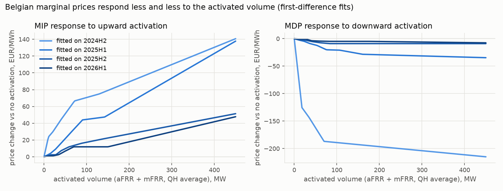
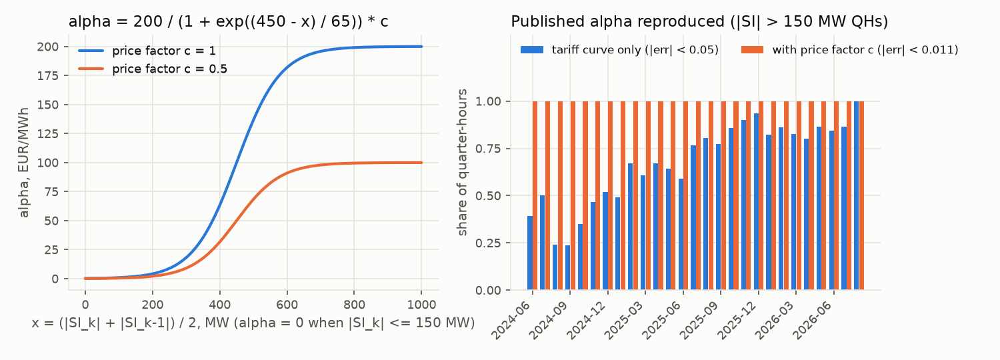
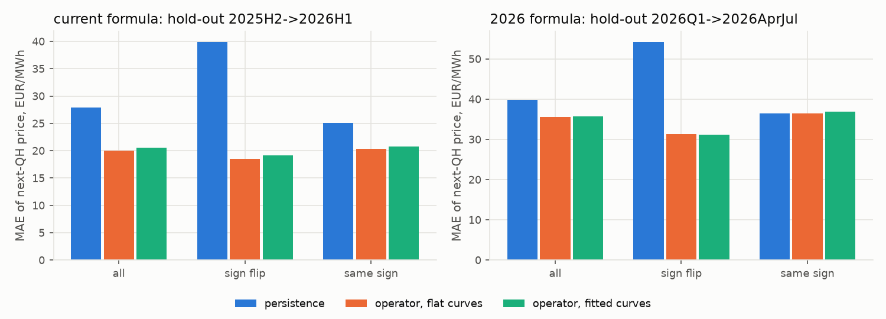
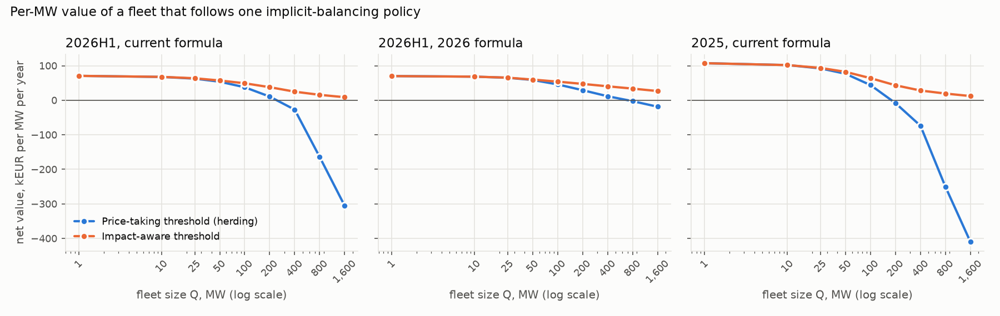
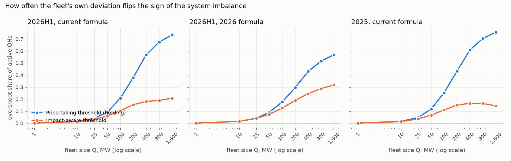
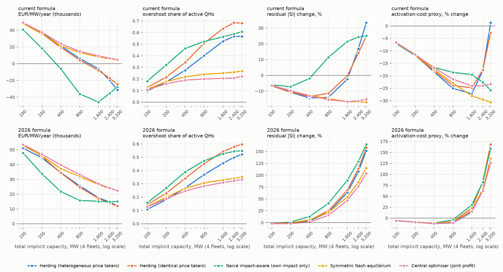

# Impact and herding: the price response to a fleet's own deviation (Belgium, both formulas)

Generated by `scripts/research/impact_study.py` from `data/public` (Elia Open Data, CC BY 4.0, attribution Elia Transmission Belgium SA). Every number below is read from `reports/ledgers/impact_*`.

**Setup.** Battery unit 1 MW / 2 MWh, 95 % / 95 % one-way efficiency, SOC 5-95 %, degradation 8 EUR/MWh discharged; publication lags of the real-time core (minute rows usable one minute after they end, final quarter-hour prices five minutes after the quarter-hour); no transaction costs beyond degradation. A fleet of Q MW is Q identical units following the same policy. Mechanisms: `current` (Elia marginal price +/- alpha, ODS134) and `new2026` (volume-weighted aFRR/mFRR price, ODS212 simulation). Windows: 2025 current 2025-01-01..2026-01-01; 2026H1 current 2026-01-01..2026-08-01; 2026H1 new2026 2026-01-01..2026-08-01.

## Key results

- **current formula, Jan-Jul 2026**: a price-taking threshold fleet earns 70.6k EUR/MW/yr at 1 MW, 37.6k at 100 MW, -27.2k at 400 MW and -305.6k at 1,600 MW (it flips the sign of SI in 74 % of its active quarter-hours at 1,600 MW; value turns negative at 200-400 MW). Internalising its own impact keeps 24.8k at 400 MW and 8.7k at 1,600 MW.
- **2026 formula, Jan-Jul 2026**: a price-taking threshold fleet earns 70.0k EUR/MW/yr at 1 MW, 45.8k at 100 MW, 11.6k at 400 MW and -18.7k at 1,600 MW (it flips the sign of SI in 57 % of its active quarter-hours at 1,600 MW; value turns negative at 400-800 MW). Internalising its own impact keeps 40.3k at 400 MW and 26.6k at 1,600 MW.
- **current formula, 2025**: 107.3k EUR/MW/yr at 1 MW and 43.9k at 100 MW for the price taker (negative at 100-200 MW); at 400 MW the price taker earns -73.9k and the impact-aware policy 28.1k.
- **Saturation**: the total value of a price-taking fleet peaks at about 100 MW under the current formula (3.8 MEUR/yr) and 200 MW under the 2026 formula (5.8 MEUR/yr); beyond that every extra reacting MW lowers the fleet's total. The impact-aware policy keeps the total growing but each extra MW adds little (marginal values in the implications section).
- **Robust to the weak volume curves**: with the volume response switched off (branch switch and alpha only) the 400 MW price taker earns current formula -17.6k, 2026 formula 27.7k EUR/MW/yr on Jan-Jul 2026 - the saturation comes mainly from the sign flip and alpha, not from the fitted curves.
- **Signal quality**: even a 1 MW price taker pushes |SI| up in 21 % of its active quarter-hours under the current formula but in 38 % under the 2026 formula.
- **Why the formulas differ**: the gap between the short-branch and the long-branch price of the same quarter-hour (what an overshooting fleet loses when it flips the sign of SI) has a median of 38.6 EUR/MWh under the current formula (never negative: 0.2 % of QHs <= 0) but only 10.0 EUR/MWh under the 2026 formula, where it is <= 0 in 42 % of quarter-hours. The 2026 formula also drops alpha. Overshooting is therefore much cheaper for the fleet under the new formula.
- **Signal alignment**: when the final price is above a band trader's upper band (discharge signal) the system was short in 93 % of quarter-hours under the current formula but in 81 % under the 2026 formula; below the lower band (charge signal) it was long in 87 % vs 70 %. A price-following fleet therefore helps the system less often under the new formula, even before any impact.
- **Where the value goes** (400 MW price taker, current formula, Jan-Jul 2026): of the -98.2k EUR/MW/yr lost to the fleet's own impact, the sign flip / neutral band takes -79.7k, alpha -9.7k (plus -1.7k through the next quarter-hour's alpha) and the merit order only -7.1k.
- **Four fleets, 1,600 MW of implicit capacity, current formula**: herding earns -6.2k EUR/MW/yr (overshoot 52 % of active QHs, residual |SI| -2.5 %), the symmetric Nash equilibrium 8.1k (overshoot 25 %, residual |SI| -16.8 %), a central optimiser 9.2k.
- **Four fleets, 1,600 MW of implicit capacity, 2026 formula**: herding earns 17.5k EUR/MW/yr (overshoot 45 % of active QHs, residual |SI| 63.6 %), the symmetric Nash equilibrium 26.5k (overshoot 33 %, residual |SI| 54.1 %), a central optimiser 27.0k.

## Method: the impact layer of PRISM

The imbalance price is `pi_k = M(X_k)` (mechanism operator applied to the quarter-hour state). A fleet that deviates by `q` MW on average over quarter-hour k (+ = long) changes the state to `X_k(q)`; the impact operator returns `pi_k(q) = M(X_k(q))`. Implemented in `euroflex_bess_lab.realtime.impact` as `ImpactModel` classes (`CurrentFormulaImpact`, `NewFormula2026Impact`) built from a `MarketData` period and plugged into `simulate(..., impact=..., fleet_mw=...)`; `adjust` returns `base + pi(q) - pi(0)`, so zero deviation leaves every published price unchanged.

1. **System imbalance and activations.** `SI' = SI + q`. Elia's aFRR + mFRR activation offsets a share `kappa` of the change (pass-through, estimated per period as the slope of the change in net aFRR + mFRR activation on the change in SI between consecutive quarter-hours; the rest is absorbed by imbalance netting / IGCC and the ACE). A long deviation first removes gross upward activation and only then adds downward activation (`U' = max(U - kappa q, 0)`, `D' = D + max(kappa q - U, 0)`), and symmetrically.
2. **Prices along volume-response curves.** Monotone piecewise-linear curves of MIP versus gross upward activation and MDP versus gross downward activation (current formula), and of the aFRR / mFRR up and down product prices versus their volumes (2026 formula), estimated with first differences between consecutive quarter-hours of the same delivery hour (the hour fixed effect absorbs the day-ahead level and the bid stack of the hour), robust to price spikes (clipped prices, winsorised residuals), one curve per local-hour block (00-06, 06-10, 10-17, 17-22, 22-24) with a pooled fallback. Prices move incrementally: `MIP' = MIP + f(U') - f(U)`.
3. **Elia's current rule, exactly.** `alpha = 1{|SI| > 150 MW} * 200 / (1 + exp((450 - x) / 65)) * c` with **x = (|SI_k| + |SI_k-1|) / 2** (this and the previous quarter-hour: why alpha is not a function of |SI| alone) and the price factor `c = clip((400 - MIP) / 200, 0, 1)` if short, `clip((MDP + 200) / 200, 0, 1)` if long; `MIP = max(aFRR, mFRR SA, mFRR DA up prices, FLOOR)`, `MDP = min(down prices, CAP)`; and if `|SI| < 25 MW` the price is the midpoint `(FLOOR + CAP) / 2` (structure from the paper agent, verified here on ODS134 - see validation). The counterfactual evaluates the rule at `SI_k + q_k`, `SI_k-1 + q_k-1` and MIP' / MDP' (bounded by FLOOR / CAP), so a deviation also prices the next quarter-hour through alpha.
4. **Branch switch (overshoot).** The branch follows `SI'`: current midpoint if `|SI'| < 25 MW`, else `MIP' + alpha'` if `SI' < 0`, else `MDP' - alpha'`; new `main_up'` / `main_down'` through `NewWeightedMechanism2026.price_given_si` (incentive rule included). Within the original branch the published aFRR/mFRR weights are kept (reductions pro-rata, increases aFRR); after a flip the new-direction regulation is aFRR priced along the aFRR curve.
5. **Guarantees (tested).** Non-increasing in `q` within a branch, exact at `q = 0`, branch switch exactly when `|q| > |SI|` with the opposite sign, operators satisfy the `ImpactModel` protocol.

## Validation (hold-out, honest errors)

**Elia's current rule** (2024-06-01..2026-08-01): the exact alpha rule (tariff logistic x price factor c) reproduces the published alpha to 0.011 EUR/MWh in 100.00 % of the quarter-hours with |SI| > 150 MW (the tariff curve alone: 68 % to 0.05 EUR/MWh); alpha = 0 below 150 MW in 100.0 % of cases; the whole rule (neutral band, structural MIP / MDP, alpha) reproduces 100.00 % of 75,936 published prices; |SI| < 25 MW in 18 % of quarter-hours. Predicting each hold-out quarter-hour's alpha (last 30 %) from the previous one:

| driver x | model | mode | change MAE EUR/MWh | level MAE | level exact share |
| --- | --- | --- | --- | --- | --- |
| mean_abs_si_prev | tariff x price factor | exact | 0.000 | 0.00 | 100 % |
| abs_mean_si_prev | tariff x price factor | exact | 0.015 | 0.04 | 96 % |
| mean_abs_si_prev | isotonic | ratio | 0.761 | 4.22 | 0 % |
| mean_abs_si_prev | logistic | ratio | 0.770 | 4.30 | 3 % |
| abs_mean_si_prev | logistic | ratio | 0.811 | 4.32 | 3 % |
| abs_mean_si_prev | isotonic | ratio | 0.819 | 4.21 | 4 % |

**Volume-response curves and the full operator.** Columns: activation pass-through `kappa` of the training period; curve calibration slope / out-of-sample R^2 when predicting within-hour price changes from the realised activation changes (1 = calibrated; R^2 against a no-change baseline); MAE of the next quarter-hour's published price when the operator is fed the realised SI change from the previous quarter-hour's state (persistence / operator with flat curves / full operator), on all pairs and on pairs where SI changed sign.

*current formula (MIP / MDP)*

| fold (train -> test) | kappa | curve 1 calib / R^2 | curve 2 calib / R^2 | price MAE all: persist / flat / full | price MAE sign flips: persist / flat / full | sign-flip share |
| --- | --- | --- | --- | --- | --- | --- |
| 2024H2->2025H1 | 0.33 | 0.70 / 0.038 | 0.11 / -0.961 | 51.1 / 33.4 / 35.0 | 68.6 / 19.6 / 22.2 | 21 % |
| 2025H1->2025H2 | 0.67 | 0.47 / -0.008 | 0.40 / -0.007 | 30.0 / 19.5 / 21.7 | 40.8 / 12.4 / 15.3 | 20 % |
| 2025H2->2026H1 | 0.66 | 0.81 / 0.010 | 0.45 / -0.000 | 27.8 / 20.0 / 20.5 | 39.9 / 18.5 / 19.1 | 18 % |

*2026 formula (aFRR up / down)*

| fold (train -> test) | kappa | curve 1 calib / R^2 | curve 2 calib / R^2 | price MAE all: persist / flat / full | price MAE sign flips: persist / flat / full | sign-flip share |
| --- | --- | --- | --- | --- | --- | --- |
| 2026Q1->2026AprJul | 0.96 | 1.01 / 0.025 | 0.10 / -0.002 | 39.8 / 35.5 / 35.8 | 54.2 / 31.3 / 31.1 | 18 % |
| 2026AprJul->2026Q1 | 0.97 | 0.95 / 0.023 | 1.74 / 0.008 | 38.3 / 34.2 / 34.8 | 55.7 / 33.8 / 34.0 | 19 % |

*Local merit order (ODS156/157 bid curves, fold 2025H2->2026H1).* The Belgian bid ladder at the activated volume tracks MIP only loosely (corr 0.57, MAE 31.9 EUR/MWh) and its local slope (0.36 EUR/MWh per MW, median) overstates the realised price response: calibration slope 0.11 (MIP) and -0.00 (MDP). The bid curves are therefore only a stress scenario; cross-border activation (PICASSO / MARI) makes the effective curve much flatter.

*Market deepening.* Fitted price change at 100 / 200 / 400 MW of activation, by half-year:

| period | kappa | MIP +100/+200/+400 MW | MDP +100/+200/+400 MW |
| --- | --- | --- | --- |
| 2024H2 | 0.33 | 70.6 / 89.3 / 130.5 | -189.1 / -196.5 / -211.3 |
| 2025H1 | 0.67 | 44.6 / 64.4 / 123.1 | -20.7 / -29.2 / -33.5 |
| 2025H2 | 0.66 | 17.3 / 27.2 / 46.6 | -9.0 / -9.0 / -9.0 |
| 2026H1 | 0.67 | 11.9 / 17.9 / 41.8 | -4.9 / -5.1 / -7.1 |

**Reading.** Current formula (hold-out 2025H2->2026H1): on quarter-hours where SI changes sign the operator cuts the next-price MAE from 39.9 EUR/MWh (persistence) to 19.1 (52 % lower; 18.5 with flat volume curves); over all pairs 20.5 vs 27.8 (flat curves 20.0). The volume curves, scored on realised activation changes, have calibration slopes 0.81 (MIP) and 0.45 (MDP) but explain only 1.0 % / 0.0 % of within-hour price changes. 2026 formula (hold-out 2026Q1->2026AprJul): on quarter-hours where SI changes sign the operator cuts the next-price MAE from 54.2 EUR/MWh (persistence) to 31.1 (43 % lower; 31.3 with flat volume curves); over all pairs 35.8 vs 39.8 (flat curves 35.5). The volume curves, scored on realised activation changes, have calibration slopes 1.01 (aFRR-up price) and 0.10 (aFRR-down price) but explain only 2.5 % / 0.0 % of within-hour price changes. The fitted MIP response at +200 MW went from 89.3 EUR/MWh (2024H2) to 17.9 (2026H1), the MDP response from -196.5 to -5.1: the Belgian balancing-energy market has become much deeper. The branch switch and alpha therefore carry most of the price impact of a fleet; the capacity-value results include a branch-and-alpha-only sensitivity.

## Capacity-value curve

`reports/ledgers/impact_capacity_value_curve.parquet` (columns `mechanism, policy, fleet_mw, eur_per_mw_year, cycles_per_day, overshoot_share`, plus `window`, overshoot / harm shares, average prices, deployed share). Price taker: `ThresholdStrategy` (running QH price of the mechanism, bands = 0.25 / 0.75 quantiles of the last 14 days of published prices) replicated across the fleet; impact-aware: same signal and bands, chooses `q` in `[-Q, Q]` maximising `q (P(q) - band)` with `P(q)` from the impact operator at the running state. Signals are open loop (the fleet does not see its own effect inside the quarter-hour).

| window | mechanism | Q MW | price taker kEUR/MW/yr | price taker cycles/d | price taker overshoot | impact-aware kEUR/MW/yr | impact-aware cycles/d | impact-aware overshoot |
| --- | --- | --- | --- | --- | --- | --- | --- | --- |
| 2025 | current | 1 | 107.3 | 1.23 | 0 % | 107.3 | 1.23 | 0 % |
| 2025 | current | 10 | 101.9 | 1.23 | 2 % | 101.8 | 1.17 | 1 % |
| 2025 | current | 25 | 92.1 | 1.23 | 5 % | 93.6 | 1.10 | 4 % |
| 2025 | current | 50 | 76.7 | 1.23 | 12 % | 82.2 | 0.99 | 7 % |
| 2025 | current | 100 | 43.9 | 1.23 | 25 % | 63.9 | 0.82 | 11 % |
| 2025 | current | 200 | -8.4 | 1.23 | 43 % | 43.3 | 0.60 | 15 % |
| 2025 | current | 400 | -73.9 | 1.23 | 61 % | 28.1 | 0.38 | 17 % |
| 2025 | current | 800 | -250.8 | 1.23 | 71 % | 19.4 | 0.21 | 16 % |
| 2025 | current | 1,600 | -410.3 | 1.23 | 76 % | 12.1 | 0.09 | 15 % |
| 2026H1 | current | 1 | 70.6 | 1.02 | 0 % | 70.6 | 1.01 | 0 % |
| 2026H1 | current | 10 | 67.5 | 1.02 | 1 % | 67.6 | 0.98 | 1 % |
| 2026H1 | current | 25 | 62.6 | 1.02 | 4 % | 63.6 | 0.93 | 3 % |
| 2026H1 | current | 50 | 53.6 | 1.02 | 9 % | 57.2 | 0.86 | 6 % |
| 2026H1 | current | 100 | 37.6 | 1.02 | 21 % | 49.1 | 0.75 | 10 % |
| 2026H1 | current | 200 | 10.6 | 1.02 | 38 % | 37.8 | 0.59 | 15 % |
| 2026H1 | current | 400 | -27.2 | 1.02 | 57 % | 24.8 | 0.40 | 18 % |
| 2026H1 | current | 800 | -164.3 | 1.02 | 68 % | 15.7 | 0.23 | 19 % |
| 2026H1 | current | 1,600 | -305.6 | 1.02 | 74 % | 8.7 | 0.11 | 21 % |
| 2026H1 | new2026 | 1 | 70.0 | 1.10 | 0 % | 70.0 | 1.10 | 0 % |
| 2026H1 | new2026 | 10 | 68.3 | 1.10 | 2 % | 68.2 | 1.08 | 2 % |
| 2026H1 | new2026 | 25 | 65.1 | 1.10 | 4 % | 65.4 | 1.05 | 4 % |
| 2026H1 | new2026 | 50 | 58.7 | 1.10 | 9 % | 59.8 | 1.02 | 7 % |
| 2026H1 | new2026 | 100 | 45.8 | 1.10 | 18 % | 53.8 | 0.96 | 13 % |
| 2026H1 | new2026 | 200 | 29.1 | 1.10 | 30 % | 47.3 | 0.88 | 19 % |
| 2026H1 | new2026 | 400 | 11.6 | 1.10 | 43 % | 40.3 | 0.75 | 25 % |
| 2026H1 | new2026 | 800 | -2.6 | 1.10 | 52 % | 33.7 | 0.58 | 29 % |
| 2026H1 | new2026 | 1,600 | -18.7 | 1.10 | 57 % | 26.6 | 0.45 | 32 % |

**Other agents' strategies** (Agent STRAT's published quarter-hour ledgers `reports/ledgers/realtime_*`, price takers, re-settled at the counterfactual price of a fleet of Q MW; `_1h` = 1 MW / 1 MWh battery). kEUR per MW per year:

| strategy | window | mechanism | Q=1 | Q=100 | Q=400 | Q=1,600 |
| --- | --- | --- | --- | --- | --- | --- |
| forecast_mpc | 2025 | current | 147.0 | 15.5 | -225.4 | -1,019.1 |
| forecast_mpc | 2026H1 | current | 78.9 | 21.6 | -86.8 | -616.0 |
| forecast_mpc | 2026H1 | new2026 | 39.7 | 11.1 | -30.3 | -86.6 |
| forecast_mpc_1h | 2025 | current | 94.6 | 2.0 | -161.9 | -723.1 |
| forecast_mpc_1h | 2026H1 | current | 43.2 | 7.3 | -60.7 | -370.0 |
| forecast_mpc_1h | 2026H1 | new2026 | 20.1 | 1.2 | -26.5 | -62.5 |
| forecast_mpc_risk | 2025 | current | 147.0 | 57.6 | -139.2 | -729.9 |
| forecast_mpc_risk | 2026H1 | current | 83.4 | 43.7 | -42.9 | -411.0 |
| forecast_mpc_risk | 2026H1 | new2026 | 48.1 | 29.6 | -9.2 | -52.2 |
| forecast_mpc_risk_1h | 2025 | current | 96.0 | 36.2 | -97.5 | -489.9 |
| forecast_mpc_risk_1h | 2026H1 | current | 48.2 | 24.6 | -30.3 | -227.5 |
| forecast_mpc_risk_1h | 2026H1 | new2026 | 28.9 | 17.3 | -7.6 | -35.4 |
| prism | 2025 | current | 149.6 | 13.6 | -233.1 | -1,039.0 |
| prism | 2026H1 | current | 80.6 | 20.6 | -91.8 | -638.4 |
| prism | 2026H1 | new2026 | 70.7 | 36.6 | -16.4 | -83.5 |
| prism_1h | 2025 | current | 97.2 | 1.2 | -169.9 | -745.0 |
| prism_1h | 2026H1 | current | 45.4 | 6.3 | -67.3 | -405.2 |
| prism_1h | 2026H1 | new2026 | 43.7 | 21.0 | -16.8 | -66.8 |
| prism_live | 2026H1 | new2026 | 80.2 | 42.5 | -14.3 | -82.6 |
| prism_live_risk | 2026H1 | new2026 | 81.1 | 48.7 | -0.7 | -51.8 |
| prism_risk | 2025 | current | 147.9 | 49.2 | -158.8 | -786.0 |
| prism_risk | 2026H1 | current | 83.2 | 39.0 | -53.7 | -455.1 |
| prism_risk | 2026H1 | new2026 | 76.4 | 48.1 | 2.4 | -47.4 |
| rl_dqn | 2026H1 | current | 38.2 | 12.7 | -38.3 | -251.1 |
| rl_dqn | 2026H1 | new2026 | 21.5 | 10.0 | -13.0 | -42.4 |
| threshold_price | 2025 | current | 108.0 | 44.2 | -74.2 | -411.7 |
| threshold_price | 2026H1 | current | 70.6 | 37.5 | -27.2 | -307.1 |
| threshold_price | 2026H1 | new2026 | 70.0 | 45.8 | 11.6 | -18.7 |
| threshold_si | 2025 | current | 94.3 | 73.3 | -48.1 | -360.2 |
| threshold_si | 2026H1 | current | 65.0 | 47.2 | -30.2 | -355.6 |
| threshold_si | 2026H1 | new2026 | 27.2 | 19.9 | -11.0 | -51.2 |

On Jan-Jul 2026 (current formula) the re-settled strategies keep 14 %-73 % of their 1 MW per-MW value at 100 MW, against 53 % for the threshold rule and 70 % for the impact-aware rule: a better price forecast does not protect a price taker from its own impact, so any of these strategies needs an impact-aware sizing layer once the reacting fleet reaches a few tens of MW.

**Sensitivity.** Price taker re-settled under alternative impact environments (`branch_alpha_only` / `branch_only`: no volume response, only the branch switch and alpha; `local_bid_curves`: ODS156/157 merit order; `pass_through_1`: Elia activations offset the whole deviation). Impact-aware policy that believes half / double the true impact, or that uses the response fitted on the previous half-year (what an optimiser that only knows history would use):

| window | mechanism | policy | environment | belief | Q MW | kEUR/MW/yr | overshoot |
| --- | --- | --- | --- | --- | --- | --- | --- |
| 2026H1 | current | price_taking_threshold | fitted_curves | - | 100 | 37.6 | 21 % |
| 2026H1 | current | price_taking_threshold | fitted_curves | - | 400 | -27.2 | 57 % |
| 2026H1 | current | price_taking_threshold | fitted_curves | - | 1,600 | -305.6 | 74 % |
| 2026H1 | current | price_taking_threshold | branch_alpha_only | - | 100 | 39.2 | 21 % |
| 2026H1 | current | price_taking_threshold | branch_alpha_only | - | 400 | -17.6 | 57 % |
| 2026H1 | current | price_taking_threshold | branch_alpha_only | - | 1,600 | -244.0 | 74 % |
| 2026H1 | current | price_taking_threshold | local_bid_curves | - | 100 | 31.1 | 21 % |
| 2026H1 | current | price_taking_threshold | local_bid_curves | - | 400 | -72.9 | 57 % |
| 2026H1 | current | price_taking_threshold | local_bid_curves | - | 1,600 | -356.3 | 74 % |
| 2026H1 | current | price_taking_threshold | pass_through_1 | - | 100 | 36.2 | 21 % |
| 2026H1 | current | price_taking_threshold | pass_through_1 | - | 400 | -35.3 | 57 % |
| 2026H1 | current | price_taking_threshold | pass_through_1 | - | 1,600 | -322.0 | 74 % |
| 2026H1 | current | impact_aware_threshold | fitted_curves | believes x0.5 | 400 | 18.1 | 28 % |
| 2026H1 | current | impact_aware_threshold | fitted_curves | believes x2 | 400 | 24.9 | 14 % |
| 2026H1 | current | impact_aware_threshold | fitted_curves | fit 2025H2 | 400 | 24.7 | 17 % |
| 2026H1 | new2026 | price_taking_threshold | fitted_curves | - | 100 | 45.8 | 18 % |
| 2026H1 | new2026 | price_taking_threshold | fitted_curves | - | 400 | 11.6 | 43 % |
| 2026H1 | new2026 | price_taking_threshold | fitted_curves | - | 1,600 | -18.7 | 57 % |
| 2026H1 | new2026 | price_taking_threshold | branch_only | - | 100 | 51.6 | 18 % |
| 2026H1 | new2026 | price_taking_threshold | branch_only | - | 400 | 27.7 | 43 % |
| 2026H1 | new2026 | price_taking_threshold | branch_only | - | 1,600 | 21.0 | 57 % |
| 2026H1 | new2026 | impact_aware_threshold | fitted_curves | believes x0.5 | 400 | 32.7 | 28 % |
| 2026H1 | new2026 | impact_aware_threshold | fitted_curves | believes x2 | 400 | 36.6 | 30 % |
| 2026H1 | new2026 | impact_aware_threshold | fitted_curves | fit 2026Q1 (inside the window) | 400 | 39.2 | 24 % |
| 2025 | current | price_taking_threshold | fitted_curves | - | 100 | 43.9 | 25 % |
| 2025 | current | price_taking_threshold | fitted_curves | - | 400 | -73.9 | 61 % |
| 2025 | current | price_taking_threshold | fitted_curves | - | 1,600 | -410.3 | 76 % |
| 2025 | current | price_taking_threshold | branch_alpha_only | - | 100 | 49.0 | 25 % |
| 2025 | current | price_taking_threshold | branch_alpha_only | - | 400 | -43.4 | 61 % |
| 2025 | current | price_taking_threshold | branch_alpha_only | - | 1,600 | -322.9 | 76 % |
| 2025 | current | price_taking_threshold | local_bid_curves | - | 100 | 37.8 | 25 % |
| 2025 | current | price_taking_threshold | local_bid_curves | - | 400 | -115.6 | 61 % |
| 2025 | current | price_taking_threshold | local_bid_curves | - | 1,600 | -448.0 | 76 % |
| 2025 | current | price_taking_threshold | pass_through_1 | - | 100 | 39.1 | 25 % |
| 2025 | current | price_taking_threshold | pass_through_1 | - | 400 | -91.5 | 61 % |
| 2025 | current | price_taking_threshold | pass_through_1 | - | 1,600 | -429.3 | 76 % |
| 2025 | current | impact_aware_threshold | fitted_curves | believes x0.5 | 400 | 16.5 | 25 % |
| 2025 | current | impact_aware_threshold | fitted_curves | believes x2 | 400 | 30.4 | 13 % |
| 2025 | current | impact_aware_threshold | fitted_curves | fit 2024H2 | 400 | 28.6 | 16 % |

### Where the value goes: impact channels

Revenue effect of each own-price channel for the price-taking fleet (sequential split, sums to the total impact; negative = value lost to the fleet's own impact): `merit` = marginal / product prices moving along the merit order; `alpha_own` = alpha of the same quarter-hour (imbalance size and price factor); `alpha_carry` = alpha of the next quarter-hour through `x` (current rule only); `weight` = aFRR / mFRR re-weighting (2026 rule; non-zero only with the `afrr_first` displacement, where aFRR absorbs the deviation while scheduled mFRR stays); `branch` = neutral band / sign flip (overshoot).

| window | mechanism | displacement | Q MW | merit kEUR/MW/yr | alpha_own kEUR/MW/yr | alpha_carry kEUR/MW/yr | weight kEUR/MW/yr | branch kEUR/MW/yr | total kEUR/MW/yr |
| --- | --- | --- | --- | --- | --- | --- | --- | --- | --- |
| 2026H1 | current | default | 100 | -2.6 | -4.3 | -1.5 | - | -24.8 | -33.3 |
| 2026H1 | current | default | 400 | -7.1 | -9.7 | -1.7 | - | -79.7 | -98.2 |
| 2026H1 | current | default | 1,600 | -11.6 | -18.8 | -4.1 | - | -342.0 | -376.5 |
| 2026H1 | new2026 | pro_rata | 100 | -10.0 | - | - | 0.0 | -14.3 | -24.3 |
| 2026H1 | new2026 | afrr_first | 100 | -9.1 | - | - | -0.7 | -14.0 | -23.8 |
| 2026H1 | new2026 | pro_rata | 400 | -22.2 | - | - | 0.0 | -36.4 | -58.5 |
| 2026H1 | new2026 | afrr_first | 400 | -19.7 | - | - | -3.3 | -35.1 | -58.0 |
| 2026H1 | new2026 | pro_rata | 1,600 | -32.5 | - | - | 0.0 | -56.4 | -88.9 |
| 2026H1 | new2026 | afrr_first | 1,600 | -29.5 | - | - | -6.0 | -53.5 | -88.9 |
| 2025 | current | default | 100 | -8.2 | -3.4 | -1.2 | - | -51.2 | -64.1 |
| 2025 | current | default | 400 | -21.9 | -7.6 | -1.3 | - | -151.2 | -181.9 |
| 2025 | current | default | 1,600 | -28.5 | -15.2 | -4.4 | - | -470.3 | -518.3 |

At 400 MW under the current rule (2026H1) the largest loss comes from the branch / overshoot channel (-79.7k EUR/MW/yr of a total -98.2k).

## Multi-fleet herding versus equilibrium (Jan-Jul 2026, both formulas)

Four fleets of equal size react every minute to the same running price signal; the quarter-hour settles at the counterfactual price of their *total* deviation. Herding fleets are price takers whose signal is closed loop (Elia's running price already contains the fleets' own deviations so far). Equilibrium fleets best-respond to each other on the price-response function of the visible running state (bands as opportunity cost of energy). TSO metrics: change in residual imbalance energy sum |SI + q| and in an activation-cost proxy `0.25 (U' MIP' - D' MDP')` (same activation model for both formulas).

*current formula*

| policy | total MW | kEUR/MW/yr | cycles/d | overshoot | harmful | resid |SI| % | act. cost % |
| --- | --- | --- | --- | --- | --- | --- | --- |
| central | 100 | 48.9 | 0.75 | 11 % | 25 % | -6.4 | -6.7 |
| central | 200 | 37.6 | 0.60 | 16 % | 26 % | -9.8 | -11.4 |
| central | 400 | 23.8 | 0.41 | 19 % | 25 % | -13.1 | -16.8 |
| central | 800 | 14.8 | 0.25 | 20 % | 24 % | -15.5 | -21.4 |
| central | 1,600 | 9.2 | 0.14 | 21 % | 22 % | -16.7 | -24.1 |
| central | 2,400 | 6.6 | 0.09 | 21 % | 21 % | -16.2 | -24.0 |
| central | 3,200 | 4.9 | 0.06 | 22 % | 21 % | -15.2 | -23.3 |
| herding | 100 | 48.7 | 0.90 | 10 % | 26 % | -6.7 | -6.6 |
| herding | 200 | 37.1 | 0.83 | 17 % | 28 % | -10.8 | -11.7 |
| herding | 400 | 21.1 | 0.76 | 27 % | 32 % | -14.5 | -18.4 |
| herding | 800 | 6.3 | 0.73 | 40 % | 39 % | -14.0 | -25.1 |
| herding | 1,600 | -6.2 | 0.90 | 52 % | 50 % | -2.5 | -27.2 |
| herding | 2,400 | -19.8 | 1.46 | 57 % | 60 % | 17.0 | -18.0 |
| herding | 3,200 | -31.4 | 1.96 | 57 % | 66 % | 33.4 | 1.3 |
| herding_homogeneous | 100 | 48.3 | 0.88 | 13 % | 26 % | -6.7 | -6.7 |
| herding_homogeneous | 200 | 36.0 | 0.80 | 21 % | 28 % | -10.6 | -11.7 |
| herding_homogeneous | 400 | 19.4 | 0.72 | 34 % | 31 % | -13.5 | -17.9 |
| herding_homogeneous | 800 | 4.3 | 0.74 | 51 % | 41 % | -11.4 | -23.9 |
| herding_homogeneous | 1,600 | -8.1 | 0.99 | 63 % | 54 % | -0.3 | -24.8 |
| herding_homogeneous | 2,400 | -17.3 | 1.42 | 68 % | 62 % | 14.2 | -17.6 |
| herding_homogeneous | 3,200 | -24.7 | 1.77 | 68 % | 66 % | 24.9 | -2.7 |
| naive | 100 | 40.8 | 0.92 | 18 % | 29 % | -6.1 | -7.1 |
| naive | 200 | 18.5 | 0.85 | 32 % | 36 % | -7.2 | -11.9 |
| naive | 400 | -6.1 | 0.74 | 46 % | 47 % | -2.0 | -16.6 |
| naive | 800 | -36.1 | 0.59 | 52 % | 57 % | 11.4 | -18.6 |
| naive | 1,600 | -45.9 | 0.39 | 56 % | 60 % | 21.5 | -19.5 |
| naive | 2,400 | -35.4 | 0.29 | 59 % | 61 % | 24.3 | -22.6 |
| naive | 3,200 | -28.0 | 0.23 | 61 % | 61 % | 25.1 | -25.8 |
| nash | 100 | 48.0 | 0.79 | 11 % | 26 % | -6.5 | -6.7 |
| nash | 200 | 35.7 | 0.65 | 18 % | 27 % | -9.9 | -11.6 |
| nash | 400 | 21.4 | 0.46 | 22 % | 27 % | -12.8 | -17.4 |
| nash | 800 | 13.2 | 0.29 | 24 % | 28 % | -14.8 | -23.0 |
| nash | 1,600 | 8.1 | 0.17 | 25 % | 27 % | -16.8 | -28.1 |
| nash | 2,400 | 5.9 | 0.12 | 26 % | 27 % | -16.8 | -29.5 |
| nash | 3,200 | 4.6 | 0.10 | 27 % | 28 % | -17.0 | -30.5 |

*2026 formula*

| policy | total MW | kEUR/MW/yr | cycles/d | overshoot | harmful | resid |SI| % | act. cost % |
| --- | --- | --- | --- | --- | --- | --- | --- |
| central | 100 | 53.6 | 0.97 | 13 % | 42 % | -2.2 | -5.5 |
| central | 200 | 47.0 | 0.89 | 19 % | 42 % | -2.2 | -8.9 |
| central | 400 | 39.8 | 0.77 | 25 % | 44 % | 1.4 | -12.4 |
| central | 800 | 33.3 | 0.60 | 28 % | 47 % | 15.5 | -10.4 |
| central | 1,600 | 27.0 | 0.46 | 31 % | 51 % | 46.8 | 15.4 |
| central | 2,400 | 24.1 | 0.41 | 32 % | 54 % | 76.7 | 62.3 |
| central | 3,200 | 22.4 | 0.37 | 33 % | 58 % | 103.8 | 126.0 |
| herding | 100 | 51.2 | 1.04 | 11 % | 43 % | -2.3 | -5.5 |
| herding | 200 | 44.5 | 0.99 | 18 % | 47 % | -1.7 | -9.1 |
| herding | 400 | 34.6 | 0.94 | 27 % | 51 % | 3.9 | -12.6 |
| herding | 800 | 25.6 | 0.91 | 37 % | 57 % | 21.7 | -11.0 |
| herding | 1,600 | 17.5 | 0.89 | 45 % | 67 % | 63.6 | 13.7 |
| herding | 2,400 | 14.6 | 0.90 | 50 % | 73 % | 107.9 | 63.6 |
| herding | 3,200 | 12.2 | 0.92 | 52 % | 78 % | 151.7 | 136.5 |
| herding_homogeneous | 100 | 53.7 | 1.02 | 14 % | 44 % | -2.1 | -5.5 |
| herding_homogeneous | 200 | 45.5 | 0.97 | 23 % | 48 % | -1.2 | -8.8 |
| herding_homogeneous | 400 | 34.4 | 0.91 | 34 % | 53 % | 5.3 | -11.5 |
| herding_homogeneous | 800 | 24.7 | 0.88 | 45 % | 61 % | 25.1 | -7.9 |
| herding_homogeneous | 1,600 | 17.1 | 0.87 | 54 % | 72 % | 68.5 | 23.1 |
| herding_homogeneous | 2,400 | 14.0 | 0.89 | 58 % | 79 % | 113.6 | 83.3 |
| herding_homogeneous | 3,200 | 12.0 | 0.92 | 60 % | 84 % | 157.9 | 168.3 |
| naive | 100 | 48.0 | 1.05 | 16 % | 46 % | -1.6 | -5.8 |
| naive | 200 | 33.8 | 1.02 | 27 % | 52 % | 1.1 | -9.3 |
| naive | 400 | 21.7 | 0.96 | 39 % | 60 % | 12.8 | -11.0 |
| naive | 800 | 15.7 | 0.88 | 47 % | 68 % | 40.6 | -3.9 |
| naive | 1,600 | 15.2 | 0.76 | 53 % | 73 % | 89.2 | 30.2 |
| naive | 2,400 | 14.8 | 0.66 | 54 % | 74 % | 129.0 | 82.4 |
| naive | 3,200 | 15.0 | 0.59 | 55 % | 75 % | 165.0 | 158.7 |
| nash | 100 | 52.9 | 0.95 | 13 % | 44 % | -1.9 | -5.5 |
| nash | 200 | 46.0 | 0.86 | 20 % | 46 % | -0.6 | -8.8 |
| nash | 400 | 37.2 | 0.74 | 27 % | 49 % | 6.0 | -11.4 |
| nash | 800 | 32.0 | 0.63 | 31 % | 50 % | 21.7 | -9.0 |
| nash | 1,600 | 26.5 | 0.52 | 33 % | 51 % | 54.1 | 17.9 |
| nash | 2,400 | 23.9 | 0.46 | 34 % | 53 % | 85.5 | 66.9 |
| nash | 3,200 | 22.4 | 0.42 | 35 % | 54 % | 115.2 | 136.2 |

## Implications for a large optimiser

- **current formula**: the total implicit-balancing value of a price-taking fleet peaks at about 100 MW (3.76 MEUR/yr, Jan-Jul 2026 annualised); every MW added beyond that lowers the fleet's total. The impact-aware fleet's total peaks at 1,600 MW of the grid (14.00 MEUR/yr) because it throttles itself: in its active quarter-hours it deploys on average 18 % of its MW at 400 MW and 7 % at 1,600 MW.

| Q MW | price taker total MEUR/yr | price taker marginal kEUR/MW/yr | impact-aware total MEUR/yr | impact-aware marginal kEUR/MW/yr |
| --- | --- | --- | --- | --- |
| 1 | 0.07 | 70.6 | 0.07 | 70.6 |
| 10 | 0.67 | 67.1 | 0.68 | 67.3 |
| 25 | 1.56 | 59.3 | 1.59 | 60.9 |
| 50 | 2.68 | 44.7 | 2.86 | 50.7 |
| 100 | 3.76 | 21.6 | 4.91 | 41.0 |
| 200 | 2.11 | -16.5 | 7.56 | 26.5 |
| 400 | -10.89 | -65.0 | 9.92 | 11.8 |
| 800 | -131.41 | -301.3 | 12.52 | 6.5 |
| 1,600 | -488.92 | -446.9 | 14.00 | 1.8 |

- **2026 formula**: the total implicit-balancing value of a price-taking fleet peaks at about 200 MW (5.82 MEUR/yr, Jan-Jul 2026 annualised); every MW added beyond that lowers the fleet's total. The impact-aware fleet's total peaks at 1,600 MW of the grid (42.55 MEUR/yr) because it throttles itself: in its active quarter-hours it deploys on average 27 % of its MW at 400 MW and 20 % at 1,600 MW.

| Q MW | price taker total MEUR/yr | price taker marginal kEUR/MW/yr | impact-aware total MEUR/yr | impact-aware marginal kEUR/MW/yr |
| --- | --- | --- | --- | --- |
| 1 | 0.07 | 70.0 | 0.07 | 70.0 |
| 10 | 0.68 | 68.1 | 0.68 | 68.0 |
| 25 | 1.63 | 62.9 | 1.64 | 63.5 |
| 50 | 2.94 | 52.3 | 2.99 | 54.2 |
| 100 | 4.58 | 33.0 | 5.38 | 47.9 |
| 200 | 5.82 | 12.4 | 9.47 | 40.8 |
| 400 | 4.64 | -5.9 | 16.13 | 33.3 |
| 800 | -2.12 | -16.9 | 26.97 | 27.1 |
| 1,600 | -29.97 | -34.8 | 42.55 | 19.5 |

- Rule for a ~1 GW optimiser: do not let the whole fleet react implicitly to the same signal at full power. Size the implicit-reacting MW where the marginal value in the table above falls to the value of the next-best use of a MW (explicit aFRR capacity, day-ahead / intraday), or run an impact-aware controller that sizes the reaction every minute (`ImpactAwareThresholdStrategy`). The capacity-value curve (`reports/ledgers/impact_capacity_value_curve.parquet`) is the input for the valuation saturation scenarios.

### Herding incentive by formula

- **current formula** (4 fleets): 800 MW: Nash - herding = 6.9k EUR/MW/yr, naive - herding = -42.4k, residual |SI| herding -14.0 % vs Nash -14.8 %; 1,600 MW: Nash - herding = 14.3k EUR/MW/yr, naive - herding = -39.7k, residual |SI| herding -2.5 % vs Nash -16.8 %; 2,400 MW: Nash - herding = 25.7k EUR/MW/yr, naive - herding = -15.6k, residual |SI| herding 17.0 % vs Nash -16.8 %; 3,200 MW: Nash - herding = 36.1k EUR/MW/yr, naive - herding = 3.5k, residual |SI| herding 33.4 % vs Nash -17.0 %.
- **2026 formula** (4 fleets): 800 MW: Nash - herding = 6.3k EUR/MW/yr, naive - herding = -9.9k, residual |SI| herding 21.7 % vs Nash 21.7 %; 1,600 MW: Nash - herding = 9.0k EUR/MW/yr, naive - herding = -2.4k, residual |SI| herding 63.6 % vs Nash 54.1 %; 2,400 MW: Nash - herding = 9.3k EUR/MW/yr, naive - herding = 0.2k, residual |SI| herding 107.9 % vs Nash 85.5 %; 3,200 MW: Nash - herding = 10.3k EUR/MW/yr, naive - herding = 2.9k, residual |SI| herding 151.7 % vs Nash 115.2 %.
- **Does the 2026 formula change the herding incentive?** At 1,600 MW the private cost of herding (Nash minus herding per-MW value) is 14.3k EUR/MW/yr under the current formula and 9.0k under the 2026 formula, i.e. the market's own penalty on herding is weaker under the new formula, while herding changes the residual imbalance by -2.5 % (current) versus 63.6 % (2026). Without alpha and with a small, often negative short/long price gap, an overshoot costs the fleet little under the new design: the price signal disciplines the herd less and the system carries more residual imbalance.

## Limitations (read before using the numbers)

- The settlement rules are exact (current: neutral band, FLOOR / CAP-bounded marginal prices and alpha with its price factor, reproducing the published ODS134 prices; 2026: `NewWeightedMechanism2026`, 100 % of ODS212). The approximations are in how the *state* responds to a fleet: the volume curves explain little within-hour variance (see validation), the pass-through and the netting rule are averages, aFRR/mFRR activation inside the quarter-hour is represented by quarter-hour averages (the 2026 operator's default keeps the aFRR/mFRR weights; `afrr_first` is the alternative), and the incentive component of the 2026 formula is kept at its published value.
- ODS126 minute activation volumes are not on the scale of the ODS127 quarter-hour volumes, so running activations are mapped from the running SI with historical medians (current formula).
- The simulation curves are fitted in-sample on each evaluation window (the 'environment'); the impact-aware policy is given the same response function (known impact function, unknown future state). Misspecified beliefs are shown in the sensitivity table.
- The fleets are incremental to the historical state: today's implicit reactions (including the ~1 GW of existing batteries) are already in the data; bands use exogenous published prices; equilibrium fleets solve a per-minute stage game (band = opportunity cost of energy) and SOC only clips their power.
- The 2026-formula data is Elia's simulation of the new design on historical days (ODS211/212); real BSP and BRP behaviour will adapt to the new design.

## Files

- Code: `src/euroflex_bess_lab/realtime/impact/` (operators, validation, policies, fleet curve, equilibrium).
- Script: `scripts/research/impact_study.py` (compute) and `scripts/research/impact_report.py` (this report).
- Results: `reports/ledgers/impact_capacity_value_curve.parquet` (+ `.json`), `impact_qh_ledgers_<window>.parquet`, `impact_capacity_value_sensitivity.parquet`, `impact_channels.parquet`, `impact_equilibrium.parquet` (+ `.json`), `impact_validation.json`, `impact_response_fits.json`; figures `reports/figures/impact_*.png`; method notes `docs/impact_and_herding.md`.
