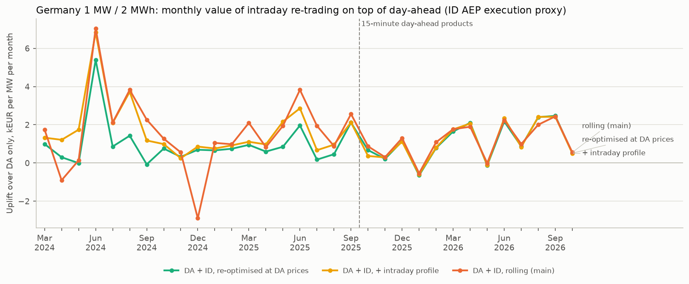
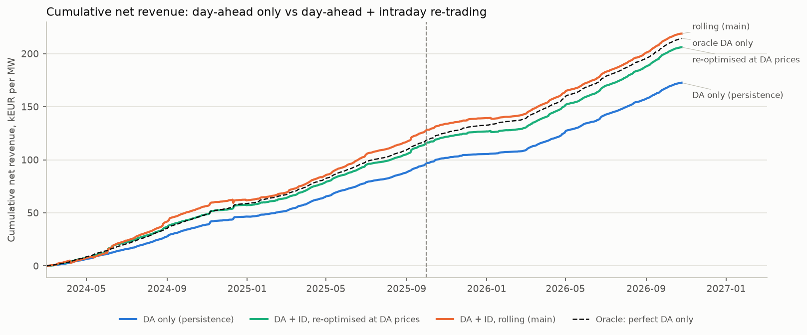
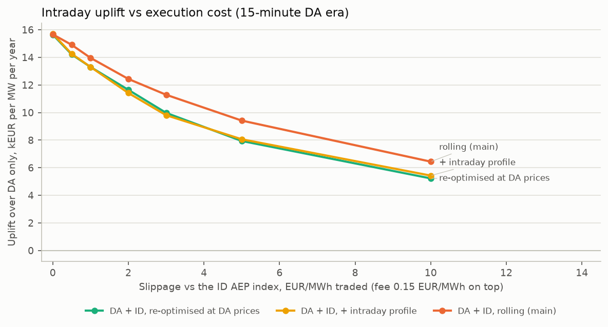
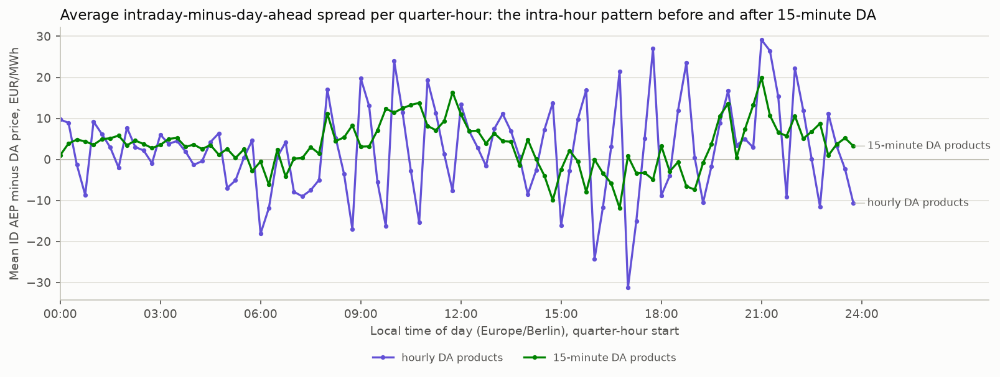

# Germany (DE-LU) intraday re-trading on real data: day-ahead + continuous intraday vs day-ahead only

Every number on this page is produced by `scripts/research/intraday_backtest.py` (`.venv/bin/python scripts/research/intraday_backtest.py`). Model, data access and limits: [docs/intraday.md](../docs/intraday.md).

**Setup.** 1 MW / 2 MWh battery, SOC window 5-95 %, 50 % at the start and end of every delivery day, charge and discharge efficiency 0.95 / 0.95, degradation 8 EUR per MWh discharged. *Day-ahead stage* at D-1 12:00 Europe/Berlin: a price-taking schedule on the persistence forecast (previous local day, as in [reports/germany.md](germany.md)), held constant over hourly products before the 15-minute MTU of 1 Oct 2025 and settled at realised DE-LU day-ahead prices. *Intraday stage*: re-trades around the day-ahead position product by product; the quantity for quarter-hour k is frozen 30 minutes before delivery and executed at the German TSOs' **ID AEP** index of that quarter-hour, used as a **VWAP-execution proxy** (the index is the volume-weighted price of the last 500 MW traded in the product), less / plus 1 EUR/MWh slippage and 0.15 EUR/MWh exchange fee (day-ahead fee 0.1 EUR/MWh). Decisions use only information visible at decision time: day-ahead prices from 13:00 on D-1, closing prices of products whose delivery has ended (an exchange member's trade feed; product k sees products up to k-3) and a trailing 56-day intraday profile from days up to D-2. Oracles know realised prices and are upper bounds, not tradable. EUR/MW/yr = period net revenue x 365 / evaluated days / 1 MW; ± is one standard error over days.

Strategies: *re-optimised at DA prices* re-plans the day once after the day-ahead auction with the DA price as the forecast of every intraday price; *+ intraday profile* adds the trailing quarter-of-day intraday spread profile (published index only); *rolling (main)* re-optimises before every gate closure with the profile and the decaying residual of the latest closing prices.

## Key findings

- **Intraday re-trading adds +14,362 EUR/MW/yr (± 2,322, +20.2 %) on top of day-ahead in the latest 12 full months (Oct 2025 - Sep 2026)**: 71,150 EUR/MW/yr with day-ahead only, 85,512 with the rolling day-ahead + intraday strategy.
- **15-minute DA era (01 Oct 2025 - 25 Oct 2026): +13,962 EUR/MW/yr (± 2,193), +19.5 %.** Most of it comes from one simple step: re-planning the battery once the day-ahead prices are known and trading the difference intraday earns +13,301 EUR/MW/yr, against a 18,543 EUR/MW/yr gap between the persistence and the perfect-foresight day-ahead schedule.
- **With hourly day-ahead products (previous 12 months) the quarter-hour structure inside each hour is worth extra:** the rolling strategy adds +15,061 EUR/MW/yr (± 4,781); the intraday profile alone contributes +4,360 (± 959) of it, because intraday quarter-hour prices follow a stable ramp pattern within hourly products (see the spread-profile figure).
- **Robust to execution cost:** in the 15-minute era the uplift stays positive over the whole tested range; at 10 EUR/MWh slippage against the index (fee on top) the rolling strategy still adds +6,443 EUR/MW/yr, because the optimiser trades less as costs rise.
- **Causal by construction and by test:** in a perturbation audit on 30 real days (all later intraday prices and later days replaced by noise) 120 of 120 tradable runs kept every protected decision unchanged, while the oracles changed decisions taken before the perturbation in 57 of 60 runs (look-ahead detected, as designed).
- **Headroom:** perfect foresight of the index would be worth 352,547 EUR/MW/yr (latest 12 months); the index is very volatile close to delivery, so the oracle is a loose upper bound, not a target.

## Latest 12 full months (Oct 2025 - Sep 2026)

Evaluated delivery days: 365.

| Strategy | Net EUR/MW/yr | Uplift vs DA only (± 1 SE) | Uplift % | ID traded MWh/yr | Cycles/day | Share of oracle DA + ID |
| --- | ---: | ---: | ---: | ---: | ---: | ---: |
| DA only (persistence) | 71,150 | - | - | 0 | 1.76 | 20.2 % |
| DA + ID, re-optimised at DA prices | 84,847 | +13,697 (± 2,497) | 19.3 % | 1,890 | 1.75 | 24.1 % |
| DA + ID, + intraday profile | 84,862 | +13,712 (± 2,507) | 19.3 % | 1,936 | 1.75 | 24.1 % |
| **DA + ID, rolling (main)** | 85,512 | +14,362 (± 2,322) | 20.2 % | 2,259 | 1.78 | 24.3 % |
| Oracle: perfect ID index, persistence DA | 162,679 | +91,529 | 128.6 % | 4,314 | 2.70 | 46.1 % |
| Oracle: perfect DA only | 89,725 | +18,575 | 26.1 % | 0 | 1.77 | 25.5 % |
| Oracle: perfect DA + ID index | 352,547 | +281,397 | 395.5 % | 10,346 | 2.69 | 100.0 % |

Revenue decomposition (EUR/MW/yr):

| Strategy | DA revenue | ID revenue at index | DA fees | ID fees | Slippage | Degradation | Net |
| --- | ---: | ---: | ---: | ---: | ---: | ---: | ---: |
| DA only (persistence) | 81,728 | 0 | -271 | -0 | -0 | -10,307 | 71,150 |
| DA + ID, re-optimised at DA prices | 81,728 | 15,775 | -271 | -284 | -1,890 | -10,211 | 84,847 |
| DA + ID, + intraday profile | 81,728 | 15,832 | -271 | -290 | -1,936 | -10,201 | 84,862 |
| DA + ID, rolling (main) | 81,728 | 17,034 | -271 | -339 | -2,259 | -10,381 | 85,512 |

## 15-minute DA era to latest (01 Oct 2025 - 25 Oct 2026)

Evaluated delivery days: 390.

| Strategy | Net EUR/MW/yr | Uplift vs DA only (± 1 SE) | Uplift % | ID traded MWh/yr | Cycles/day | Share of oracle DA + ID |
| --- | ---: | ---: | ---: | ---: | ---: | ---: |
| DA only (persistence) | 71,708 | - | - | 0 | 1.77 | 20.3 % |
| DA + ID, re-optimised at DA prices | 85,009 | +13,301 (± 2,354) | 18.5 % | 1,896 | 1.75 | 24.1 % |
| DA + ID, + intraday profile | 85,013 | +13,305 (± 2,364) | 18.6 % | 1,940 | 1.75 | 24.1 % |
| **DA + ID, rolling (main)** | 85,669 | +13,962 (± 2,193) | 19.5 % | 2,252 | 1.78 | 24.2 % |
| Oracle: perfect ID index, persistence DA | 162,156 | +90,449 | 126.1 % | 4,295 | 2.69 | 45.9 % |
| Oracle: perfect DA only | 90,251 | +18,543 | 25.9 % | 0 | 1.77 | 25.5 % |
| Oracle: perfect DA + ID index | 353,433 | +281,725 | 392.9 % | 10,336 | 2.68 | 100.0 % |

## Previous 12 months, hourly DA era (Oct 2024 - Sep 2025)

Evaluated delivery days: 365.

| Strategy | Net EUR/MW/yr | Uplift vs DA only (± 1 SE) | Uplift % | ID traded MWh/yr | Cycles/day | Share of oracle DA + ID |
| --- | ---: | ---: | ---: | ---: | ---: | ---: |
| DA only (persistence) | 62,018 | - | - | 0 | 1.50 | 18.6 % |
| DA + ID, re-optimised at DA prices | 72,297 | +10,279 (± 2,541) | 16.6 % | 1,328 | 1.49 | 21.7 % |
| DA + ID, + intraday profile | 76,657 | +14,639 (± 2,330) | 23.6 % | 2,002 | 1.67 | 23.0 % |
| **DA + ID, rolling (main)** | 77,080 | +15,061 (± 4,781) | 24.3 % | 2,445 | 1.75 | 23.2 % |
| Oracle: perfect ID index, persistence DA | 172,992 | +110,974 | 178.9 % | 5,049 | 3.18 | 52.0 % |
| Oracle: perfect DA only | 75,512 | +13,494 | 21.8 % | 0 | 1.50 | 22.7 % |
| Oracle: perfect DA + ID index | 332,859 | +270,840 | 436.7 % | 8,960 | 3.23 | 100.0 % |

## Monthly breakdown (15-minute DA era to latest (01 Oct 2025 - 25 Oct 2026))

Net revenue in EUR per MW for the month.

| Month | Days | DA only | DA + ID rolling | Uplift | Uplift % |
| --- | ---: | ---: | ---: | ---: | ---: |
| 2025-10 | 31 | 5,725 | 6,596 | +872 | 15.2 % |
| 2025-11 | 30 | 2,732 | 3,038 | +306 | 11.2 % |
| 2025-12 | 31 | 958 | 2,256 | +1,298 | 135.5 % |
| 2026-01 | 31 | 1,849 | 1,312 | -537 | -29.1 % |
| 2026-02 | 28 | 1,449 | 2,538 | +1,088 | 75.1 % |
| 2026-03 | 31 | 8,249 | 10,019 | +1,770 | 21.5 % |
| 2026-04 | 30 | 8,498 | 10,393 | +1,896 | 22.3 % |
| 2026-05 | 31 | 8,532 | 8,527 | -5 | -0.1 % |
| 2026-06 | 30 | 8,259 | 10,499 | +2,239 | 27.1 % |
| 2026-07 | 31 | 7,029 | 8,022 | +993 | 14.1 % |
| 2026-08 | 31 | 7,889 | 9,894 | +2,005 | 25.4 % |
| 2026-09 | 30 | 9,982 | 12,420 | +2,438 | 24.4 % |
| 2026-10 | 25 | 5,469 | 6,025 | +556 | 10.2 % |

## Sensitivities

Uplift over DA only in EUR/MW/yr. Cost cases re-run all three intraday strategies; timing cases re-run the rolling strategy (the others decide before the day starts).

| Case | Period | Re-optimised at DA prices | + intraday profile | Rolling (main) | Rolling ID traded MWh/yr |
| --- | --- | ---: | ---: | ---: | ---: |
| slippage 0 EUR/MWh | 15-min era | +15,650 | +15,708 | +15,667 | 2,592 |
| slippage 0 EUR/MWh | hourly era (prev. 12 m) | +10,892 | +16,428 | +17,394 | 2,786 |
| slippage 0.5 EUR/MWh | 15-min era | +14,212 | +14,254 | +14,909 | 2,417 |
| slippage 0.5 EUR/MWh | hourly era (prev. 12 m) | +10,080 | +15,349 | +15,964 | 2,617 |
| slippage 1 EUR/MWh | 15-min era | +13,301 | +13,305 | +13,962 | 2,252 |
| slippage 1 EUR/MWh | hourly era (prev. 12 m) | +10,279 | +14,639 | +15,061 | 2,445 |
| slippage 2 EUR/MWh | 15-min era | +11,645 | +11,418 | +12,435 | 1,977 |
| slippage 2 EUR/MWh | hourly era (prev. 12 m) | +8,873 | +12,328 | +12,812 | 2,143 |
| slippage 3 EUR/MWh | 15-min era | +9,976 | +9,808 | +11,289 | 1,718 |
| slippage 3 EUR/MWh | hourly era (prev. 12 m) | +8,293 | +10,338 | +10,614 | 1,880 |
| slippage 5 EUR/MWh | 15-min era | +7,940 | +8,063 | +9,418 | 1,307 |
| slippage 5 EUR/MWh | hourly era (prev. 12 m) | +6,565 | +8,288 | +7,681 | 1,468 |
| slippage 10 EUR/MWh | 15-min era | +5,228 | +5,430 | +6,443 | 705 |
| slippage 10 EUR/MWh | hourly era (prev. 12 m) | +4,233 | +5,366 | +3,390 | 811 |
| intraday fee 0 EUR/MWh | 15-min era | +13,556 | +13,541 | +14,315 | 2,303 |
| intraday fee 0 EUR/MWh | hourly era (prev. 12 m) | +10,247 | +14,983 | +15,261 | 2,492 |
| intraday fee 0.15 EUR/MWh | 15-min era | +13,301 | +13,305 | +13,962 | 2,252 |
| intraday fee 0.15 EUR/MWh | hourly era (prev. 12 m) | +10,279 | +14,639 | +15,061 | 2,445 |
| intraday fee 0.5 EUR/MWh | 15-min era | +12,746 | +12,516 | +13,145 | 2,150 |
| intraday fee 0.5 EUR/MWh | hourly era (prev. 12 m) | +9,610 | +13,707 | +14,240 | 2,334 |
| intraday fee 1 EUR/MWh | 15-min era | +11,862 | +11,633 | +12,474 | 2,015 |
| intraday fee 1 EUR/MWh | hourly era (prev. 12 m) | +8,856 | +12,509 | +13,298 | 2,184 |
| decision 5 min before delivery | 15-min era | - | - | +14,726 | 2,363 |
| decision 5 min before delivery | hourly era (prev. 12 m) | - | - | +15,718 | 2,482 |
| decision 30 min before delivery | 15-min era | - | - | +13,962 | 2,252 |
| decision 30 min before delivery | hourly era (prev. 12 m) | - | - | +15,061 | 2,445 |
| decision 60 min before delivery | 15-min era | - | - | +12,307 | 2,155 |
| decision 60 min before delivery | hourly era (prev. 12 m) | - | - | +11,658 | 2,194 |
| closing prices usable 0 min after delivery end | 15-min era | - | - | +13,962 | 2,252 |
| closing prices usable 0 min after delivery end | hourly era (prev. 12 m) | - | - | +15,061 | 2,445 |
| closing prices usable 15 min after delivery end | 15-min era | - | - | +12,506 | 2,200 |
| closing prices usable 15 min after delivery end | hourly era (prev. 12 m) | - | - | +13,949 | 2,367 |
| closing prices usable 60 min after delivery end | 15-min era | - | - | +12,860 | 2,123 |
| closing prices usable 60 min after delivery end | hourly era (prev. 12 m) | - | - | +10,248 | 2,172 |

Base case: slippage 1 EUR/MWh, intraday fee 0.15 EUR/MWh, decision 30 minutes before delivery, closing prices usable 0 minutes after delivery end. Break-even slippage of the rolling strategy: above 10 EUR/MWh (15-minute era), above 10 EUR/MWh (hourly era).

## Forecast skill of the intraday execution price

Error of the forecast each information set gives for quarter-hour k at its own decision time (30 minutes before delivery). RMSE uses errors clipped at ± 300 EUR/MWh so a few extreme quarter-hours do not dominate.

| Period | Forecast | MAE EUR/MWh | RMSE (clipped) EUR/MWh |
| --- | --- | ---: | ---: |
| 15-minute DA era to latest (01 Oct 2025 - 25 Oct 2026) | day-ahead price | 30.7 | 46.0 |
| 15-minute DA era to latest (01 Oct 2025 - 25 Oct 2026) | + intraday profile (published index) | 30.7 | 46.0 |
| 15-minute DA era to latest (01 Oct 2025 - 25 Oct 2026) | + live residual (rolling) | 26.8 | 41.5 |
| Previous 12 months, hourly DA era (Oct 2024 - Sep 2025) | day-ahead price | 34.6 | 48.9 |
| Previous 12 months, hourly DA era (Oct 2024 - Sep 2025) | + intraday profile (published index) | 33.7 | 48.0 |
| Previous 12 months, hourly DA era (Oct 2024 - Sep 2025) | + live residual (rolling) | 29.9 | 44.3 |

## Causality audit

For each sampled day the intraday prices of all quarter-hours from a random cut onwards, and every price of later days, are replaced with noise and the day is re-run. A decision for quarter-hour k may only change if a perturbed price was visible to it.

| Strategy | Runs | Runs with every protected decision unchanged | Largest change of a protected decision (MW) | Runs where decisions before the cut changed (look-ahead) |
| --- | ---: | ---: | ---: | ---: |
| DA only (persistence) | 30 | 30 | 0 | 0 |
| DA + ID, re-optimised at DA prices | 30 | 30 | 0 | 0 |
| DA + ID, + intraday profile | 30 | 30 | 0 | 0 |
| DA + ID, rolling (main) | 30 | 30 | 0 | 0 |
| Oracle: perfect ID index, persistence DA | 30 | n/a (oracle) | n/a | 28 |
| Oracle: perfect DA + ID index | 30 | n/a (oracle) | n/a | 29 |

Tradable strategies never react to a perturbed price before it is visible. The oracles see realised prices, so their earlier decisions move when later prices change (the few runs without a change are days where the perturbation did not alter the optimal plan before the cut).

## Market context

| Period | Mean DA EUR/MWh | Mean ID AEP EUR/MWh | Mean abs(ID AEP - DA) | Std (ID AEP - DA) | Quarter-hours with abs spread > 50 |
| --- | ---: | ---: | ---: | ---: | ---: |
| Latest 12 full months (Oct 2025 - Sep 2026) | 104.0 | 107.6 | 30.6 | 87.4 | 14.3 % |
| 15-minute DA era to latest (01 Oct 2025 - 25 Oct 2026) | 107.4 | 110.9 | 30.7 | 89.5 | 14.5 % |
| Previous 12 months, hourly DA era (Oct 2024 - Sep 2025) | 91.7 | 94.1 | 34.6 | 108.8 | 16.7 % |

## Data and coverage

- Day-ahead prices: data/public/energy_charts/da_prices_DE-LU.parquet (Energy-Charts; CC BY 4.0, Bundesnetzagentur | SMARD.de). Hourly SDAC products before 2025-10-01 are expanded to four quarter-hours and traded as one hourly position.
- Baseline consistency: before the 0.1 EUR/MWh day-ahead fee, day-ahead only earns 71,421 EUR/MW/yr in the latest 12 full months, the same persistence workflow and battery as the DA-only row of [reports/germany.md](germany.md) (which solves the day with exclusive charge / discharge binaries; here `d + c <= P`).
- Intraday index: ID AEP (Index Ausgleichsenergiepreis) of the four German TSOs, downloaded from the public CSV download of netztransparenz.de (no account) and built locally under `data/raw/intraday/` with `python -m euroflex_bess_lab.public_data.intraday fetch`. It is **not redistributed**: the netztransparenz.de imprint requires the TSOs' prior written consent for reproducing site content, so this repository commits only the fetch code, a sidecar stub (`data/public/intraday/id_aep_DE-LU.meta.json`, `redistributed: false`) and results derived from the data (daily simulated P&L and aggregate statistics).
- Evaluated delivery days: 969 (2024-03-01 to 2026-10-25); every day has complete day-ahead prices and 0 quarter-hours have an undefined index (trades there settle at the day-ahead price; 0 such trades).
- Physical checks on every committed schedule (SOC window, power limit, position balance, terminal SOC): 0 violations. LP fallbacks (warm and cold start both non-optimal; product committed as planned one step earlier): 0. Runtime of this script run: 4.2 minutes.
- Ledgers: `reports/ledgers/intraday_daily.parquet` (daily P&L per strategy, valuation-ready), `intraday_sensitivity.parquet`, `intraday_audit.json` (causality audit, forecast skill, run settings).

## Scope

- Simulated revenue for one price-taking 1 MW battery; no real orders. Execution at the ID AEP is a proxy for continuous trading (no order book, queue position or partial fills); the slippage parameter stands for the difference to achievable prices, and the fees are assumptions.
- Day-ahead bids are quantity schedules from a persistence forecast; intraday auctions (IDA), reserve markets and imbalance positions are not part of this study (reserves: [reports/germany.md](germany.md)).
