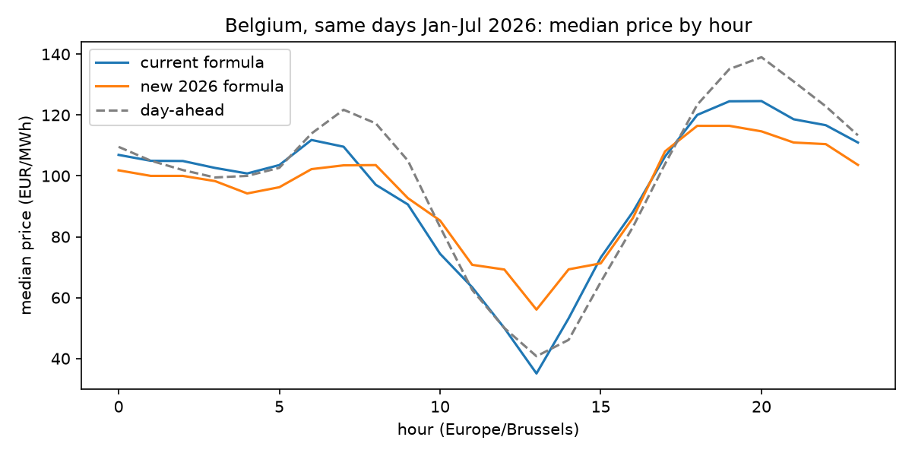
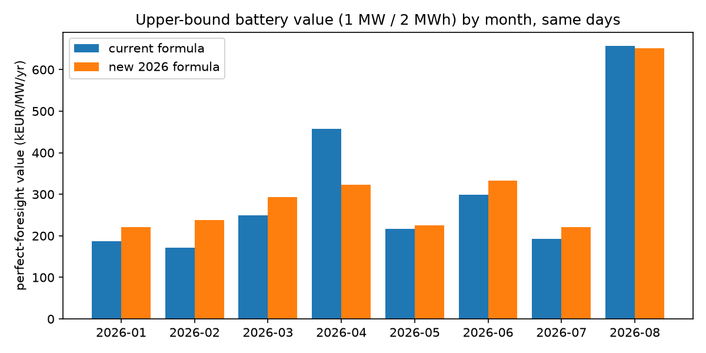

# Natural experiment: Elia's current vs new (2026) imbalance price formula

Generated by `scripts/research/mechanism_natural_experiment.py` from `data/public` (Elia Open Data, CC BY 4.0;
Energy-Charts day-ahead, CC BY 4.0). Battery for value numbers: 1 MW / 2 MWh, efficiency 0.95 each way,
SOC 5-95 %, degradation 8 EUR/MWh discharged, perfect foresight on final quarter-hour prices (7-day windows).

## 1. Both formulas are reproduced from published components

| Formula | Quarter-hours | Match rate (abs error <= 0.011 EUR/MWh) | Max abs error |
| --- | ---: | ---: | ---: |
| current (ODS134, 2024-06-01..2026-08-01) | 75936 | 99.9987% | 16.491 |
| new 2026 (ODS212, Jan-Jul 2026) | 20352 | 100.0000% | 0.000 |

## 2. Counterfactual reconstruction of the new formula from current-design components

`reconstruct_new_formula_history` uses only ODS134/ODS166/ODS127 fields (no new-formula data). Compared with
Elia's own simulation on the same quarter-hours:

- quarter-hours compared: 20352
- within 1 EUR/MWh: 22.4%; within 5 EUR/MWh: 45.7%
- MAE 18.26 EUR/MWh, median abs error 6.36, correlation 0.830
- aFRR weight MAE 0.004

The weights are reproduced closely, but the prices are not: the new design's aFRR price is a volume-weighted
average over 4-second PICASSO cycles, which the historical public data does not contain (a minute-level
volume-weighted rebuild only lifts the correlation to about 0.89). The 2024-2025 counterfactual below is
therefore indicative; the natural experiment itself uses Elia's official simulation.

## 3. Same days, two prices (Jan-Jul 2026)

| Statistic | current | new 2026 |
| --- | ---: | ---: |
| mean_eur_mwh | 95.199 | 96.662 |
| std_eur_mwh | 252.861 | 122.808 |
| p01_eur_mwh | -87.233 | -77.064 |
| p99_eur_mwh | 383.789 | 366.855 |
| min_eur_mwh | -15000.000 | -6572.613 |
| max_eur_mwh | 2131.183 | 7834.340 |
| negative_share | 0.090 | 0.063 |
| evening_minus_midday_eur_mwh | 84.226 | 51.085 |
| mean_abs_minus_da_eur_mwh | 44.341 | 46.086 |

## 4. Upper-bound battery value under each formula

| Window | Pricing | Perfect-foresight value (EUR/MW/yr) |
| --- | --- | ---: |
| Jan-Jul 2026 | current formula | 252,479 |
| Jan-Jul 2026 | new 2026 formula (Elia simulation) | 263,564 |
| Jan-Jul 2026 | day-ahead only | 95,870 |
| Jun 2024-Dec 2025 | current formula | 532,470 |
| Jun 2024-Dec 2025 | new 2026 formula (approximate reconstruction, indicative) | 521,496 |

## Caveats

- Elia calls its simulation best effort and non-validated; it reprices historical system states and does not
  include how market parties would react to the new price. The same holds for our reconstruction.
- Perfect-foresight values are upper bounds, not achievable revenue; see `reports/realtime_belgium.md` for
  causal strategies.
