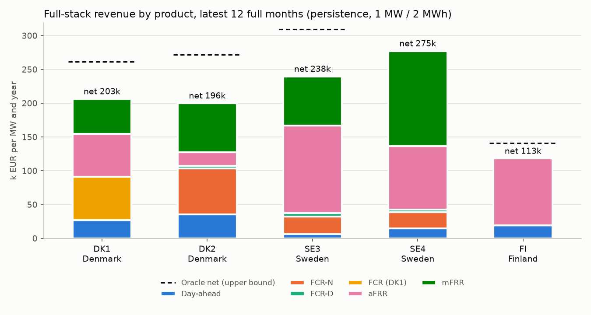
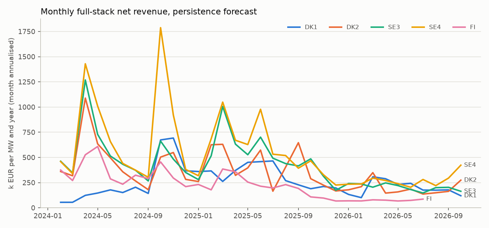
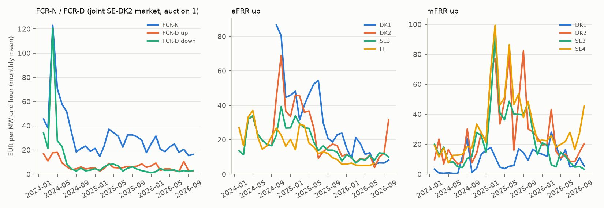

# Nordic BESS backtest: day-ahead plus FCR, aFRR and mFRR capacity in Denmark, Sweden and Finland

Every number on this page is produced by `scripts/research/nordic_backtest.py` (`.venv/bin/python scripts/research/nordic_backtest.py`) from the committed public data in `data/public/nordic` (Energinet Energi Data Service and Svenska kraftnät SVK Data Service, both CC BY 4.0). Market rules, data sources and limits: [docs/nordics.md](../docs/nordics.md).

**Setup.** 1 MW / 2 MWh battery, SOC window 5-95 % (0.1-1.9 MWh), start and end every delivery day (CET/CEST) at 50 %, charge and discharge efficiency 0.95 / 0.95, degradation 8 EUR per MWh discharged. One linear programme per delivery day co-optimises the day-ahead schedule with every capacity product of the zone under the published power and energy reservations (FCR-N 1.34 x C power and 1 h of energy in both directions, FCR-D 1 x C plus 0.2 x C recovery power and 20 minutes of energy, DK1 FCR 1.25 x C and 30 minutes, aFRR and mFRR 1 h in the product direction, plus the opposite-direction reservation Energinet describes for aFRR/mFRR energy management in DK1/DK2). Decisions for day D are taken at D-1 00:30 (SE/DK2 FCR auction 1, the earliest gate) or D-1 07:30 (aFRR/mFRR capacity) with a persistence forecast (D-1 prices at the same local time); all capacity markets are pay-as-cleared, so the offer is a zero-price bid paid the realised marginal price. The oracle solves the same problem with realised prices (upper bound, not tradable). EUR/MW/yr = period net revenue x 365 / evaluated days; cycles/day = MWh discharged / 2 MWh / day. Evaluation window 2024-02-01 to 2026-10-25 (Finland to 2026-07-01, the end of the open Finnish day-ahead data).

## Key findings

- **Reserve stacking is the main value driver in every Nordic zone.** Latest 12 full months, full stack with a persistence forecast (EUR/MW/yr): DK1 203,047, DK2 196,362, SE3 237,936, SE4 274,900, FI 113,114; the highest is SE4.
- **Versus day-ahead arbitrage alone** the full stack earns DK1 3.5x, DK2 3.2x, SE3 7.4x, SE4 6.0x, FI 4.7x as much.
- **A simple, causal forecast gets most of the way.** Persistence captures DK1 77.6 %, DK2 72.2 %, SE3 76.9 %, SE4 75.3 %, FI 80.1 % of the perfect-foresight oracle for the full stack.
- **Low cycling.** Full-stack schedules discharge DK1 0.54, DK2 0.61, SE3 0.27, SE4 0.39, FI 0.85 cycles per day (day-ahead throughput only).
- **Capacity prices have come down from their 2024-25 levels**, so the 2026 year-to-date stack is below 2024 in every zone: DK1 254,290 (2024) to 197,277 (2026); DK2 456,849 (2024) to 193,466 (2026); SE3 534,256 (2024) to 205,005 (2026); SE4 736,759 (2024) to 267,180 (2026); FI 352,625 (2024) to 72,202 (2026). FCR-D and FCR-N fell first (2024), aFRR and mFRR followed in 2025-26; DK1 rose in 2025 when its aFRR capacity market opened (October 2024). The persistence capture stays at 69-96 % in every year.

## Latest 12 full months: revenue stack per zone

Full-stack co-optimisation, persistence forecast. Product columns are EUR/MW/yr; the window is the latest 12 full months of each zone's data.

| Zone | Window | Days | Day-ahead | FCR-N | FCR-D up | FCR-D down | FCR (DK1) | aFRR up | aFRR down | mFRR up | mFRR down | Degradation | Net | Oracle net | Capture | Cycles/day |
| --- | --- | ---: | ---: | ---: | ---: | ---: | ---: | ---: | ---: | ---: | ---: | ---: | ---: | ---: | ---: | ---: |
| DK1 | Oct 2025 - Sep 2026 | 365 | 26,847 | n/a | n/a | n/a | 64,312 | 63,445 | 34 | 51,556 | 3 | -3,150 | **203,047** | 261,559 | 77.6 % | 0.54 |
| DK2 | Oct 2025 - Sep 2026 | 365 | 35,256 | 67,920 | 3,436 | 857 | n/a | 17,659 | 2,010 | 72,720 | 39 | -3,535 | **196,362** | 272,095 | 72.2 % | 0.61 |
| SE3 | Oct 2025 - Sep 2026 | 365 | 6,644 | 25,666 | 4,447 | 456 | n/a | 33,221 | 96,571 | 70,987 | 1,498 | -1,555 | **237,936** | 309,452 | 76.9 % | 0.27 |
| SE4 | Oct 2025 - Sep 2026 | 365 | 14,547 | 23,910 | 2,829 | 1,138 | n/a | 19,760 | 74,544 | 138,448 | 2,018 | -2,293 | **274,900** | 365,031 | 75.3 % | 0.39 |
| FI | Jul 2025 - Jun 2026 | 326 | 19,008 | n/a | n/a | n/a | n/a | 51,408 | 47,640 | n/a | n/a | -4,942 | **113,114** | 141,252 | 80.1 % | 0.85 |

`n/a` = product not available to the model in that zone (Finnish FCR and mFRR prices are only published behind a Fingrid API key; DK1 is in the Continental European FCR market).

## Workflows compared (latest 12 full months)

Net EUR/MW/yr with the persistence forecast (capture vs the oracle of the same workflow in brackets).

| Zone | DA only | DA + FCR | DA + aFRR | DA + mFRR | Full stack | Full stack / DA only |
| --- | ---: | ---: | ---: | ---: | ---: | ---: |
| DK1 | 57,886 (73.1 %) | 126,043 (88.0 %) | 142,073 (82.5 %) | 130,667 (80.4 %) | 203,047 (77.6 %) | 3.5x |
| DK2 | 61,685 (72.4 %) | 154,433 (82.2 %) | 113,107 (78.5 %) | 177,604 (85.7 %) | 196,362 (72.2 %) | 3.2x |
| SE3 | 32,082 (61.4 %) | 141,074 (84.5 %) | 194,401 (90.9 %) | 152,094 (86.0 %) | 237,936 (76.9 %) | 7.4x |
| SE4 | 46,102 (63.3 %) | 144,225 (80.1 %) | 184,901 (85.0 %) | 232,122 (86.8 %) | 274,900 (75.3 %) | 6.0x |
| FI | 23,927 (44.0 %) | n/a | 113,114 (80.1 %) | n/a | 113,114 (80.1 %) | 4.7x |

## Per calendar year

Full stack and DA only, persistence vs oracle, EUR/MW/yr (2024 starts on 1 February, the first day of pay-as-cleared FCR pricing in the joint SE-DK2 market; the last year runs to the end of the data).

| Zone | Year | Days | Full stack | Oracle | Capture | Reserve share | DA only | DA-only oracle | Cycles/day (full stack) |
| --- | --- | ---: | ---: | ---: | ---: | ---: | ---: | ---: | ---: |
| DK1 | 2024 | 335 | 254,290 | 315,773 | 80.5 % | 94.7 % | 38,226 | 56,092 | 0.41 |
| DK1 | 2025 | 365 | 318,620 | 380,117 | 83.8 % | 95.6 % | 47,847 | 65,972 | 0.37 |
| DK1 | 2026 | 298 | 197,277 | 256,889 | 76.8 % | 82.8 % | 67,672 | 88,647 | 0.64 |
| DK2 | 2024 | 335 | 456,849 | 598,549 | 76.3 % | 96.7 % | 41,072 | 58,837 | 0.37 |
| DK2 | 2025 | 365 | 389,426 | 509,725 | 76.4 % | 96.3 % | 52,566 | 71,600 | 0.34 |
| DK2 | 2026 | 298 | 193,466 | 259,755 | 74.5 % | 77.4 % | 70,780 | 93,716 | 0.69 |
| SE3 | 2024 | 335 | 534,256 | 610,864 | 87.5 % | 99.9 % | 12,104 | 24,070 | 0.09 |
| SE3 | 2025 | 365 | 498,038 | 588,936 | 84.6 % | 99.6 % | 29,306 | 45,812 | 0.11 |
| SE3 | 2026 | 298 | 205,005 | 272,064 | 75.4 % | 95.7 % | 33,654 | 55,216 | 0.34 |
| SE4 | 2024 | 335 | 736,759 | 967,006 | 76.2 % | 99.6 % | 30,758 | 50,781 | 0.16 |
| SE4 | 2025 | 365 | 564,686 | 674,743 | 83.7 % | 99.1 % | 41,391 | 61,363 | 0.17 |
| SE4 | 2026 | 298 | 267,180 | 358,358 | 74.6 % | 93.6 % | 52,506 | 81,387 | 0.45 |
| FI | 2024 | 322 | 352,625 | 369,186 | 95.5 % | 99.0 % | 14,652 | 42,949 | 0.21 |
| FI | 2025 | 324 | 213,719 | 238,327 | 89.7 % | 95.7 % | 21,309 | 52,580 | 0.44 |
| FI | 2026 | 168 | 72,202 | 105,373 | 68.5 % | 63.2 % | 22,478 | 58,506 | 1.14 |

### Revenue stack per year (full stack, persistence, EUR/MW/yr)

| Zone | Year | Day-ahead | FCR-N | FCR-D up | FCR-D down | FCR (DK1) | aFRR up | aFRR down | mFRR up | mFRR down | Degradation | Net |
| --- | --- | ---: | ---: | ---: | ---: | ---: | ---: | ---: | ---: | ---: | ---: | ---: |
| DK1 | 2024 | 13,440 | n/a | n/a | n/a | 81,347 | 151,991 | 233 | 9,636 | 33 | -2,389 | 254,290 |
| DK1 | 2025 | 14,075 | n/a | n/a | n/a | 36,439 | 246,079 | 75 | 23,396 | 688 | -2,133 | 318,620 |
| DK1 | 2026 | 33,369 | n/a | n/a | n/a | 75,947 | 40,310 | 39 | 51,321 | 4 | -3,713 | 197,277 |
| DK2 | 2024 | 14,897 | 105,316 | 17,117 | 97,484 | n/a | 82,064 | 117,318 | 24,822 | 0 | -2,170 | 456,849 |
| DK2 | 2025 | 14,505 | 39,203 | 2,729 | 1,189 | n/a | 68,197 | 5,485 | 250,163 | 9,955 | -1,999 | 389,426 |
| DK2 | 2026 | 42,851 | 60,410 | 3,166 | 960 | n/a | 29,840 | 2,356 | 57,854 | 48 | -4,019 | 193,466 |
| SE3 | 2024 | 533 | 44,058 | 6,478 | 107,035 | n/a | 126,660 | 175,330 | 46,582 | 28,094 | -514 | 534,256 |
| SE3 | 2025 | 1,990 | 8,343 | 2,820 | 1,566 | n/a | 50,179 | 84,672 | 261,158 | 87,944 | -635 | 498,038 |
| SE3 | 2026 | 8,667 | 25,705 | 3,087 | 556 | n/a | 39,969 | 96,366 | 31,721 | 932 | -1,998 | 205,005 |
| SE4 | 2024 | 2,982 | 42,706 | 6,461 | 104,387 | n/a | 136,298 | 188,338 | 59,354 | 197,186 | -954 | 736,759 |
| SE4 | 2025 | 4,811 | 8,267 | 1,764 | 1,929 | n/a | 61,151 | 73,579 | 328,790 | 85,380 | -984 | 564,686 |
| SE4 | 2026 | 16,910 | 23,377 | 2,215 | 1,244 | n/a | 26,334 | 72,188 | 126,337 | 1,226 | -2,652 | 267,180 |
| FI | 2024 | 3,375 | n/a | n/a | n/a | n/a | 179,015 | 171,451 | n/a | n/a | -1,217 | 352,625 |
| FI | 2025 | 8,996 | n/a | n/a | n/a | n/a | 120,078 | 87,209 | n/a | n/a | -2,564 | 213,719 |
| FI | 2026 | 24,128 | n/a | n/a | n/a | n/a | 31,128 | 23,578 | n/a | n/a | -6,632 | 72,202 |

## Market context

Time-weighted means over each zone's latest-12-months window; capacity prices in EUR per MW and hour (auction 1 for FCR-N/FCR-D).

| Zone | Mean DA EUR/MWh | Mean daily DA spread EUR/MWh | Negative DA QHs | FCR-N | FCR-D up | FCR-D down | FCR (DK1) | aFRR up | aFRR down | mFRR up | mFRR down |
| --- | ---: | ---: | ---: | ---: | ---: | ---: | ---: | ---: | ---: | ---: | ---: |
| DK1 | 101.2 | 150.7 | 2.7 % | n/a | n/a | n/a | 17.0 | 14.3 | 0.2 | 13.3 | 0.1 |
| DK2 | 103.1 | 159.7 | 1.2 % | 22.8 | 5.6 | 2.8 | n/a | 10.6 | 2.5 | 19.7 | 0.3 |
| SE3 | 67.1 | 96.4 | 1.4 % | 22.8 | 5.6 | 2.8 | n/a | 10.2 | 15.2 | 15.4 | 3.3 |
| SE4 | 82.3 | 129.7 | 1.6 % | 22.8 | 5.6 | 2.8 | n/a | 11.2 | 13.0 | 25.6 | 3.3 |
| FI | 57.4 | 92.9 | 1.3 % | n/a | n/a | n/a | n/a | 7.8 | 6.7 | n/a | n/a |

Market depth: median procured capacity per hour in the same windows (MW; FCR-N/FCR-D = total of the joint SE-DK2 market, DK1 FCR = Danish requirement incl. imports). Several of these markets are a few tens of MW per zone, so the price-taker results apply to a small share of each market. SE3/SE4 aFRR is mostly procured in other zones of the common Nordic auction (median local volume 0 MW) while a zonal price is published for every hour.

| Zone | FCR-N | FCR-D up | FCR-D down | FCR (DK1) | aFRR up | aFRR down | mFRR up | mFRR down |
| --- | ---: | ---: | ---: | ---: | ---: | ---: | ---: | ---: |
| DK1 | n/a | n/a | n/a | 29 | 90 | 20 | 398 | 0 |
| DK2 | 185 | 411 | 413 | n/a | 59 | 39 | 304 | 0 |
| SE3 | 185 | 411 | 413 | n/a | 0 | 0 | 555 | 163 |
| SE4 | 185 | 411 | 413 | n/a | 0 | 0 | 162 | 33 |
| FI | n/a | n/a | n/a | n/a | 67 | 65 | n/a | n/a |

## Rule sensitivities (latest 12 full months, full stack, persistence)

| Case | Zone | Net EUR/MW/yr | Base | Change |
| --- | --- | ---: | ---: | ---: |
| No opposite-direction reservation for aFRR/mFRR (Nordic-style rules only) | DK1 | 205,094 | 203,047 | 1.0 % |
| No opposite-direction reservation for aFRR/mFRR (Nordic-style rules only) | DK2 | 206,316 | 196,362 | 5.1 % |
| FCR-N energy 1.5 h per direction (upper end of the range the TSOs will evaluate) | SE3 | 234,774 | 237,936 | -1.3 % |

## Danish imbalance settlement

Denmark settles imbalances at a single price per bidding zone and 15-minute period. Since the new design (mFRR energy activation market, March 2025) the price is the higher of the mFRR marginal price and the aFRR volume-weighted average price when the dominating direction is up, the lower of the two when it is down, and the day-ahead price without a dominating direction ([Energinet](https://en.energinet.dk/electricity/balancing-and-ancillary-services/imbalance-price-design/)). The committed Energinet data follows this rule in 99.998 % of quarter-hours from 2025-03-20 (aFRR averages of exactly 0 EUR with no aFRR energy read as 'no aFRR price').

**Not modelled as a strategy.** Deliberate (implicit or passive) balancing is not an accepted business model in Denmark: the Nordic TSOs expect balance responsible parties to be balanced before the operating hour and to follow their submitted plans, monitor systematic deviations, and do not publish intra-period prices in order to avoid self-balancing ([Nordic Balancing Philosophy](https://www.fingrid.fi/globalassets/dokumentit/fi/tiedotteet/ajankohtaista/nordic-balancing-philosophy-may24.pdf)); Danish BRPs submit 5-minute operational schedules and are financially responsible for being in balance ([Energinet regulation C1, in Danish](https://energinet.dk/media/d45j2s2m/forskrift-c1.pdf)), and Energinet does not allow battery energy management through imbalances ([prequalification, section 10.1.4](https://en.energinet.dk/media/fm1pgsez/prequalification-of-units-and-agggegated-portfolios-november-2025.pdf)). The table is context only.

| Area | Quarter-hours | Mean imbalance price | Mean day-ahead price | Mean abs. difference | Std of difference | Dominant up | Dominant down | No dominant direction |
| --- | ---: | ---: | ---: | ---: | ---: | ---: | ---: | ---: |
| DK1 | 56,160 | 95.2 | 93.4 | 63.9 | 173.4 | 30.1 % | 56.9 % | 13.0 % |
| DK2 | 56,160 | 96.1 | 95.1 | 73.0 | 194.1 | 24.2 % | 53.9 % | 21.9 % |

Window 2025-03-20 to 2026-10-25; prices in EUR/MWh.

## Checks

- **Same LP as the real-time engine.** With the terminal-SOC and converter constraints dropped, the day LP reproduces `realtime.strategies.solve_qh_arbitrage` on 20 SE3 days (largest objective gap 1.71e-13 EUR).
- **Product rules hold.** 75 full-stack schedules re-checked independently against the power and energy reservations: 0 violations.
- **No look-ahead.** Randomly perturbing every price from the start of day D onwards changed the forecast inputs of day D in 0 of 25 tested days. The forecast only uses delivery days up to D-1, whose prices are all published by D-2 evening, before the earliest gate (D-1 00:30).
- **Simultaneous charge and discharge.** 32 of 4,301,160 solved quarter-hours charge and discharge in the same quarter-hour (the converter limit c + d <= P bounds it); they shape the SOC under the hourly day-ahead constraint and change revenue negligibly.

## Data and coverage

- Day-ahead DK1, DK2, SE3, SE4: Energinet `Elspotprices` (hourly, to 2025-09-30) and `DayAheadPrices` (15-minute, from 2025-10-01); FI: SVK Data Service `market_data_day_ahead_area_prices` (Energinet's SE3/SE4 prices agree with SVK's except on 2024-10-15, where SVK is inconsistent and the Finnish day is dropped). Hourly prices before 2025-10-01 are held flat over their four quarter-hours and the day-ahead position is constant within each hour.
- FCR-N / FCR-D: Energinet `FcrNdDK2` (joint SE-DK2 auctions; identical prices in DK2, SE3 and SE4); DK1 FCR: Energinet `FcrDK1`; aFRR: Energinet `AfrrReservesNordic` (DK1 from 2024-10-02); mFRR: Energinet `mFRRCapacityMarket` (DK1, DK2) and SVK Data Service `mfrr_capacity_market` (SE3, SE4). Danish imbalance: Energinet `ImbalancePrice` and `RegulatingBalancePowerdata`. Licence CC BY 4.0 for all; attribution 'Source: Energinet (www.energidataservice.dk)' and 'Svenska kraftnät (SVK Data Service)'.
- DK1: 998 delivery days evaluated (2024-02-01 to 2026-10-25), 0 skipped (more than 2 hours of day-ahead prices missing), 0 untradable quarter-hours, 3 days on which some forecast quarter-hours came from D-2 or earlier (missing on D-1).
- DK2: 998 delivery days evaluated (2024-02-01 to 2026-10-25), 0 skipped (more than 2 hours of day-ahead prices missing), 0 untradable quarter-hours, 3 days on which some forecast quarter-hours came from D-2 or earlier (missing on D-1).
- SE3: 998 delivery days evaluated (2024-02-01 to 2026-10-25), 0 skipped (more than 2 hours of day-ahead prices missing), 0 untradable quarter-hours, 3 days on which some forecast quarter-hours came from D-2 or earlier (missing on D-1).
- SE4: 998 delivery days evaluated (2024-02-01 to 2026-10-25), 0 skipped (more than 2 hours of day-ahead prices missing), 0 untradable quarter-hours, 3 days on which some forecast quarter-hours came from D-2 or earlier (missing on D-1).
- FI: 814 delivery days evaluated (2024-02-01 to 2026-07-01), 68 skipped (more than 2 hours of day-ahead prices missing), 973 untradable quarter-hours, 281 days on which some forecast quarter-hours came from D-2 or earlier (missing on D-1).
- Runtime of this script run: 1.1 minutes.

## Scope and assumptions

- **Simulated money on public prices.** Day-ahead schedule plus capacity reservations; no orders were placed. Results are per MW of a pooled fleet (minimum bid sizes of 0.1 MW for FCR and 1 MW for aFRR/mFRR are assumed to be met by pooling) and assume a price taker whose zero-price offers are always accepted.
- **No intraday trading and no activation energy.** Intraday re-optimisation, aFRR/mFRR energy bids, FCR-N energy remuneration and FFR are not modelled; the expected activation energy is taken as zero and the energy reservations cover the SOC excursions (no SOC drift, no NEM recharge cost).
- **FCR auction.** SE/DK2 FCR is offered in auction 1 (D-1 early), where most volume is procured; auction 2 and the interplay between the two are not modelled. January 2024 is excluded because FCR prices were average (pay-as-bid) prices before 2024-02-01.
- **Finland.** Day-ahead prices come from SVK Data Service (Energy-Charts restricts FI to private use and Fingrid does not publish them); that dataset ends on 2026-07-01 and misses some hours: quarter-hours without a price are untradable and days with more than two missing hours are skipped. Finnish FCR-N, FCR-D and mFRR capacity prices need a Fingrid API key and are not used, so the Finnish stack is day-ahead plus aFRR only.
- **Swedish mFRR.** SVK publishes only hours with Swedish procurement; other hours pay nothing.
- **Danish aFRR/mFRR energy management.** The opposite-direction power reservation follows Energinet's example energy-management design for LER units; Energinet states that these requirements are still being refined (sensitivity above).
- **Battery.** Daily 50 % to 50 % SOC boundary, linear efficiencies, no auxiliary load or availability losses, degradation as a linear cost per MWh discharged; no grid tariffs, fees or taxes.

## External reference points

- Clean Horizon Storage Index, September 2026 (https://www.cleanhorizon.com/news/storage-index-september-2026-is-out/): the 2-hour index is reported at 286 k EUR/MW/yr in DK1, 447 in DK2 and 142 in SE3 (one month, annualised). This backtest's September 2026 full-stack value is DK1 178k, DK2 163k, SE3 203k. The index adds intraday trading, activation energy and (DK2) FFR, and uses its own asset and bidding assumptions, so it is a scale reference, not a like-for-like comparison.
- Nordic TSOs, 'Batteries in the Nordic reserve markets' (April 2025, https://www.svk.se/siteassets/om-oss/rapporter/2025/nordic-tsos---batteries-in-the-nordic-reserve-markets-april-2025.pdf): the TSOs' own account of the rapid growth of prequalified battery volumes in FCR, which is the background to the falling FCR-D prices visible in the market-context figure.

