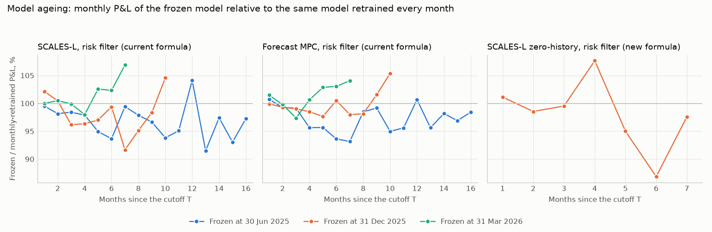
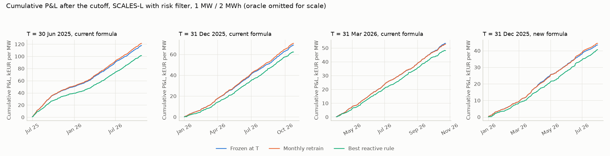
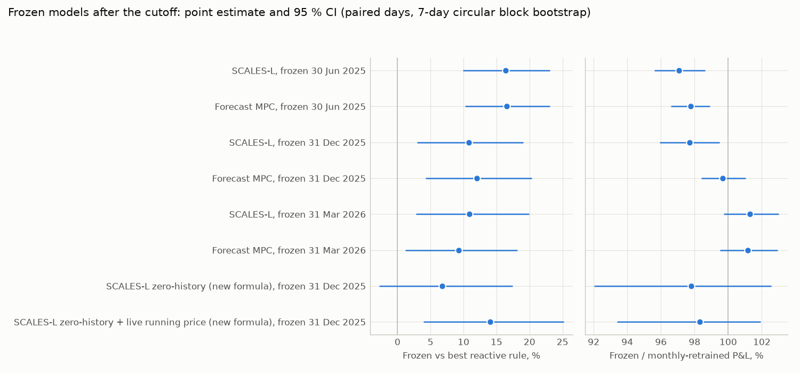

# Out-of-sample evidence: models frozen at a cutoff keep earning

> Generated by `scripts/research/out_of_sample.py` from `data/public` (Elia Open Data, CC BY 4.0,
> attribution "Elia Transmission Belgium SA"; day-ahead prices from Energy-Charts, CC BY 4.0). Every number
> below is produced by that script; do not edit by hand. Simulated money, not trading advice.

## Headline

- Models trained only on data up to 30 June 2025 and never updated earn 89,454 EUR/MW/yr over the 16 months that followed (1 Jul 2025 to 24 Oct 2026), 97 % of the monthly-retrained model and 16 % above the best reactive rule (95 % CI +10 % to +23 %).
- Models trained only on data up to 31 December 2025 and never updated earn 84,724 EUR/MW/yr over the 10 months that followed (1 Jan 2026 to 24 Oct 2026), 98 % of the monthly-retrained model and 11 % above the best reactive rule (95 % CI +3 % to +19 %).
- Models trained only on data up to 31 March 2026 and never updated earn 94,111 EUR/MW/yr over the 7 months that followed (1 Apr 2026 to 24 Oct 2026), 101 % of the monthly-retrained model and 11 % above the best reactive rule (95 % CI +3 % to +20 %).
- A zero-history SCALES-L model frozen at 1 January 2026, which never saw a new-formula price, earns 74,889 EUR/MW/yr at the new-formula price over the 7 months 1 Jan 2026 to 31 Jul 2026, 98 % of its monthly-retrained version and 7 % above the best reactive rule (95 % CI -3 % to +17 %); with the live running new-formula price as an extra input it earns 80,007 EUR/MW/yr, 14 % above the rule (95 % CI +4 % to +25 %).

- The second strategy of the stack, forecast MPC with the risk filter, frozen at the same cutoffs earns 89,550 EUR/MW/yr (98 % of its monthly-retrained version, T = 2025-06-30), 85,676 EUR/MW/yr (100 % of its monthly-retrained version, T = 2025-12-31), 92,720 EUR/MW/yr (101 % of its monthly-retrained version, T = 2026-03-31).
- Every tradable arm passed every look-ahead audit on real Elia data (120 of 120 audits over 24 strategy/cutoff combinations; white-box plan comparison 84 of 84); the perfect-foresight oracle, the positive control, failed 17 of 18.

SCALES-L with the risk filter is the primary arm, fixed before the run. Battery 1 MW / 2 MWh, efficiencies 0.95 / 0.95, SOC band 5-95 %, degradation 8 EUR per MWh discharged; minute data usable 1 minute after the minute ends, final quarter-hour prices 5 minutes after the quarter-hour; price taker; settlement at Elia's published imbalance price (current formula: ODS134; new formula: Elia's ODS212 simulation).



## Results

### Current formula: frozen vs monthly-retrained vs reactive rules

| Cutoff T (end of day) | Model | Test window | Months | Frozen EUR/MW/yr | Monthly retrain EUR/MW/yr | Frozen / retrain [95 % CI] | Best reactive rule EUR/MW/yr | Frozen vs best rule [95 % CI] | Months frozen > rule | Capture vs oracle | Oracle EUR/MW/yr |
| --- | ---: | ---: | ---: | ---: | ---: | ---: | ---: | ---: | ---: | ---: | ---: |
| 2025-06-30 | SCALES-L | 2025-07-01 to 2026-10-24 | 16 | 89,454 | 92,162 | 97 % [96, 99] % | 76,844 | +16 % [+10, +23] % | 13/16 | 0.364 | 245,895 |
| 2025-06-30 | Forecast MPC | 2025-07-01 to 2026-10-24 | 16 | 89,550 | 91,607 | 98 % [97, 99] % | 76,844 | +17 % [+10, +23] % | 14/16 | 0.364 | 245,895 |
| 2025-12-31 | SCALES-L | 2026-01-01 to 2026-10-24 | 10 | 84,724 | 86,725 | 98 % [96, 99] % | 76,478 | +11 % [+3, +19] % | 9/10 | 0.341 | 248,101 |
| 2025-12-31 | Forecast MPC | 2026-01-01 to 2026-10-24 | 10 | 85,676 | 85,964 | 100 % [98, 101] % | 76,478 | +12 % [+4, +20] % | 9/10 | 0.345 | 248,101 |
| 2026-03-31 | SCALES-L | 2026-04-01 to 2026-10-24 | 7 | 94,111 | 92,928 | 101 % [100, 103] % | 84,869 | +11 % [+3, +20] % | 6/7 | 0.352 | 267,686 |
| 2026-03-31 | Forecast MPC | 2026-04-01 to 2026-10-24 | 7 | 92,720 | 91,666 | 101 % [100, 103] % | 84,869 | +9 % [+1, +18] % | 6/7 | 0.346 | 267,686 |

EUR/MW/yr annualises the net P&L (revenue minus degradation) over the test window. *Monthly retrain* is the same model specification refitted at every month start on the previous six months (the walk-forward arms of `reports/realtime_belgium.md`, re-run on exactly the same days). *Best reactive rule* is the better of the two threshold rules (running price, running system imbalance) on that window, chosen after the fact. Brackets are 95 % circular block-bootstrap intervals (7-day blocks) of paired daily P&L.



### New formula: zero-history SCALES-L frozen at 1 January 2026

| Cutoff T (end of day) | Model | Test window | Months | Frozen EUR/MW/yr | Monthly retrain EUR/MW/yr | Frozen / retrain [95 % CI] | Best reactive rule EUR/MW/yr | Frozen vs best rule [95 % CI] | Months frozen > rule | Capture vs oracle | Oracle EUR/MW/yr |
| --- | ---: | ---: | ---: | ---: | ---: | ---: | ---: | ---: | ---: | ---: | ---: |
| 2025-12-31 | SCALES-L zero-history | 2026-01-01 to 2026-07-31 | 7 | 74,889 | 76,574 | 98 % [92, 103] % | 70,140 | +7 % [-3, +17] % | 3/7 | 0.284 | 263,514 |
| 2025-12-31 | SCALES-L zero-history + live running price | 2026-01-01 to 2026-07-31 | 7 | 80,007 | 81,388 | 98 % [93, 102] % | 70,140 | +14 % [+4, +25] % | 6/7 | 0.304 | 263,514 |

The zero-history model is trained on the six months before the cutoff on current-design data only: its training targets are new-formula prices recomputed from the current-design state (ODS166 product prices, ODS127 volumes), and no new-formula price (ODS211/ODS212) is loaded while it is fitted. It is then settled at Elia's published new-formula price for 1 Jan 2026 to 31 Jul 2026. The live-running-price variant also reads the running new-formula price minute by minute at decision time (precision-weighted fusion whose error profile was estimated on current-formula data before the cutoff). The best reactive rule here acts on that same live running new-formula price, an input the plain zero-history model does not use. Elia's simulated series starts at 00:00 UTC on 1 January 2026, so the first 4 quarter-hours of the local day have no price and earn nothing for every arm.



### Model ageing

Monthly P&L of each frozen model divided by the P&L of the same model retrained every month, pooled over the three cutoffs by number of months since the cutoff (sum of frozen P&L / sum of retrained P&L in the bucket):

| Model | Months since T | Cutoff-months pooled | Cutoffs | Frozen / retrain |
| --- | ---: | ---: | ---: | ---: |
| SCALES-L, risk filter | 1-3 | 9 | 3 | 99 % |
| SCALES-L, risk filter | 4-6 | 9 | 3 | 98 % |
| SCALES-L, risk filter | 7-10 | 9 | 3 | 98 % |
| SCALES-L, risk filter | 11-16 | 6 | 1 | 96 % |
| Forecast MPC, risk filter | 1-3 | 9 | 3 | 100 % |
| Forecast MPC, risk filter | 4-6 | 9 | 3 | 99 % |
| Forecast MPC, risk filter | 7-10 | 9 | 3 | 99 % |
| Forecast MPC, risk filter | 11-16 | 6 | 1 | 98 % |

Forecast skill of the frozen and the monthly-retrained forecasters (current quarter-hour, all minutes; MAE of the mean forecast in EUR/MWh against the published final price, Brier score of P(SI < 0)):

| Cutoff (formula) | Model | MAE first 3 months, frozen | MAE first 3 months, retrain | MAE last 3 months, frozen | MAE last 3 months, retrain | Brier P(SI<0), frozen | Brier P(SI<0), retrain |
| --- | ---: | ---: | ---: | ---: | ---: | ---: | ---: |
| 2025-06-30 (current) | SCALES-L | 20.9 | 20.4 | 23.9 | 18.5 | 0.088 | 0.083 |
| 2025-06-30 (current) | Forecast MPC (price model) | 21.4 | 20.9 | 25.1 | 18.6 | 0.088 | 0.083 |
| 2025-12-31 (current) | SCALES-L | 16.7 | 16.4 | 21.2 | 18.5 | 0.084 | 0.082 |
| 2025-12-31 (current) | Forecast MPC (price model) | 16.4 | 16.3 | 20.9 | 18.6 | 0.084 | 0.082 |
| 2026-03-31 (current) | SCALES-L | 19.3 | 19.7 | 19.6 | 18.5 | 0.086 | 0.080 |
| 2026-03-31 (current) | Forecast MPC (price model) | 19.8 | 20.7 | 19.9 | 18.6 | 0.086 | 0.080 |
| 2025-12-31 (new2026) | SCALES-L zero-history | 28.1 | 28.2 | 28.5 | 28.1 | 0.085 | 0.084 |

The frozen forecasters do age: after the 30 June 2025 cutoff the error of SCALES-L's mean forecast goes from 20.9 EUR/MWh in the first three months to 23.9 EUR/MWh in the last three (monthly retrain: 20.4 and 18.5), while its monthly P&L stays between 91 % and 104 % of the retrained model's.

### Month by month

**Frozen at 30 June 2025, current formula** (EUR/MW/yr per month):

| Month | Months since T | SCALES-L frozen | SCALES-L retrain | Frozen / retrain | Forecast MPC frozen | Forecast MPC retrain | Frozen / retrain | Best reactive rule | Oracle | SCALES-L frozen capture |
| --- | ---: | ---: | ---: | ---: | ---: | ---: | ---: | ---: | ---: | ---: |
| 2025-07 | 1 | 156,975 | 157,743 | 100 % | 157,837 | 156,671 | 101 % | 121,640 | 342,984 | 0.458 |
| 2025-08 | 2 | 149,665 | 152,486 | 98 % | 149,587 | 150,728 | 99 % | 108,147 | 308,311 | 0.485 |
| 2025-09 | 3 | 123,436 | 125,426 | 98 % | 124,574 | 125,635 | 99 % | 94,862 | 287,183 | 0.430 |
| 2025-10 | 4 | 66,098 | 67,526 | 98 % | 65,889 | 68,895 | 96 % | 57,512 | 192,667 | 0.343 |
| 2025-11 | 5 | 57,466 | 60,526 | 95 % | 57,489 | 60,094 | 96 % | 48,403 | 193,176 | 0.297 |
| 2025-12 | 6 | 43,470 | 46,419 | 94 % | 43,204 | 46,149 | 94 % | 36,371 | 129,620 | 0.335 |
| 2026-01 | 7 | 50,972 | 51,272 | 99 % | 48,744 | 52,326 | 93 % | 34,083 | 185,432 | 0.275 |
| 2026-02 | 8 | 56,412 | 57,642 | 98 % | 58,753 | 59,669 | 98 % | 55,796 | 171,308 | 0.329 |
| 2026-03 | 9 | 95,310 | 98,609 | 97 % | 95,808 | 96,612 | 99 % | 77,864 | 249,358 | 0.382 |
| 2026-04 | 10 | 84,082 | 89,615 | 94 % | 84,360 | 88,825 | 95 % | 68,178 | 444,085 | 0.189 |
| 2026-05 | 11 | 88,093 | 92,652 | 95 % | 91,022 | 95,216 | 96 % | 89,313 | 218,216 | 0.404 |
| 2026-06 | 12 | 106,275 | 102,058 | 104 % | 104,316 | 103,629 | 101 % | 91,569 | 294,912 | 0.360 |
| 2026-07 | 13 | 79,683 | 87,103 | 91 % | 80,614 | 84,308 | 96 % | 76,256 | 192,755 | 0.413 |
| 2026-08 | 14 | 88,065 | 90,410 | 97 % | 86,561 | 88,167 | 98 % | 94,057 | 244,247 | 0.361 |
| 2026-09 | 15 | 97,258 | 104,532 | 93 % | 98,191 | 101,340 | 97 % | 101,759 | 239,895 | 0.405 |
| 2026-10 (partial) | 16 | 84,381 | 86,733 | 97 % | 81,861 | 83,177 | 98 % | 71,034 | 238,854 | 0.353 |

SCALES-L frozen beats the best reactive rule, the threshold rule on the running price, in 13 of 16 months.

**Frozen at 31 December 2025, current formula** (EUR/MW/yr per month):

| Month | Months since T | SCALES-L frozen | SCALES-L retrain | Frozen / retrain | Forecast MPC frozen | Forecast MPC retrain | Frozen / retrain | Best reactive rule | Oracle | SCALES-L frozen capture |
| --- | ---: | ---: | ---: | ---: | ---: | ---: | ---: | ---: | ---: | ---: |
| 2026-01 | 1 | 57,463 | 56,259 | 102 % | 56,634 | 56,694 | 100 % | 36,763 | 185,432 | 0.310 |
| 2026-02 | 2 | 57,901 | 57,642 | 100 % | 59,257 | 59,669 | 99 % | 55,796 | 171,308 | 0.338 |
| 2026-03 | 3 | 94,829 | 98,609 | 96 % | 95,656 | 96,612 | 99 % | 77,864 | 249,358 | 0.380 |
| 2026-04 | 4 | 86,326 | 89,615 | 96 % | 87,494 | 88,825 | 99 % | 68,178 | 444,085 | 0.194 |
| 2026-05 | 5 | 89,885 | 92,652 | 97 % | 92,969 | 95,216 | 98 % | 89,313 | 218,216 | 0.412 |
| 2026-06 | 6 | 101,423 | 102,058 | 99 % | 104,161 | 103,629 | 101 % | 91,569 | 294,912 | 0.344 |
| 2026-07 | 7 | 79,842 | 87,103 | 92 % | 82,605 | 84,308 | 98 % | 76,256 | 192,755 | 0.414 |
| 2026-08 | 8 | 86,003 | 90,410 | 95 % | 86,525 | 88,167 | 98 % | 94,057 | 244,247 | 0.352 |
| 2026-09 | 9 | 102,815 | 104,532 | 98 % | 102,917 | 101,340 | 102 % | 101,759 | 239,895 | 0.429 |
| 2026-10 (partial) | 10 | 90,689 | 86,733 | 105 % | 87,658 | 83,177 | 105 % | 71,034 | 238,854 | 0.380 |

SCALES-L frozen beats the best reactive rule, the threshold rule on the running price, in 9 of 10 months.

**Frozen at 31 March 2026, current formula** (EUR/MW/yr per month):

| Month | Months since T | SCALES-L frozen | SCALES-L retrain | Frozen / retrain | Forecast MPC frozen | Forecast MPC retrain | Frozen / retrain | Best reactive rule | Oracle | SCALES-L frozen capture |
| --- | ---: | ---: | ---: | ---: | ---: | ---: | ---: | ---: | ---: | ---: |
| 2026-04 | 1 | 86,048 | 86,054 | 100 % | 85,613 | 84,373 | 101 % | 67,158 | 444,085 | 0.194 |
| 2026-05 | 2 | 93,108 | 92,652 | 100 % | 95,021 | 95,216 | 100 % | 89,313 | 218,216 | 0.427 |
| 2026-06 | 3 | 101,955 | 102,058 | 100 % | 100,907 | 103,629 | 97 % | 91,569 | 294,912 | 0.346 |
| 2026-07 | 4 | 85,342 | 87,103 | 98 % | 84,842 | 84,308 | 101 % | 76,256 | 192,755 | 0.443 |
| 2026-08 | 5 | 92,729 | 90,410 | 103 % | 90,692 | 88,167 | 103 % | 94,057 | 244,247 | 0.380 |
| 2026-09 | 6 | 106,969 | 104,532 | 102 % | 104,432 | 101,340 | 103 % | 101,759 | 239,895 | 0.446 |
| 2026-10 (partial) | 7 | 92,721 | 86,733 | 107 % | 86,551 | 83,177 | 104 % | 71,034 | 238,854 | 0.388 |

SCALES-L frozen beats the best reactive rule, the threshold rule on the running price, in 6 of 7 months.

**Frozen at 31 December 2025, new formula** (EUR/MW/yr per month):

| Month | Months since T | SCALES-L zero-history frozen | SCALES-L zero-history retrain | Frozen / retrain | SCALES-L zero-history + live running price frozen | SCALES-L zero-history + live running price retrain | Frozen / retrain | Best reactive rule | Oracle | SCALES-L zero-history frozen capture |
| --- | ---: | ---: | ---: | ---: | ---: | ---: | ---: | ---: | ---: | ---: |
| 2026-01 | 1 | 56,994 | 56,358 | 101 % | 58,007 | 60,330 | 96 % | 41,493 | 219,916 | 0.259 |
| 2026-02 | 2 | 57,301 | 58,152 | 99 % | 65,777 | 64,984 | 101 % | 61,178 | 237,615 | 0.241 |
| 2026-03 | 3 | 96,690 | 97,152 | 100 % | 101,892 | 101,331 | 101 % | 75,123 | 293,087 | 0.330 |
| 2026-04 | 4 | 92,236 | 85,683 | 108 % | 94,463 | 90,728 | 104 % | 76,122 | 318,707 | 0.289 |
| 2026-05 | 5 | 73,832 | 77,723 | 95 % | 78,401 | 79,373 | 99 % | 78,187 | 225,942 | 0.327 |
| 2026-06 | 6 | 80,223 | 92,367 | 87 % | 89,923 | 98,657 | 91 % | 84,316 | 328,145 | 0.244 |
| 2026-07 | 7 | 66,010 | 67,633 | 98 % | 71,027 | 73,609 | 96 % | 74,351 | 222,587 | 0.297 |

SCALES-L zero-history frozen beats the best reactive rule, the threshold rule on the running price, in 3 of 7 months.

## Statistics

For each arm the net P&L is summed per local delivery day (Europe/Brussels). The frozen arm and its reference trade the same days, so the comparison is paired: the statistic is the mean daily difference (annualised per MW) and the ratio of total P&L. Days are serially dependent, so confidence intervals come from a circular block bootstrap (Politis and Romano, 1992) with 7-day blocks and 10,000 replicates (fixed seed), resampling both series jointly; intervals are percentile intervals at 95 %. The p-value is one-sided for a positive mean difference, from replicates re-centred on the null.

| Evaluation | Arm | Reference | Days | Mean difference EUR/MW/yr | 95 % CI | P&L ratio | 95 % CI | p (one-sided) | Months won |
| --- | ---: | ---: | ---: | ---: | ---: | ---: | ---: | ---: | ---: |
| current, T = 2025-06-30 | SCALES-L, risk filter - frozen at T | Threshold (running price) | 481 | 12,610 | [+7,712, +17,486] | 1.164 | [1.099, 1.231] | 0.0001 | 13/16 |
| current, T = 2025-06-30 | SCALES-L, risk filter - frozen at T | SCALES-L, risk filter - monthly retrain | 481 | -2,708 | [-3,969, -1,277] | 0.971 | [0.956, 0.986] | - | 1/16 |
| current, T = 2025-06-30 | Forecast MPC, risk filter - frozen at T | Threshold (running price) | 481 | 12,706 | [+7,924, +17,466] | 1.165 | [1.102, 1.231] | 0.0001 | 14/16 |
| current, T = 2025-06-30 | Forecast MPC, risk filter - frozen at T | Forecast MPC, risk filter - monthly retrain | 481 | -2,056 | [-3,052, -1,023] | 0.978 | [0.966, 0.989] | - | 2/16 |
| current, T = 2025-12-31 | SCALES-L, risk filter - frozen at T | Threshold (running price) | 297 | 8,244 | [+2,417, +13,780] | 1.108 | [1.030, 1.190] | 0.0010 | 9/10 |
| current, T = 2025-12-31 | SCALES-L, risk filter - frozen at T | SCALES-L, risk filter - monthly retrain | 297 | -2,001 | [-3,511, -454] | 0.977 | [0.959, 0.995] | - | 3/10 |
| current, T = 2025-12-31 | Forecast MPC, risk filter - frozen at T | Threshold (running price) | 297 | 9,196 | [+3,400, +14,671] | 1.120 | [1.042, 1.203] | 0.0004 | 9/10 |
| current, T = 2025-12-31 | Forecast MPC, risk filter - frozen at T | Forecast MPC, risk filter - monthly retrain | 297 | -288 | [-1,357, +912] | 0.997 | [0.984, 1.010] | - | 3/10 |
| current, T = 2026-03-31 | SCALES-L, risk filter - frozen at T | Threshold (running price) | 207 | 9,242 | [+2,500, +16,015] | 1.109 | [1.028, 1.199] | 0.0041 | 6/7 |
| current, T = 2026-03-31 | SCALES-L, risk filter - frozen at T | SCALES-L, risk filter - monthly retrain | 207 | 1,184 | [-255, +2,730] | 1.013 | [0.997, 1.030] | - | 4/7 |
| current, T = 2026-03-31 | Forecast MPC, risk filter - frozen at T | Threshold (running price) | 207 | 7,851 | [+1,015, +14,623] | 1.093 | [1.011, 1.182] | 0.0119 | 6/7 |
| current, T = 2026-03-31 | Forecast MPC, risk filter - frozen at T | Forecast MPC, risk filter - monthly retrain | 207 | 1,053 | [-450, +2,626] | 1.011 | [0.995, 1.029] | - | 5/7 |
| new2026, T = 2025-12-31 | SCALES-L zero-history, risk filter - frozen 2026-01-01 | Threshold (running price) | 212 | 4,748 | [-2,068, +11,429] | 1.068 | [0.972, 1.174] | 0.0846 | 3/7 |
| new2026, T = 2025-12-31 | SCALES-L zero-history, risk filter - frozen 2026-01-01 | SCALES-L zero-history, risk filter - monthly retrain | 212 | -1,684 | [-6,416, +1,913] | 0.978 | [0.920, 1.026] | - | 2/7 |
| new2026, T = 2025-12-31 | SCALES-L zero-history + live running price, risk filter - frozen 2026-01-01 | Threshold (running price) | 212 | 9,865 | [+2,900, +16,632] | 1.141 | [1.039, 1.252] | 0.0022 | 6/7 |
| new2026, T = 2025-12-31 | SCALES-L zero-history + live running price, risk filter - frozen 2026-01-01 | SCALES-L zero-history + live running price, risk filter - monthly retrain | 212 | -1,380 | [-5,576, +1,551] | 0.983 | [0.934, 1.019] | - | 3/7 |

## No look-ahead

**Frozen fits.** Each frozen forecaster is fitted on a market that ends at the cutoff - no minute or quarter-hour at or after T is loaded - with the walk-forward embargo: a training row is used only if its target (the final quarter-hour value, published 5 minutes after the quarter-hour) was published by T. The fit records the last training decision and the last target publication time:

| Frozen model | Cutoff T (UTC) | Training window (UTC) | Training rows (current / next QH) | Last training decision (UTC) | Last target published (UTC) | Data loaded until (UTC) | Frozen check |
| --- | ---: | ---: | ---: | ---: | ---: | ---: | ---: |
| frozen_price_current | 2025-06-30T22:00 | 2024-12-31T23:00 to 2025-06-30T22:00 | 86,855 / 86,850 | 2025-06-30T21:42 | 2025-06-30T21:50 | 2025-06-30T22:00 | yes |
| frozen_prism_current | 2025-06-30T22:00 | 2024-12-31T23:00 to 2025-06-30T22:00 | 86,855 / 86,850 | 2025-06-30T21:42 | 2025-06-30T21:50 | 2025-06-30T22:00 | yes |
| frozen_price_current | 2025-12-31T23:00 | 2025-06-30T22:00 to 2025-12-31T23:00 | 88,335 / 88,330 | 2025-12-31T22:42 | 2025-12-31T22:50 | 2025-12-31T23:00 | yes |
| frozen_prism_current | 2025-12-31T23:00 | 2025-06-30T22:00 to 2025-12-31T23:00 | 88,335 / 88,330 | 2025-12-31T22:42 | 2025-12-31T22:50 | 2025-12-31T23:00 | yes |
| frozen_price_current | 2026-03-31T22:00 | 2025-09-30T22:00 to 2026-03-31T22:00 | 87,355 / 87,350 | 2026-03-31T21:42 | 2026-03-31T21:50 | 2026-03-31T22:00 | yes |
| frozen_prism_current | 2026-03-31T22:00 | 2025-09-30T22:00 to 2026-03-31T22:00 | 87,355 / 87,350 | 2026-03-31T21:42 | 2026-03-31T21:50 | 2026-03-31T22:00 | yes |
| frozen_prism_zero | 2025-12-31T23:00 | 2025-06-30T22:00 to 2025-12-31T23:00 | 88,335 / 88,330 | 2025-12-31T22:42 | 2025-12-31T22:50 | 2025-12-31T23:00 | yes |

Unit tests (`tests/test_oos_holdout.py`) check on synthetic and real fixture data that the fitted model is bit-identical when every value not yet published at T is replaced by noise. Loading nothing stamped at or after T is stricter than the publication model requires: it also withholds day-ahead prices for delivery after T that were published before T (they would reach the features of the last training hour).

**Trading decisions.** `check_no_lookahead` replaces every value not yet published at a cut minute (minute rows, quarter-hour values, settlement prices, unpublished day-ahead prices) by noise and re-runs the strategy; any change of a decision before the earliest legitimate use of that data proves look-ahead. Forecast strategies are also audited white-box (their precomputed plan must be identical before the cut). Cuts 37, 1503, 2999 minutes from the start of each 3-day real-data slice; every frozen arm is audited on a slice in the first week after its cutoff and on a late slice.

| Strategy | Evaluation | Real-data slices (start, local) | Audits | Passed | White-box passed |
| --- | ---: | ---: | ---: | ---: | ---: |
| Oracle (perfect foresight) | current_2025-06-30 | 2025-07-07, 2026-09-10 | 6 | 1 | n/a |
| Threshold (running price) | current_2025-06-30 | 2025-07-07, 2026-09-10 | 6 | 6 | n/a |
| Threshold (running SI) | current_2025-06-30 | 2025-07-07, 2026-09-10 | 6 | 6 | n/a |
| SCALES-L, risk filter - frozen at T | current_2025-06-30 | 2025-07-07, 2026-09-10 | 6 | 6 | 6/6 |
| Forecast MPC, risk filter - frozen at T | current_2025-06-30 | 2025-07-07, 2026-09-10 | 6 | 6 | 6/6 |
| SCALES-L, risk filter - monthly retrain | current_2025-06-30 | 2025-07-07, 2026-09-10 | 6 | 6 | 6/6 |
| Forecast MPC, risk filter - monthly retrain | current_2025-06-30 | 2025-07-07, 2026-09-10 | 6 | 6 | 6/6 |
| Oracle (perfect foresight) | current_2025-12-31 | 2026-01-07 | 3 | 0 | n/a |
| Threshold (running price) | current_2025-12-31 | 2026-01-07 | 3 | 3 | n/a |
| Threshold (running SI) | current_2025-12-31 | 2026-01-07 | 3 | 3 | n/a |
| SCALES-L, risk filter - frozen at T | current_2025-12-31 | 2026-01-07, 2026-09-10 | 6 | 6 | 6/6 |
| Forecast MPC, risk filter - frozen at T | current_2025-12-31 | 2026-01-07, 2026-09-10 | 6 | 6 | 6/6 |
| SCALES-L, risk filter - monthly retrain | current_2025-12-31 | 2026-01-07 | 3 | 3 | 3/3 |
| Forecast MPC, risk filter - monthly retrain | current_2025-12-31 | 2026-01-07 | 3 | 3 | 3/3 |
| Oracle (perfect foresight) | current_2026-03-31 | 2026-04-07 | 3 | 0 | n/a |
| Threshold (running price) | current_2026-03-31 | 2026-04-07 | 3 | 3 | n/a |
| Threshold (running SI) | current_2026-03-31 | 2026-04-07 | 3 | 3 | n/a |
| SCALES-L, risk filter - frozen at T | current_2026-03-31 | 2026-04-07, 2026-09-10 | 6 | 6 | 6/6 |
| Forecast MPC, risk filter - frozen at T | current_2026-03-31 | 2026-04-07, 2026-09-10 | 6 | 6 | 6/6 |
| SCALES-L, risk filter - monthly retrain | current_2026-03-31 | 2026-04-07 | 3 | 3 | 3/3 |
| Forecast MPC, risk filter - monthly retrain | current_2026-03-31 | 2026-04-07 | 3 | 3 | 3/3 |
| Oracle (perfect foresight) | new2026_2025-12-31 | 2026-01-07, 2026-05-04 | 6 | 0 | n/a |
| Threshold (running price) | new2026_2025-12-31 | 2026-01-07, 2026-05-04 | 6 | 6 | n/a |
| Threshold (running SI) | new2026_2025-12-31 | 2026-01-07, 2026-05-04 | 6 | 6 | n/a |
| SCALES-L zero-history, risk filter - frozen 2026-01-01 | new2026_2025-12-31 | 2026-01-07, 2026-05-04 | 6 | 6 | 6/6 |
| SCALES-L zero-history + live running price, risk filter - frozen 2026-01-01 | new2026_2025-12-31 | 2026-01-07, 2026-05-04 | 6 | 6 | 6/6 |
| SCALES-L zero-history, risk filter - monthly retrain | new2026_2025-12-31 | 2026-01-07, 2026-05-04 | 6 | 6 | 6/6 |
| SCALES-L zero-history + live running price, risk filter - monthly retrain | new2026_2025-12-31 | 2026-01-07, 2026-05-04 | 6 | 6 | 6/6 |

## Method

- **Cutoffs.** T = end of 30 June 2025, 31 December 2025, 31 March 2026 (local time, Europe/Brussels); test window (T, end of 24 October 2026] for the current formula. New formula: T = end of 31 December 2025, test window to the end of 31 July 2026 (the period for which Elia published the simulated new price).
- **Training.** The forecasters of `realtime_backtest.py` with their fixed a-priori hyper-parameters (scikit-learn histogram gradient boosting: quantiles 10/25/50/75/90 %, mean and P(SI < 0) heads for the current and the next quarter-hour), fitted once on the 6 local calendar months before T (every third minute) - the same window length as the walk-forward folds, so in the first month after T the frozen and the retrained model are trained on almost the same data and the comparison isolates ageing.
- **Frozen** means that no learned parameter changes after T: the gradient-boosting models, the MPC settings and the fusion error profile are fixed at T. What a live system recomputes from data published before each decision keeps updating, as it would in operation: the model inputs (running quarter-hour values, recent final prices, Elia's SI forecasts, day-ahead prices), the MPC's 28-day same-time-of-day price profile for the 4-hour look-ahead and its 7-day trailing terminal price, and the threshold rules' 14-day bands.
- **Strategies.** Forecast MPC and SCALES-L as in `reports/realtime_belgium.md`: rolling stochastic MPC on the forecast distributions, re-planned at minutes 0, 5 and 10 of each quarter-hour, risk filter = discharge on the 30 % quantile and charge on the 70 % quantile; SCALES-L forecasts P(SI < 0) and the regime components and prices them with the settlement operator. Threshold rules act on the running quarter-hour price (bands from the quantiles of the last 14 days of published prices) or on the running system imbalance (+/-150 MW).
- **Simulation.** `realtime.simulate`, minute decisions, quarter-hour settlement; every arm starts 3 days before T (the frozen models idle until T because they have no forecast before their test window), ledgers are trimmed to the test window, and the oracle is the perfect-foresight LP on final prices (upper bound, not tradable).
- **Walk-forward models** are the cached models of `scripts/research/realtime_backtest.py` (fold windows in `reports/ledgers/realtime_forecaster_folds.json`; refitted by this script with the same specification when the cache is absent).

## Scope

Simulated money on public data, not trading results: a single 1 MW battery as a price taker (no own price impact, see `reports/impact.md` for fleets), full delivery of every minute-level power change, no outages, no intraday or reserve revenues. The new-formula price is Elia's simulation of the 2026 design on historical days (market parties were reacting to the current formula).

## Reproduce

```bash
python scripts/research/out_of_sample.py                    # train, simulate, audit, report
python scripts/research/out_of_sample.py --stages report    # rebuild this report from cached runs
```

Runtime of the last full run: train 2.6 min, simulate 3.1 min, audit 0.9 min (total 7 min on 3 worker processes). Outputs: this report, `reports/figures/oos_*.png`, the quarter-hour ledgers of the frozen arms `reports/ledgers/oos_<arm>_<formula>_<cutoff>.parquet` (+ JSON sidecars), daily P&L of every arm `reports/ledgers/oos_daily_pnl.parquet`, and the machine-readable summary `reports/ledgers/oos_summary.json` (every number above, the audits and the fold windows). How to run: `docs/out_of_sample.md`.
