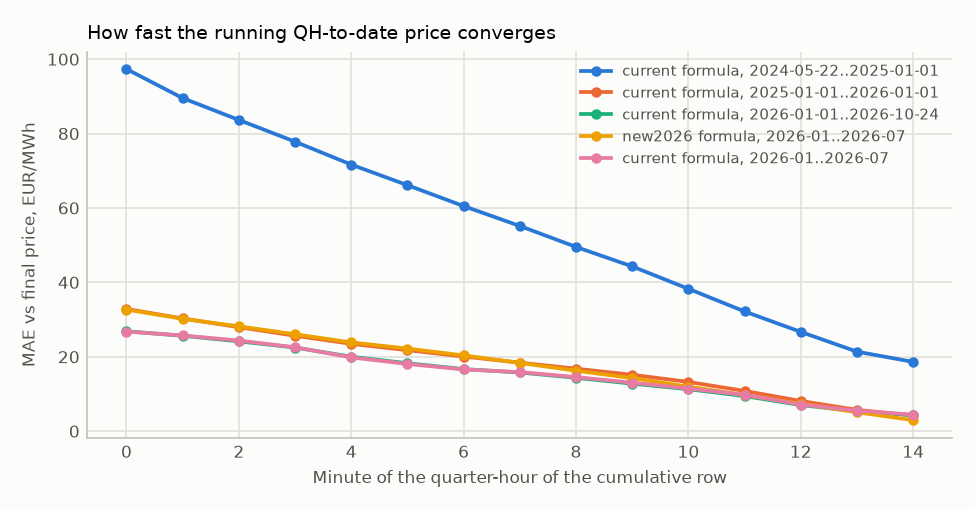
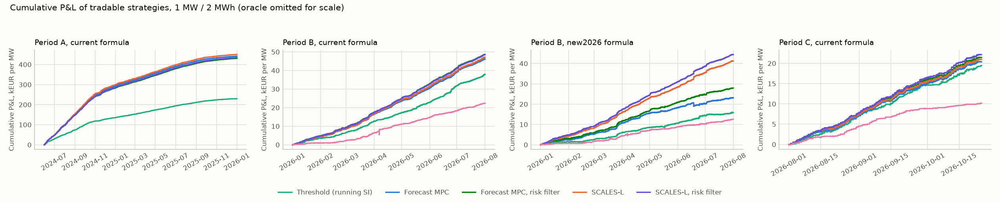
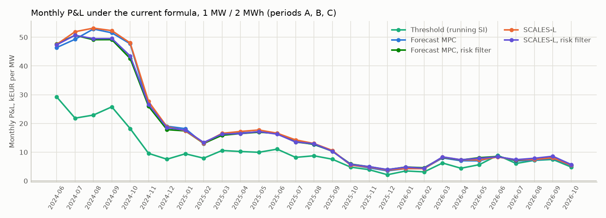
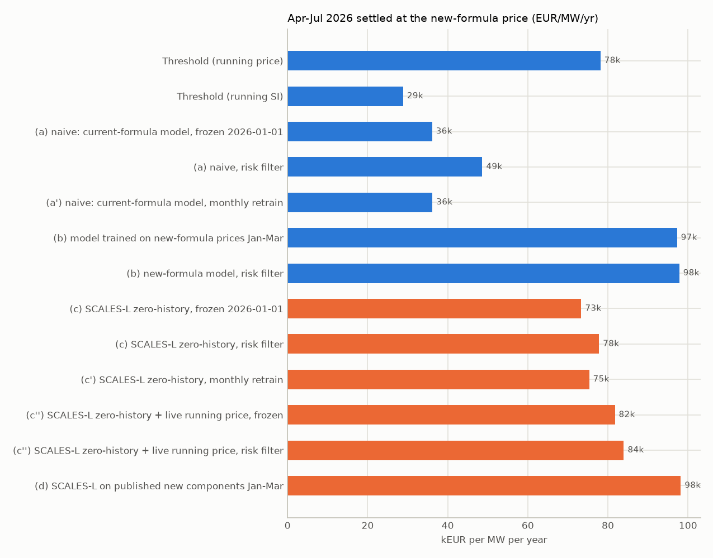
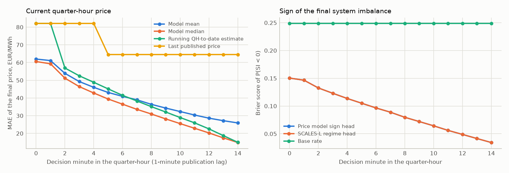
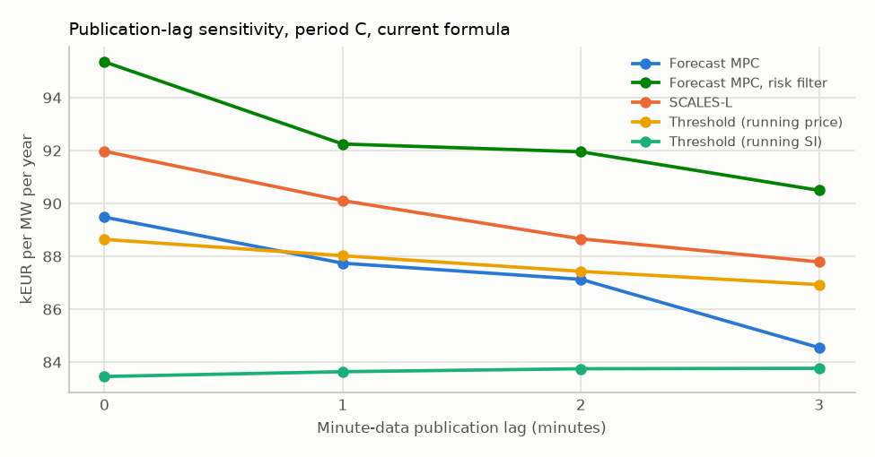

# Belgian real-time implicit balancing: forecast MPC, SCALES-L and RL on Elia data

> Generated by `scripts/research/realtime_backtest.py` from `data/public` (Elia Open Data, CC BY 4.0,
> attribution "Elia Transmission Belgium SA"; day-ahead prices from Energy-Charts, CC BY 4.0). Every number
> below is produced by that script; do not edit by hand. Simulated money, not trading advice.

## Headline

| Period | Formula | Best threshold | Forecast MPC (risk) | SCALES-L (risk) | Best tradable | Best EUR/MW/yr | Capture | Oracle EUR/MW/yr |
| --- | ---: | ---: | ---: | ---: | ---: | ---: | ---: | ---: |
| A: 2024-06-01 to 2026-01-01 | current | 195,403 | 271,693 | 274,058 | SCALES-L | 283,915 | 0.534 | 531,547 |
| B: 2026-01-01 to 2026-08-01 | current | 70,929 | 83,771 | 83,653 | Forecast MPC, risk filter | 83,771 | 0.334 | 250,999 |
| B: 2026-01-01 to 2026-08-01 | new2026 | 70,126 | 48,104 | 76,546 | SCALES-L + live running price, risk filter | 81,350 | 0.309 | 263,493 |
| C: 2026-08-01 to 2026-10-24 | current | 88,024 | 92,248 | 95,324 | SCALES-L, risk filter | 95,324 | 0.396 | 240,858 |

1 MW / 2 MWh battery, round-trip efficiency 0.95 x 0.95, SOC band 5-95 %, degradation 8 EUR per MWh
discharged, minute data usable 1 minute after the minute ends, final quarter-hour prices 5 minutes after the
quarter-hour, price taker (no own price impact). EUR/MW/yr annualises the net P&L (revenue minus degradation).

### Key findings (computed)

- Period A, current formula: best learned strategy is SCALES-L with 283,915 EUR/MW/yr (53% of the 531,547 oracle), +45 % vs the best reactive threshold (195,403).
- Period B, current formula: best learned strategy is Forecast MPC, risk filter with 83,771 EUR/MW/yr (33% of the 250,999 oracle), +18 % vs the best reactive threshold (70,929).
- Period B, new2026 formula: best learned strategy is SCALES-L + live running price, risk filter with 81,350 EUR/MW/yr (31% of the 263,493 oracle), +16 % vs the best reactive threshold (70,126).
- Period C, current formula: best learned strategy is SCALES-L, risk filter with 95,324 EUR/MW/yr (40% of the 240,858 oracle), +8 % vs the best reactive threshold (88,024).
- Same period-B days (2026-01-01 to 2026-08-01), perfect foresight: 263,493 EUR/MW/yr under the new formula vs 250,999 under the current one (+5%).
- Forecast MPC, risk filter: 48,104 (new) vs 83,771 (current) EUR/MW/yr on the same days.
- SCALES-L, risk filter: 76,546 (new) vs 83,653 (current) EUR/MW/yr on the same days.
- Threshold (running SI): 27,275 (new) vs 65,245 (current) EUR/MW/yr on the same days.
- Natural experiment, Apr-Jul 2026 at the new price (risk-filter variants, EUR/MW/yr): naive (a) 48,622, new-formula-trained (b) 97,816, SCALES-L zero-history (c) 77,781, SCALES-L zero-history + live running price (c'') 83,962.
- Publication lag: forecast MPC (risk) earns 95,353 EUR/MW/yr with 0-minute lag and 90,494 with 3-minute lag in period C (-5%).

## Data and minute-level semantics (checked, not assumed)

**ODS133 (cumulative quarter-hour-to-date) at the last minute vs the validated ODS134 quarter-hour.** The
running estimate at minute 14 is *close to* but not identical to the final price: Elia validates the
quarter-hour after real time, so even a perfect reader of the running feed faces residual uncertainty.

| Window | QHs | Price identical (+/-0.01) | Price MAE | Price p95 abs err | SI MAE (MW) | SI sign agreement |
| --- | ---: | ---: | ---: | ---: | ---: | ---: |
| 2024-05-22..2025-01-01 | 21,399 | 0.625 | 18.62 | 120.7 | 13.2 | 0.9491 |
| 2025-01-01..2026-01-01 | 35,020 | 0.441 | 4.21 | 23.5 | 9.7 | 0.9684 |
| 2026-01-01..2026-10-24 | 28,387 | 0.361 | 4.31 | 20.5 | 14.4 | 0.9539 |

**ODS126 is instantaneous, ODS133 is cumulative, and they are offset by one minute.** Differencing the ODS133 cumulative SI recovers an instantaneous series that matches ODS126 best when ODS126 is read 1 minute(s) later (MAE by offset: -1: 59.5 MW, 0: 41.2 MW, 1: 9.5 MW, 2: 41.7 MW). The loaders keep Elia's timestamps, so ODS126 rows enter the features one minute later than strictly necessary (conservative, never look-ahead).

**New-formula minute data (ODS211) are cumulative quarter-hour-to-date values as well**: at the last
minute the cumulative fields equal the ODS212 quarter-hour values, and the minute-to-minute change of
`nf_si_mw` shrinks like 1/(m+1) through the quarter-hour (the signature of a running mean), exactly like
ODS133 `si_cum_mw` and unlike the instantaneous ODS126 `si_mw`.

| ODS211 field | QHs | Last minute == ODS212 | MAE |
| --- | ---: | ---: | ---: |
| imbalance_price_eur_mwh | 20,351 | 0.947 | 2.96 |
| si_mw | 20,351 | 0.072 | 14.19 |
| main_up_eur_mwh | 20,351 | 0.993 | 0.29 |
| main_down_eur_mwh | 20,351 | 0.993 | 0.19 |
| afrr_up_mw | 20,351 | 1.000 | 0.00 |
| afrr_price_up_eur_mwh | 20,351 | 1.000 | 0.00 |
| afrr_price_down_eur_mwh | 20,351 | 1.000 | 0.00 |
| frce_mw | 20,351 | 1.000 | 0.00 |
| weight_afrr | 20,347 | 0.993 | 0.00 |

Std of the minute-to-minute change at minutes 1, 5, 10, 14 of the quarter-hour: `nf_si_mw` 35.6 / 17.9 / 9.1 / 7.6; `nf_afrr_up_mw` 20.9 / 10.0 / 5.0 / 4.2; `si_cum_mw` 35.2 / 18.3 / 9.3 / 7.6; `si_mw` 85.2 / 67.3 / 51.9 / 52.6.

ODS212 and ODS134 report almost the same final SI (MAE 1.4 MW, sign agreement 0.9964). The counterfactual reconstruction of the new price from current-design components (`reconstruct_new_formula_history`) has a quarter-hour MAE of 18.8 EUR/MWh and correlation 0.829 with ODS212 (the current price correlates 0.675). The error comes from a genuinely new input: the new formula uses *directional* aFRR prices, while current-design data only publish one aFRR price per quarter-hour (MAE 24.0 up / 27.0 down EUR/MWh). At the regime level the reconstruction is nearly unbiased:

| Final SI regime | Share of QHs | Current price mean | New price (ODS212) mean | Reconstructed mean |
| --- | ---: | ---: | ---: | ---: |
| short | 0.517 | 141.3 | 124.9 | 123.8 |
| long | 0.483 | 45.8 | 66.4 | 65.5 |

The short-minus-long price spread - what an implicit-balancing battery monetises - falls from 96 EUR/MWh under the current formula to 58 EUR/MWh under the new one on the same Jan-Jul 2026 days. The incentive component was active in 53 quarter-hours.



## Methods

**Information model.** The decision for minute t is taken at the start of the minute and may use minute rows
j <= t - lag - 1, final quarter-hour values published by t (quarter-hour end + 5 minutes) and day-ahead
prices published by t (13:00 local on D-1). With the default 1-minute lag a strategy sees no row of the current
quarter-hour at minutes 0 and 1, and at the last minute it has seen 13 of 15 minutes.

**Features** (`realtime.forecasting.features`, one row per decision minute, visible data only): running
quarter-hour-to-date SI, price, MIP/MDP/alpha and aFRR price (ODS133/ODS165); instantaneous SI, its 1/3/5-minute
trend and activated aFRR/mFRR/IGCC volumes (ODS126); a projected final SI (visible running mean extended with
the latest instantaneous value) and the mechanism applied to it; the previous quarter-hour's last visible values;
Elia's own SI forecasts and probability bins for the current and next quarter-hour (ODS136/ODS147); day-ahead
price; recent published final prices and SI; calendar. New-formula running fields (`nf_*`) form a separate
group. A perturbation test proves every feature row is unchanged when all unpublished data is replaced by noise.

**Forecasters** (scikit-learn histogram gradient boosting, fixed hyper-parameters chosen a priori: 200 trees,
learning rate 0.08, 31 leaves, min 80 samples per leaf). Heads predict the residual to the running
quarter-hour-to-date estimate (trees cannot reproduce a near-identity map on heavy-tailed prices):
quantiles 10/25/50/75/90 %, the conditional mean, and P(SI < 0), for the current and the next quarter-hour.
Walk-forward: retrained at every month start on the previous 6 months (every third minute), with an embargo
that drops training rows whose target was not yet published at the fit time; a fold never sees its test month.
Every fold's train and test window is listed in `reports/ledgers/realtime_forecaster_folds.json`.

**Forecast MPC** (`strategies/forecast_mpc.py`). A stochastic dynamic programme on a 46-point SOC grid values
energy at the start of the next quarter-hour: stage 1 uses the model's next-quarter-hour price distribution
(re-planned at minutes 0, 5, 10), stages 2-16 (4 hours) use 28-day same-time-of-day quantiles of published prices,
and a terminal value prices leftover energy at the trailing 7-day mean. Every minute it solves the remaining
energy of the current quarter-hour in closed form against that value function, with SOC limits, efficiencies and
degradation, and spreads it over the remaining minutes. The risk-filter variant discharges only on the 30 %
quantile and charges only on the 70 % quantile of the current-quarter-hour distribution (a quantile trade filter).
Grid: 46 SOC points for 2 MWh (23 for 1 MWh) plus exact full-power transitions; per-quarter-hour discount 0.995.
Structural guard: the strategy never pays to inject (no discharge while its discharge price is negative).

**SCALES-L** - the mechanism-aware, lag-aware control layer of the SCALES framework (State, Code/mechanism,
Agent impact, Lag-aware control, Equilibrium, Structured contracts); implemented in `strategies/prism.py` and
`forecasting/state.py` (called PRISM in earlier drafts; class names `PrismStrategy`/`PrismForecaster` kept).
Forecast the mechanism-invariant state, then price it
with the explicit operator: P(SI < 0) times the regime-conditional component distributions (current: MIP + alpha /
MDP - alpha; new: volume-weighted aFRR/mFRR main components), i.e. `p * D_up + (1 - p) * D_down`, traded by the
same MPC core. For the new formula without new-formula history (zero-history transfer) the components are
rebuilt from current-design state with the new operator, and only mechanism-invariant features are used.

**SCALES-L + live running price** (`forecasting/fusion.py`). After go-live Elia publishes the running new-formula
price every minute; a zero-history model cannot have learned to use it, and current-design minute data do not
allow rebuilding it (minute-level reconstruction MAE about 30 EUR/MWh). The fusion treats the live running value
as a noisy observation of the final price and combines it with SCALES-L's distribution by precision weighting; the
observation variance per visible minute is the *current* formula's running-estimate error on 2025-07..2025-12
(no new-formula data, no tuned parameter). It was added after the main run, as an extra arm.

**RL baseline** (`strategies/rl.py`): double DQN over five power levels (-1, -0.5, 0, 0.5, 1 x P) on 26 causal
market features plus SOC and the energy already delivered in the quarter-hour; reward = realised quarter-hour
price x energy - degradation; trained on 2024-06..2025-09 with a 2025-10..2025-12 validation window for
checkpoint selection, wall-clock capped; evaluated out of sample (periods B and C only).

**Simulation.** `realtime.simulate` (minute loop, quarter-hour settlement at the published single price). Each run
starts 3 days before its period (warm-up, then trimmed) so that features and SOC are not cold-started.
No hyper-parameter was tuned on any reported window. Two development looks at test-period data are disclosed:
(1) the pipeline was sanity-checked on January 2026 (period B); (2) a development smoke run exposed a failure in
the 6 April 2026 event (five quarter-hours at the -15,000 EUR/MWh floor): every re-plan paid the floor price to
make room for one more floor-price quarter-hour and never charged that room. The fix is structural, not tuned
(the no-negative-price-discharge guard and a 0.995 per-quarter-hour discount, fixed before the full run).

## Results

### Period A (2024-06-01 to 2026-01-01), current formula, 1 MW / 2 MWh

| Strategy | EUR/MW/yr | Capture vs oracle | Cycles/day | Avg sell price | Avg buy price | Daily CVaR 5 % (EUR) | Max drawdown (EUR) | Loss-day share |
| --- | ---: | ---: | ---: | ---: | ---: | ---: | ---: | ---: |
| Threshold (running price) | 195,403 | 0.368 | 1.43 | 194.3 | -19.3 | -30 | 100 | 0.043 |
| Threshold (running SI) | 144,830 | 0.272 | 0.98 | 181.0 | -46.7 | -40 | 132 | 0.047 |
| Forecast MPC | 278,320 | 0.524 | 3.75 | 147.5 | 24.0 | 17 | 58 | 0.009 |
| Forecast MPC, risk filter | 271,693 | 0.511 | 2.49 | 165.0 | -8.0 | 24 | 39 | 0.012 |
| SCALES-L | 283,915 | 0.534 | 3.68 | 148.5 | 20.8 | 22 | 50 | 0.012 |
| SCALES-L, risk filter | 274,058 | 0.516 | 2.63 | 161.7 | -4.6 | 28 | 40 | 0.012 |
| Oracle (perfect foresight) | 531,547 | 1.000 | 4.52 | 173.2 | -12.4 | 220 | 0 | 0.000 |

RL is not reported for period A: it is the RL training/validation window (in-sample).

### Period A (2024-06-01 to 2026-01-01), current formula, 1 MW / 1 MWh

| Strategy | EUR/MW/yr | Capture vs oracle | Cycles/day | Avg sell price | Avg buy price | Daily CVaR 5 % (EUR) | Max drawdown (EUR) | Loss-day share |
| --- | ---: | ---: | ---: | ---: | ---: | ---: | ---: | ---: |
| Threshold (running price) | 137,085 | 0.315 | 2.20 | 187.8 | -9.1 | -16 | 74 | 0.038 |
| Threshold (running SI) | 104,213 | 0.239 | 1.50 | 172.6 | -41.7 | -18 | 59 | 0.047 |
| Forecast MPC | 196,117 | 0.450 | 6.14 | 139.8 | 31.2 | 4 | 41 | 0.014 |
| Forecast MPC, risk filter | 192,027 | 0.441 | 3.83 | 157.7 | -2.7 | 12 | 23 | 0.016 |
| SCALES-L | 200,442 | 0.460 | 5.94 | 141.9 | 28.2 | 9 | 34 | 0.017 |
| SCALES-L, risk filter | 194,389 | 0.446 | 4.04 | 155.4 | 0.9 | 15 | 25 | 0.012 |
| Oracle (perfect foresight) | 435,737 | 1.000 | 7.68 | 167.8 | -11.7 | 175 | 0 | 0.000 |

### Period B (2026-01-01 to 2026-08-01), current formula, 1 MW / 2 MWh

| Strategy | EUR/MW/yr | Capture vs oracle | Cycles/day | Avg sell price | Avg buy price | Daily CVaR 5 % (EUR) | Max drawdown (EUR) | Loss-day share |
| --- | ---: | ---: | ---: | ---: | ---: | ---: | ---: | ---: |
| Threshold (running price) | 70,929 | 0.283 | 1.03 | 162.7 | 45.1 | -47 | 131 | 0.066 |
| Threshold (running SI) | 65,245 | 0.260 | 1.15 | 155.4 | 55.4 | -109 | 192 | 0.117 |
| Forecast MPC | 79,496 | 0.317 | 2.36 | 132.1 | 65.9 | -13 | 89 | 0.028 |
| Forecast MPC, risk filter | 83,771 | 0.334 | 1.57 | 150.7 | 55.6 | -7 | 79 | 0.023 |
| SCALES-L | 81,191 | 0.323 | 2.37 | 133.4 | 66.2 | -17 | 87 | 0.038 |
| SCALES-L, risk filter | 83,653 | 0.333 | 1.68 | 147.5 | 57.5 | -9 | 74 | 0.023 |
| RL (DQN) | 38,482 | 0.153 | 1.56 | 90.6 | 40.7 | -38 | 65 | 0.136 |
| Oracle (perfect foresight) | 250,999 | 1.000 | 3.56 | 154.4 | 35.4 | 74 | 23 | 0.005 |

### Period B (2026-01-01 to 2026-08-01), current formula, 1 MW / 1 MWh

| Strategy | EUR/MW/yr | Capture vs oracle | Cycles/day | Avg sell price | Avg buy price | Daily CVaR 5 % (EUR) | Max drawdown (EUR) | Loss-day share |
| --- | ---: | ---: | ---: | ---: | ---: | ---: | ---: | ---: |
| Threshold (running price) | 40,048 | 0.212 | 1.43 | 154.3 | 55.1 | -25 | 60 | 0.061 |
| Threshold (running SI) | 39,483 | 0.209 | 1.69 | 146.8 | 61.2 | -58 | 86 | 0.141 |
| Forecast MPC | 43,509 | 0.231 | 3.53 | 127.8 | 74.4 | -22 | 61 | 0.052 |
| Forecast MPC, risk filter | 48,392 | 0.256 | 2.18 | 148.8 | 66.3 | -7 | 55 | 0.023 |
| SCALES-L | 45,840 | 0.243 | 3.58 | 129.2 | 74.3 | -14 | 43 | 0.038 |
| SCALES-L, risk filter | 49,072 | 0.260 | 2.39 | 145.4 | 67.7 | -6 | 45 | 0.028 |
| Oracle (perfect foresight) | 188,738 | 1.000 | 5.85 | 149.8 | 39.5 | 72 | 0 | 0.000 |

### Period B (2026-01-01 to 2026-08-01), new2026 formula, 1 MW / 2 MWh

| Strategy | EUR/MW/yr | Capture vs oracle | Cycles/day | Avg sell price | Avg buy price | Daily CVaR 5 % (EUR) | Max drawdown (EUR) | Loss-day share |
| --- | ---: | ---: | ---: | ---: | ---: | ---: | ---: | ---: |
| Threshold (running price) | 70,126 | 0.266 | 1.10 | 154.4 | 44.7 | -22 | 95 | 0.038 |
| Threshold (running SI) | 27,275 | 0.104 | 1.15 | 130.5 | 78.3 | -182 | 437 | 0.300 |
| Forecast MPC | 39,840 | 0.151 | 2.36 | 120.8 | 78.8 | -246 | 1,476 | 0.197 |
| Forecast MPC, risk filter | 48,104 | 0.183 | 1.57 | 133.7 | 71.5 | -110 | 194 | 0.150 |
| SCALES-L | 71,063 | 0.270 | 2.75 | 123.7 | 69.0 | -66 | 305 | 0.056 |
| SCALES-L, risk filter | 76,546 | 0.291 | 1.84 | 138.7 | 60.9 | -38 | 222 | 0.042 |
| SCALES-L + live running price | 80,474 | 0.305 | 2.76 | 126.9 | 67.4 | -24 | 121 | 0.028 |
| SCALES-L + live running price, risk filter | 81,350 | 0.309 | 1.92 | 138.7 | 59.8 | -12 | 94 | 0.028 |
| RL (DQN) | 21,590 | 0.082 | 1.56 | 91.8 | 56.7 | -103 | 291 | 0.282 |
| Oracle (perfect foresight) | 263,493 | 1.000 | 4.30 | 150.9 | 44.9 | 201 | 0 | 0.000 |

Under the new formula the forecast MPC uses the current-formula price model unchanged (naive
transfer); SCALES-L uses the zero-history new-formula operator (no new-formula price ever used).

### Period B (2026-01-01 to 2026-08-01), new2026 formula, 1 MW / 1 MWh

| Strategy | EUR/MW/yr | Capture vs oracle | Cycles/day | Avg sell price | Avg buy price | Daily CVaR 5 % (EUR) | Max drawdown (EUR) | Loss-day share |
| --- | ---: | ---: | ---: | ---: | ---: | ---: | ---: | ---: |
| Threshold (running price) | 46,370 | 0.213 | 1.63 | 150.7 | 51.0 | -9 | 58 | 0.023 |
| Threshold (running SI) | 14,771 | 0.068 | 1.69 | 124.7 | 81.5 | -122 | 287 | 0.352 |
| Forecast MPC | 20,079 | 0.092 | 3.53 | 119.0 | 84.6 | -166 | 1,076 | 0.263 |
| Forecast MPC, risk filter | 28,931 | 0.133 | 2.18 | 136.2 | 79.4 | -66 | 141 | 0.197 |
| SCALES-L | 43,949 | 0.202 | 4.37 | 120.8 | 74.2 | -54 | 244 | 0.066 |
| SCALES-L, risk filter | 47,430 | 0.218 | 2.76 | 134.7 | 67.3 | -30 | 162 | 0.047 |
| SCALES-L + live running price | 51,963 | 0.238 | 4.39 | 124.0 | 72.2 | -19 | 61 | 0.038 |
| SCALES-L + live running price, risk filter | 51,682 | 0.237 | 2.90 | 134.8 | 65.6 | -11 | 35 | 0.038 |
| Oracle (perfect foresight) | 218,007 | 1.000 | 7.70 | 146.4 | 47.2 | 168 | 0 | 0.000 |

Under the new formula the forecast MPC uses the current-formula price model unchanged (naive
transfer); SCALES-L uses the zero-history new-formula operator (no new-formula price ever used).

### Period C (2026-08-01 to 2026-10-24), current formula, 1 MW / 2 MWh

| Strategy | EUR/MW/yr | Capture vs oracle | Cycles/day | Avg sell price | Avg buy price | Daily CVaR 5 % (EUR) | Max drawdown (EUR) | Loss-day share |
| --- | ---: | ---: | ---: | ---: | ---: | ---: | ---: | ---: |
| Threshold (running price) | 88,024 | 0.365 | 0.89 | 235.2 | 69.0 | -63 | 136 | 0.118 |
| Threshold (running SI) | 83,638 | 0.347 | 1.19 | 205.9 | 81.3 | -114 | 170 | 0.106 |
| Forecast MPC | 87,742 | 0.364 | 2.14 | 189.2 | 106.7 | -72 | 142 | 0.082 |
| Forecast MPC, risk filter | 92,248 | 0.383 | 1.48 | 202.4 | 88.9 | -58 | 149 | 0.071 |
| SCALES-L | 90,108 | 0.374 | 2.14 | 191.8 | 107.6 | -77 | 175 | 0.082 |
| SCALES-L, risk filter | 95,324 | 0.396 | 1.59 | 204.2 | 93.9 | -52 | 124 | 0.047 |
| RL (DQN) | 43,772 | 0.182 | 0.99 | 113.6 | 34.2 | -19 | 52 | 0.141 |
| Oracle (perfect foresight) | 240,858 | 1.000 | 3.33 | 216.2 | 88.5 | 211 | 0 | 0.000 |

### Period C (2026-08-01 to 2026-10-24), current formula, 1 MW / 1 MWh

| Strategy | EUR/MW/yr | Capture vs oracle | Cycles/day | Avg sell price | Avg buy price | Daily CVaR 5 % (EUR) | Max drawdown (EUR) | Loss-day share |
| --- | ---: | ---: | ---: | ---: | ---: | ---: | ---: | ---: |
| Threshold (running price) | 46,257 | 0.265 | 1.13 | 229.4 | 86.6 | -26 | 76 | 0.118 |
| Threshold (running SI) | 48,363 | 0.277 | 1.68 | 197.9 | 91.9 | -80 | 136 | 0.094 |
| Forecast MPC | 42,995 | 0.246 | 3.18 | 181.5 | 119.0 | -67 | 104 | 0.129 |
| Forecast MPC, risk filter | 49,002 | 0.280 | 2.03 | 195.8 | 102.7 | -50 | 83 | 0.082 |
| SCALES-L | 45,624 | 0.261 | 3.23 | 185.7 | 121.1 | -62 | 118 | 0.118 |
| SCALES-L, risk filter | 50,948 | 0.291 | 2.24 | 198.5 | 108.9 | -43 | 69 | 0.071 |
| Oracle (perfect foresight) | 174,838 | 1.000 | 5.32 | 210.3 | 92.1 | 131 | 0 | 0.000 |



### Monthly breakdown (current formula, 1 MW / 2 MWh, EUR per MW per month)



| Month | Threshold (running SI) | Forecast MPC | Forecast MPC, risk filter | SCALES-L | SCALES-L, risk filter | Oracle (perfect foresight) | MPC-risk capture |
| --- | ---: | ---: | ---: | ---: | ---: | ---: | ---: |
| 2024-06 | 29,236 | 46,417 | 47,678 | 47,513 | 47,378 | 79,972 | 0.596 |
| 2024-07 | 21,843 | 49,296 | 50,677 | 51,927 | 50,693 | 82,970 | 0.611 |
| 2024-08 | 22,917 | 52,880 | 49,143 | 53,179 | 49,513 | 89,756 | 0.548 |
| 2024-09 | 25,778 | 51,544 | 49,163 | 52,310 | 49,553 | 89,229 | 0.551 |
| 2024-10 | 18,195 | 47,727 | 42,607 | 48,014 | 43,483 | 78,349 | 0.544 |
| 2024-11 | 9,584 | 26,202 | 25,954 | 27,634 | 26,607 | 48,838 | 0.531 |
| 2024-12 | 7,542 | 19,033 | 17,852 | 18,853 | 18,517 | 38,627 | 0.462 |
| 2025-01 | 9,442 | 18,188 | 17,396 | 17,442 | 17,649 | 40,045 | 0.434 |
| 2025-02 | 7,900 | 12,946 | 13,061 | 13,146 | 13,379 | 27,717 | 0.471 |
| 2025-03 | 10,582 | 16,130 | 15,885 | 16,555 | 16,308 | 36,325 | 0.437 |
| 2025-04 | 10,236 | 16,729 | 16,458 | 17,204 | 16,469 | 34,685 | 0.475 |
| 2025-05 | 9,954 | 16,997 | 16,958 | 17,727 | 17,166 | 35,113 | 0.483 |
| 2025-06 | 11,051 | 16,568 | 16,503 | 16,599 | 16,266 | 38,853 | 0.425 |
| 2025-07 | 8,188 | 13,868 | 13,527 | 14,274 | 13,557 | 29,110 | 0.465 |
| 2025-08 | 8,743 | 12,648 | 12,793 | 13,013 | 12,942 | 26,167 | 0.489 |
| 2025-09 | 7,549 | 10,416 | 10,319 | 10,613 | 10,302 | 23,588 | 0.437 |
| 2025-10 | 4,792 | 5,556 | 5,855 | 5,484 | 5,739 | 16,374 | 0.358 |
| 2025-11 | 3,905 | 4,555 | 4,936 | 4,816 | 4,971 | 15,867 | 0.311 |
| 2025-12 | 2,148 | 3,495 | 3,917 | 3,761 | 3,940 | 11,001 | 0.356 |
| 2026-01 | 3,461 | 4,275 | 4,824 | 4,330 | 4,787 | 15,738 | 0.307 |
| 2026-02 | 3,137 | 4,338 | 4,574 | 4,254 | 4,419 | 13,132 | 0.348 |
| 2026-03 | 6,230 | 7,994 | 8,189 | 8,271 | 8,358 | 21,135 | 0.387 |
| 2026-04 | 4,403 | 7,016 | 7,296 | 7,351 | 7,361 | 36,475 | 0.200 |
| 2026-05 | 5,651 | 6,979 | 8,081 | 7,287 | 7,864 | 18,521 | 0.436 |
| 2026-06 | 8,918 | 8,598 | 8,512 | 8,306 | 8,383 | 24,223 | 0.351 |
| 2026-07 | 6,067 | 6,945 | 7,156 | 7,328 | 7,393 | 16,360 | 0.437 |
| 2026-08 | 7,152 | 7,252 | 7,658 | 7,466 | 7,877 | 20,730 | 0.369 |
| 2026-09 | 7,465 | 7,827 | 8,324 | 8,037 | 8,586 | 19,704 | 0.422 |
| 2026-10 | 4,831 | 5,319 | 5,465 | 5,446 | 5,699 | 15,695 | 0.348 |

## Natural experiment: the new formula without new-formula history

Elia published the new-formula price (ODS212) for the same Jan-Jul 2026 days that were settled under the current
formula. Every arm below is settled at the **new-formula** price. Arms (a) and (c) never see a new-formula price
in training; (b) and (d) are trained on Jan-Mar 2026 new-formula data, so the common test window is Apr-Jul 2026.

### Apr-Jul 2026, new formula, 1 MW / 2 MWh

| Arm | EUR/MW/yr | Capture | Cycles/day | Daily CVaR 5 % | Price MAE (mean) | Pinball | Brier P(SI<0) |
| --- | ---: | ---: | ---: | ---: | ---: | ---: | ---: |
| Threshold (running price) | 78,127 | 0.286 | 1.07 | -3 | n/a | n/a | n/a |
| Threshold (running SI) | 28,856 | 0.106 | 1.25 | -191 | n/a | n/a | n/a |
| (a) naive: current-formula model, frozen 2026-01-01 | 36,099 | 0.132 | 2.65 | -331 | 43.1 | 18.04 | 0.083 |
| (a) naive, risk filter | 48,622 | 0.178 | 1.70 | -121 | 43.1 | 18.04 | 0.083 |
| (a') naive: current-formula model, monthly retrain | 36,191 | 0.133 | 2.33 | -338 | 42.5 | 18.08 | 0.081 |
| (b) model trained on new-formula prices Jan-Mar | 97,253 | 0.356 | 2.98 | 33 | 24.3 | 8.33 | 0.087 |
| (b) new-formula model, risk filter | 97,816 | 0.358 | 1.88 | 42 | 24.3 | 8.33 | 0.087 |
| (c) SCALES-L zero-history, frozen 2026-01-01 | 73,344 | 0.269 | 2.86 | -11 | 29.4 | 11.58 | 0.082 |
| (c) SCALES-L zero-history, risk filter | 77,781 | 0.285 | 1.85 | 12 | 29.4 | 11.58 | 0.082 |
| (c') SCALES-L zero-history, monthly retrain | 75,320 | 0.276 | 2.72 | -17 | 29.5 | 11.63 | 0.081 |
| (c'') SCALES-L zero-history + live running price, frozen | 81,735 | 0.299 | 2.86 | -0 | 26.6 | 10.75 | 0.082 |
| (c'') SCALES-L zero-history + live running price, risk filter | 83,962 | 0.307 | 1.90 | 21 | 26.6 | 10.75 | 0.082 |
| (d) SCALES-L on published new components Jan-Mar | 98,189 | 0.359 | 3.10 | 33 | 23.9 | 8.17 | 0.087 |
| Oracle (perfect foresight) | 273,133 | 1.000 | 4.31 | 266 | n/a | n/a | n/a |

Forecast skill columns score the current-quarter-hour forecast of the *new-formula* price over all minutes
of the window; the naive arm is scored on the new price although it was trained on current prices.



Same window settled at the **current** formula (in-domain reference for the transfer gap):

| Strategy | EUR/MW/yr | Capture vs oracle | Cycles/day | Avg sell price | Avg buy price | Daily CVaR 5 % (EUR) | Max drawdown (EUR) | Loss-day share |
| --- | ---: | ---: | ---: | ---: | ---: | ---: | ---: | ---: |
| Threshold (running SI) | 74,974 | 0.261 | 1.25 | 159.6 | 54.6 | -84 | 192 | 0.089 |
| (a) naive: current-formula model, frozen 2026-01-01 | 85,436 | 0.298 | 2.65 | 130.3 | 66.1 | -31 | 73 | 0.049 |
| Forecast MPC | 87,460 | 0.305 | 2.33 | 129.9 | 58.6 | -0 | 49 | 0.016 |
| SCALES-L | 89,779 | 0.313 | 2.33 | 131.9 | 58.9 | 6 | 31 | 0.016 |
| Oracle (perfect foresight) | 286,933 | 1.000 | 3.58 | 153.8 | 21.6 | 157 | 0 | 0.000 |

### Jan-Jul 2026 (full overlap), new formula, frozen pre-2026 models

| Strategy | EUR/MW/yr | Capture vs oracle | Cycles/day | Avg sell price | Avg buy price | Daily CVaR 5 % (EUR) | Max drawdown (EUR) | Loss-day share |
| --- | ---: | ---: | ---: | ---: | ---: | ---: | ---: | ---: |
| Threshold (running SI) | 27,275 | 0.104 | 1.15 | 130.5 | 78.3 | -182 | 437 | 0.300 |
| (a) naive: current-formula model, frozen 2026-01-01 | 39,404 | 0.150 | 2.60 | 120.5 | 80.7 | -248 | 1,410 | 0.216 |
| (a) naive, risk filter | 48,778 | 0.185 | 1.66 | 133.6 | 73.2 | -104 | 197 | 0.150 |
| (c) SCALES-L zero-history, frozen 2026-01-01 | 70,632 | 0.268 | 2.84 | 123.9 | 70.5 | -48 | 142 | 0.052 |
| (c) SCALES-L zero-history, risk filter | 74,824 | 0.284 | 1.88 | 136.2 | 61.0 | -28 | 162 | 0.023 |
| (c') SCALES-L zero-history, monthly retrain | 71,063 | 0.270 | 2.75 | 123.7 | 69.0 | -66 | 305 | 0.056 |
| (c'') SCALES-L zero-history + live running price, frozen | 78,960 | 0.300 | 2.85 | 126.4 | 68.8 | -28 | 121 | 0.038 |
| (c'') SCALES-L zero-history + live running price, risk filter | 80,863 | 0.307 | 1.92 | 138.7 | 60.3 | -11 | 94 | 0.028 |
| Oracle (perfect foresight) | 263,493 | 1.000 | 4.30 | 150.9 | 44.9 | 201 | 0 | 0.000 |

## Forecast skill (walk-forward, out of sample)

**price_current**, period A, scored on the current-formula price, current quarter-hour:

| Minute in QH | MAE mean | MAE median | MAE running est. | MAE last final | Pinball (avg 5 q) | CRPS | 80 % coverage | Brier P(SI<0) | Brier base rate |
| --- | ---: | ---: | ---: | ---: | ---: | ---: | ---: | ---: | ---: |
| 0 | 62.0 | 60.6 | 82.1 | 82.1 | 21.89 | 45.40 | 0.813 | 0.150 | 0.249 |
| 2 | 53.9 | 51.2 | 56.9 | 82.1 | 19.08 | 39.44 | 0.748 | 0.133 | 0.249 |
| 5 | 43.1 | 39.4 | 45.1 | 64.5 | 14.57 | 30.14 | 0.763 | 0.105 | 0.249 |
| 8 | 36.4 | 30.9 | 35.1 | 64.5 | 11.54 | 23.84 | 0.763 | 0.080 | 0.249 |
| 11 | 30.4 | 22.9 | 25.9 | 64.5 | 8.62 | 17.76 | 0.789 | 0.056 | 0.249 |
| 14 | 25.9 | 14.8 | 15.0 | 64.5 | 5.76 | 11.83 | 0.876 | 0.034 | 0.249 |
| all | 40.7 | 35.3 | 41.7 | 70.4 | 13.07 | 27.02 | 0.799 | 0.090 | 0.249 |

Next quarter-hour: MAE (mean) 70.2 vs last published 84.6 EUR/MWh, Brier 0.174 vs base rate 0.249.

**prism_current**, period A, scored on the current-formula price, current quarter-hour:

| Minute in QH | MAE mean | MAE median | MAE running est. | MAE last final | Pinball (avg 5 q) | CRPS | 80 % coverage | Brier P(SI<0) | Brier base rate |
| --- | ---: | ---: | ---: | ---: | ---: | ---: | ---: | ---: | ---: |
| 0 | 61.0 | 58.6 | 82.1 | 82.1 | 21.62 | 43.64 | 0.799 | 0.150 | 0.249 |
| 2 | 51.3 | 48.2 | 56.9 | 82.1 | 18.13 | 36.78 | 0.746 | 0.133 | 0.249 |
| 5 | 41.7 | 37.8 | 45.1 | 64.5 | 14.20 | 28.72 | 0.747 | 0.105 | 0.249 |
| 8 | 34.8 | 29.8 | 35.1 | 64.5 | 11.23 | 22.71 | 0.754 | 0.080 | 0.249 |
| 11 | 28.7 | 22.4 | 25.9 | 64.5 | 8.38 | 17.03 | 0.785 | 0.056 | 0.249 |
| 14 | 23.9 | 14.7 | 15.0 | 64.5 | 5.71 | 11.58 | 0.871 | 0.034 | 0.249 |
| all | 39.1 | 34.0 | 41.7 | 70.4 | 12.72 | 25.75 | 0.789 | 0.090 | 0.249 |

Next quarter-hour: MAE (mean) 68.6 vs last published 84.6 EUR/MWh, Brier 0.174 vs base rate 0.249.

**price_current**, period B, scored on the current-formula price, current quarter-hour:

| Minute in QH | MAE mean | MAE median | MAE running est. | MAE last final | Pinball (avg 5 q) | CRPS | 80 % coverage | Brier P(SI<0) | Brier base rate |
| --- | ---: | ---: | ---: | ---: | ---: | ---: | ---: | ---: | ---: |
| 0 | 26.6 | 26.7 | 37.2 | 37.2 | 9.97 | 20.57 | 0.801 | 0.134 | 0.250 |
| 2 | 23.8 | 23.9 | 26.8 | 37.2 | 9.00 | 18.55 | 0.740 | 0.118 | 0.250 |
| 5 | 19.4 | 18.4 | 22.5 | 27.8 | 6.88 | 14.20 | 0.745 | 0.096 | 0.250 |
| 8 | 15.3 | 13.5 | 16.6 | 27.8 | 5.04 | 10.41 | 0.747 | 0.074 | 0.250 |
| 11 | 13.7 | 11.1 | 13.1 | 27.8 | 4.24 | 8.72 | 0.767 | 0.055 | 0.250 |
| 14 | 11.2 | 7.1 | 7.2 | 27.8 | 2.69 | 5.53 | 0.856 | 0.035 | 0.250 |
| all | 17.9 | 16.2 | 20.0 | 30.9 | 6.09 | 12.57 | 0.785 | 0.083 | 0.250 |

Next quarter-hour: MAE (mean) 33.2 vs last published 39.1 EUR/MWh, Brier 0.157 vs base rate 0.250.

**prism_current**, period B, scored on the current-formula price, current quarter-hour:

| Minute in QH | MAE mean | MAE median | MAE running est. | MAE last final | Pinball (avg 5 q) | CRPS | 80 % coverage | Brier P(SI<0) | Brier base rate |
| --- | ---: | ---: | ---: | ---: | ---: | ---: | ---: | ---: | ---: |
| 0 | 26.6 | 26.2 | 37.2 | 37.2 | 9.88 | 19.99 | 0.787 | 0.134 | 0.250 |
| 2 | 22.7 | 22.8 | 26.8 | 37.2 | 8.49 | 17.22 | 0.739 | 0.118 | 0.250 |
| 5 | 18.6 | 18.0 | 22.5 | 27.8 | 6.54 | 13.40 | 0.731 | 0.096 | 0.250 |
| 8 | 14.8 | 13.2 | 16.6 | 27.8 | 4.90 | 9.94 | 0.738 | 0.074 | 0.250 |
| 11 | 13.3 | 10.9 | 13.1 | 27.8 | 4.14 | 8.34 | 0.772 | 0.055 | 0.250 |
| 14 | 10.8 | 6.9 | 7.2 | 27.8 | 2.65 | 5.46 | 0.860 | 0.035 | 0.250 |
| all | 17.4 | 15.8 | 20.0 | 30.9 | 5.88 | 12.00 | 0.778 | 0.083 | 0.250 |

Next quarter-hour: MAE (mean) 32.1 vs last published 39.1 EUR/MWh, Brier 0.157 vs base rate 0.250.

**price_current**, period B, scored on the new2026-formula price, current quarter-hour:

| Minute in QH | MAE mean | MAE median | MAE running est. | MAE last final | Pinball (avg 5 q) | CRPS | 80 % coverage | Brier P(SI<0) | Brier base rate |
| --- | ---: | ---: | ---: | ---: | ---: | ---: | ---: | ---: | ---: |
| 0 | 43.2 | 43.1 | 46.4 | 46.4 | 16.99 | 34.85 | 0.575 | 0.134 | 0.250 |
| 2 | 39.9 | 41.2 | 32.7 | 46.4 | 16.73 | 34.18 | 0.518 | 0.118 | 0.250 |
| 5 | 39.2 | 39.7 | 26.1 | 39.1 | 16.59 | 33.82 | 0.459 | 0.096 | 0.250 |
| 8 | 36.7 | 36.5 | 20.4 | 39.1 | 15.64 | 31.79 | 0.411 | 0.074 | 0.250 |
| 11 | 36.6 | 36.1 | 14.3 | 39.1 | 15.87 | 32.16 | 0.366 | 0.055 | 0.250 |
| 14 | 35.2 | 34.4 | 7.4 | 39.1 | 15.07 | 30.53 | 0.372 | 0.035 | 0.250 |
| all | 38.4 | 38.4 | 23.6 | 41.6 | 16.11 | 32.82 | 0.451 | 0.083 | 0.250 |

Next quarter-hour: MAE (mean) 46.3 vs last published 47.5 EUR/MWh, Brier 0.157 vs base rate 0.250.

**prism_zero_wf**, period B, scored on the new2026-formula price, current quarter-hour:

| Minute in QH | MAE mean | MAE median | MAE running est. | MAE last final | Pinball (avg 5 q) | CRPS | 80 % coverage | Brier P(SI<0) | Brier base rate |
| --- | ---: | ---: | ---: | ---: | ---: | ---: | ---: | ---: | ---: |
| 0 | 35.8 | 35.7 | 46.4 | 46.4 | 13.72 | 27.95 | 0.676 | 0.135 | 0.250 |
| 2 | 34.4 | 34.2 | 32.7 | 46.4 | 13.54 | 27.54 | 0.571 | 0.119 | 0.250 |
| 5 | 29.7 | 29.0 | 26.1 | 39.1 | 11.68 | 23.72 | 0.554 | 0.097 | 0.250 |
| 8 | 27.0 | 26.0 | 20.4 | 39.1 | 10.73 | 21.77 | 0.500 | 0.075 | 0.250 |
| 11 | 25.4 | 23.9 | 14.3 | 39.1 | 10.30 | 20.82 | 0.433 | 0.055 | 0.250 |
| 14 | 24.2 | 22.5 | 7.4 | 39.1 | 9.64 | 19.52 | 0.474 | 0.036 | 0.250 |
| all | 29.0 | 28.1 | 23.6 | 41.6 | 11.37 | 23.10 | 0.548 | 0.084 | 0.250 |

Next quarter-hour: MAE (mean) 38.3 vs last published 47.5 EUR/MWh, Brier 0.158 vs base rate 0.250.

**price_current**, period C, scored on the current-formula price, current quarter-hour:

| Minute in QH | MAE mean | MAE median | MAE running est. | MAE last final | Pinball (avg 5 q) | CRPS | 80 % coverage | Brier P(SI<0) | Brier base rate |
| --- | ---: | ---: | ---: | ---: | ---: | ---: | ---: | ---: | ---: |
| 0 | 27.6 | 26.6 | 36.6 | 36.6 | 9.82 | 20.28 | 0.803 | 0.124 | 0.249 |
| 2 | 24.3 | 23.3 | 27.0 | 36.6 | 8.80 | 18.12 | 0.771 | 0.112 | 0.249 |
| 5 | 20.3 | 18.7 | 22.3 | 27.7 | 6.91 | 14.29 | 0.753 | 0.094 | 0.249 |
| 8 | 16.5 | 14.3 | 16.9 | 27.7 | 5.30 | 10.96 | 0.764 | 0.067 | 0.249 |
| 11 | 13.9 | 10.3 | 12.2 | 27.7 | 4.00 | 8.23 | 0.786 | 0.050 | 0.249 |
| 14 | 11.9 | 6.7 | 6.8 | 27.7 | 2.67 | 5.47 | 0.871 | 0.033 | 0.249 |
| all | 18.6 | 16.1 | 19.7 | 30.7 | 6.05 | 12.48 | 0.797 | 0.078 | 0.249 |

Next quarter-hour: MAE (mean) 36.6 vs last published 38.6 EUR/MWh, Brier 0.148 vs base rate 0.249.

**prism_current**, period C, scored on the current-formula price, current quarter-hour:

| Minute in QH | MAE mean | MAE median | MAE running est. | MAE last final | Pinball (avg 5 q) | CRPS | 80 % coverage | Brier P(SI<0) | Brier base rate |
| --- | ---: | ---: | ---: | ---: | ---: | ---: | ---: | ---: | ---: |
| 0 | 27.6 | 26.5 | 36.6 | 36.6 | 9.65 | 19.72 | 0.797 | 0.124 | 0.249 |
| 2 | 23.5 | 22.2 | 27.0 | 36.6 | 8.25 | 16.77 | 0.758 | 0.112 | 0.249 |
| 5 | 19.8 | 17.9 | 22.3 | 27.7 | 6.59 | 13.39 | 0.753 | 0.094 | 0.249 |
| 8 | 16.5 | 13.7 | 16.9 | 27.7 | 5.11 | 10.40 | 0.759 | 0.067 | 0.249 |
| 11 | 14.0 | 10.3 | 12.2 | 27.7 | 3.79 | 7.75 | 0.781 | 0.050 | 0.249 |
| 14 | 12.5 | 7.0 | 6.8 | 27.7 | 2.70 | 5.51 | 0.871 | 0.033 | 0.249 |
| all | 18.5 | 15.7 | 19.7 | 30.7 | 5.83 | 11.86 | 0.792 | 0.078 | 0.249 |

Next quarter-hour: MAE (mean) 33.1 vs last published 38.6 EUR/MWh, Brier 0.148 vs base rate 0.249.



## Sensitivity

**Publication lag** (period C, current formula, 1 MW / 2 MWh; forecasters re-trained for every lag):

| Lag (min) | Forecast MPC | Forecast MPC, risk filter | SCALES-L | Threshold (running price) | Threshold (running SI) |
| --- | ---: | ---: | ---: | ---: | ---: |
| 0 | 89,482 | 95,353 | 91,973 | 88,641 | 83,457 |
| 1 | 87,742 | 92,248 | 90,108 | 88,024 | 83,638 |
| 2 | 87,131 | 91,954 | 88,661 | 87,433 | 83,749 |
| 3 | 84,548 | 90,494 | 87,790 | 86,930 | 83,766 |

Oracle (lag-independent): 240,858 EUR/MW/yr.



**Degradation cost** (period B, current formula, 1 MW / 2 MWh; EUR/MW/yr, cycles/day in brackets). The
strategies see the cost in their objective, so they trade less as it rises:

| Strategy | 0 EUR/MWh | 4 EUR/MWh | 8 EUR/MWh | 16 EUR/MWh |
| --- | ---: | ---: | ---: | ---: |
| Forecast MPC | 89,906 (3.06) | 84,269 (2.67) | 79,496 (2.36) | 71,567 (1.90) |
| Forecast MPC, risk filter | 92,975 (1.95) | 88,151 (1.74) | 83,771 (1.57) | 76,530 (1.31) |
| Oracle (perfect foresight) | 271,101 (4.23) | 260,735 (3.88) | 250,999 (3.56) | 233,682 (3.03) |
| SCALES-L | 92,579 (3.06) | 86,356 (2.68) | 81,191 (2.37) | 72,973 (1.91) |
| Threshold (running SI) | 71,293 (1.15) | 68,269 (1.15) | 65,245 (1.15) | 59,197 (1.15) |

## Look-ahead audit on real data

`check_no_lookahead` replaces every value not yet published at a cut minute (minute rows, quarter-hour
values, settlement prices, unpublished day-ahead prices) with noise and re-runs the strategy; any change of
a decision before the earliest legitimate use of that data proves look-ahead. Forecast strategies are also
audited white-box: their precomputed plan (risk prices, value-function slopes) must be identical before
the cut. Cuts per slice: 37, 1503, 2999 (minutes from
the slice start).

The oracle is the positive control: it reads unpublished final prices and fails 14 of 15 audits (a failure needs the perturbed future to change an earlier decision).

| Strategy | Formula | Real-data slices | Audits | Passed | White-box passed |
| --- | ---: | ---: | ---: | ---: | ---: |
| Threshold (running price) | current | 2025-06-10, 2026-03-02, 2026-09-10 | 9 | 9 | n/a |
| Threshold (running SI) | current | 2025-06-10, 2026-03-02, 2026-09-10 | 9 | 9 | n/a |
| Forecast MPC | current | 2025-06-10, 2026-03-02, 2026-09-10 | 9 | 9 | 9/9 |
| Forecast MPC, risk filter | current | 2025-06-10, 2026-03-02, 2026-09-10 | 9 | 9 | 9/9 |
| SCALES-L | current | 2025-06-10, 2026-03-02, 2026-09-10 | 9 | 9 | 9/9 |
| SCALES-L, risk filter | current | 2025-06-10, 2026-03-02, 2026-09-10 | 9 | 9 | 9/9 |
| Oracle (perfect foresight) | current | 2025-06-10, 2026-03-02, 2026-09-10 | 9 | 1 | n/a |
| RL (DQN) | current | 2026-03-02, 2026-09-10 | 6 | 6 | n/a |
| Threshold (running price) | new2026 | 2026-03-02, 2026-05-04 | 6 | 6 | n/a |
| Threshold (running SI) | new2026 | 2026-03-02, 2026-05-04 | 6 | 6 | n/a |
| Forecast MPC | new2026 | 2026-03-02, 2026-05-04 | 6 | 6 | 6/6 |
| Forecast MPC, risk filter | new2026 | 2026-03-02, 2026-05-04 | 6 | 6 | 6/6 |
| SCALES-L | new2026 | 2026-03-02, 2026-05-04 | 6 | 6 | 6/6 |
| SCALES-L, risk filter | new2026 | 2026-03-02, 2026-05-04 | 6 | 6 | 6/6 |
| Oracle (perfect foresight) | new2026 | 2026-03-02, 2026-05-04 | 6 | 0 | n/a |
| RL (DQN) | new2026 | 2026-03-02, 2026-05-04 | 6 | 6 | n/a |
| (a) naive: current-formula model, frozen 2026-01-01 | new2026 | 2026-03-02, 2026-05-04 | 6 | 6 | 6/6 |
| (c) SCALES-L zero-history, frozen 2026-01-01 | new2026 | 2026-03-02, 2026-05-04 | 6 | 6 | 6/6 |
| (c') SCALES-L zero-history, monthly retrain | new2026 | 2026-03-02, 2026-05-04 | 6 | 6 | 6/6 |
| (c'') SCALES-L zero-history + live running price, frozen | new2026 | 2026-03-02, 2026-05-04 | 6 | 6 | 6/6 |
| SCALES-L + live running price | new2026 | 2026-03-02, 2026-05-04 | 6 | 6 | 6/6 |
| (b) model trained on new-formula prices Jan-Mar | new2026 | 2026-05-04 | 3 | 3 | 3/3 |
| (d) SCALES-L on published new components Jan-Mar | new2026 | 2026-05-04 | 3 | 3 | 3/3 |

## RL training details

- Device: `mps`; wall-clock 25.0 min (cap 25.0 min); 196,792 gradient updates on 50,398,720 environment transitions (256 parallel days).
- Network [128, 128], gamma 0.997, lr 0.0005, batch 1024, replay 1,000,000, target sync every 2000 updates, epsilon 1.0 -> 0.05 over 100,000 updates.
- Train ['2024-06-01T00:00:00Z', '2025-10-01T00:00:00Z'], validation ['2025-10-01T00:00:00Z', '2026-01-01T00:00:00Z']; best validation daily P&L 112.3 EUR (checkpoint kept).
- Validation curve (updates: EUR/day): 10,000: 103, 30,000: 96, 50,000: 92, 70,000: 105, 90,000: 106, 110,000: 72, 130,000: 104, 150,000: 101, 170,000: 78, 190,000: 112.

## Live deployment (paper trading)

The same strategy objects run in the live paper-trading loop (`realtime.live`, `euroflex live run`):

- `refresh(ctx)` re-plans before every live decision on the window that fills in place: the forecast MPC and
  SCALES-L recompute only the forecasts and value-to-go of the current quarter-hour from the data visible now;
  the RL policy rebuilds its observations but keeps the energy already delivered in the quarter-hour.
  `tests/test_rt_strategy_live_refresh.py` replays a window minute by minute and checks that every live
  decision equals the backtest decision.
- `LIVE_STRATEGIES` factories: `forecast-mpc` (current-formula model), `prism` / `scales-l` (current operator
  before the switch, zero-history new operator fused with the live running new price after it; `auto` follows
  the live settlement rule), `rl-dqn` (numpy policy, committed as `reports/ledgers/realtime_rl_policy.npz`).
- Deployment fold (`--stages deploy`): trained 2026-04-24T22:00 to 2026-10-24T22:00, valid for decisions from 2026-10-24T22:00 to 2027-11-28; models are written to `$EUROFLEX_MODELS_DIR` (default `~/.cache/euroflex_bess_lab/realtime_backtest/models`).

## Limitations

- **Price taker.** A single 1 MW battery does not move the Belgian imbalance price; a fleet does. Own-impact,
  herding and saturation are handled in `reports/impact*.md` (separate agent); numbers here are per-MW values
  of an infinitesimal participant.
- **Real-time data quality.** Decisions use the non-validated real-time feeds; settlement uses validated
  quarter-hour prices. The gap (table above) is real risk and is included in every result.
- **Counterfactual new-formula prices** (reconstruction, zero-history training targets) ignore how BRPs would
  have behaved under the new price, and the incentive component is not reconstructed. Elia's ODS212 is itself a
  simulation of the new design on historical days (participants were reacting to the current formula).
- **Execution.** Minute-level power changes are assumed feasible and fully delivered; no nomination/aFRR
  interaction, no availability outages, no intraday market, no imbalance from other portfolio assets.
- **RL** is a single, wall-clock-capped run with one seed; results are indicative of the approach, not its limit.
- **Development looks** at January 2026 and at the 6 April 2026 floor event (see Methods); no parameter was
  optimised on a reported window.

## References

- Elia Open Data, imbalance prices per minute (ODS133) and per quarter-hour (ODS134), system imbalance per
  minute (ODS126), SI forecasts (ODS136/ODS147): https://opendata.elia.be/explore/dataset/ods133/ (and
  `/ods134/`, `/ods126/`, `/ods136/`, `/ods147/`).
- Elia simulation of the new imbalance price formula (to be removed on 17 Nov 2026, go-live planned 24 Nov
  2026): https://opendata.elia.be/explore/dataset/ods211/ (minute) and https://opendata.elia.be/explore/dataset/ods212/
  (quarter-hour).
- RL literature on Belgian imbalance arbitrage that the DQN baseline follows in spirit: S. S. Karimi Madahi,
  B. Claessens, C. Develder, Distributional reinforcement learning-based energy arbitrage strategies in imbalance
  settlement mechanism, https://arxiv.org/abs/2401.00015 (no result of that paper is reproduced or compared here).
- Mechanism-level natural experiment (oracle values under both formulas): `reports/mechanism_natural_experiment.md`.

## Reproduce

```bash
python scripts/research/realtime_backtest.py            # all stages (about 1-2 h on 11 cores)
python scripts/research/realtime_backtest.py --stages report   # rebuild this report from cached runs
```

Outputs: this report, `reports/figures/realtime_*.png`, quarter-hour ledgers
`reports/ledgers/realtime_<strategy>_<mechanism>_<period>.parquet` (+ JSON sidecars; `_1mwh` for the 1 MWh
battery), the look-ahead audit `reports/ledgers/realtime_lookahead_audit.json` and the data checks
`reports/ledgers/realtime_data_semantics.json`.
Forecaster training in this run: 87 fold fits, 115 CPU-process minutes.
Ledgers written: 49.
