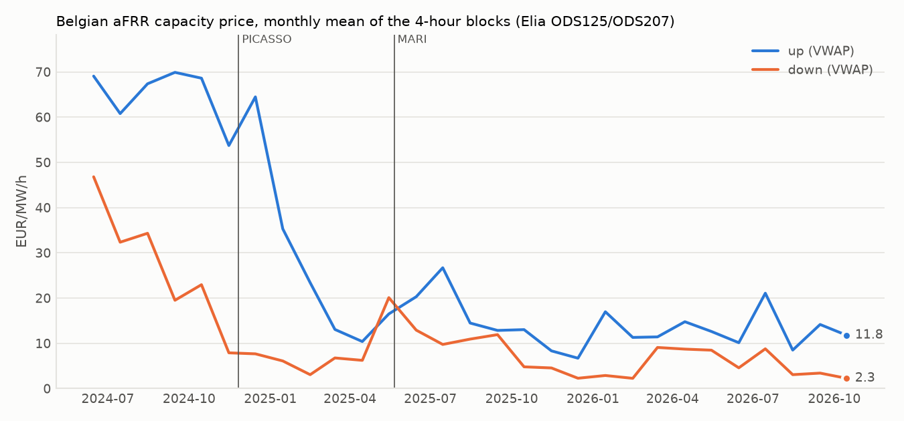
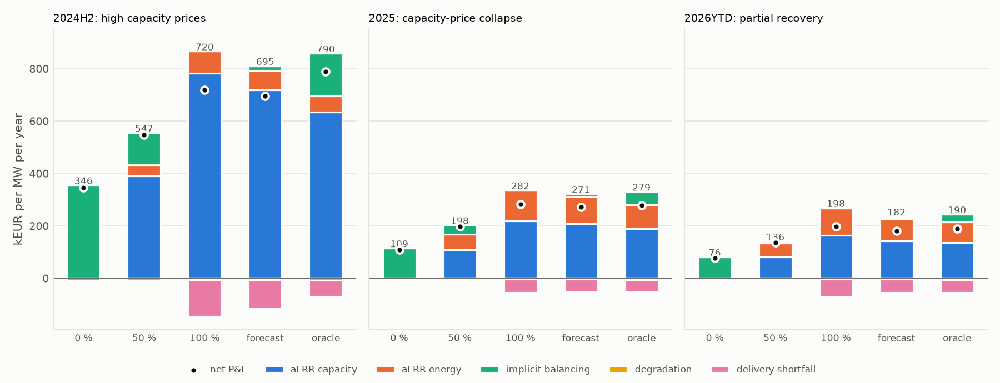
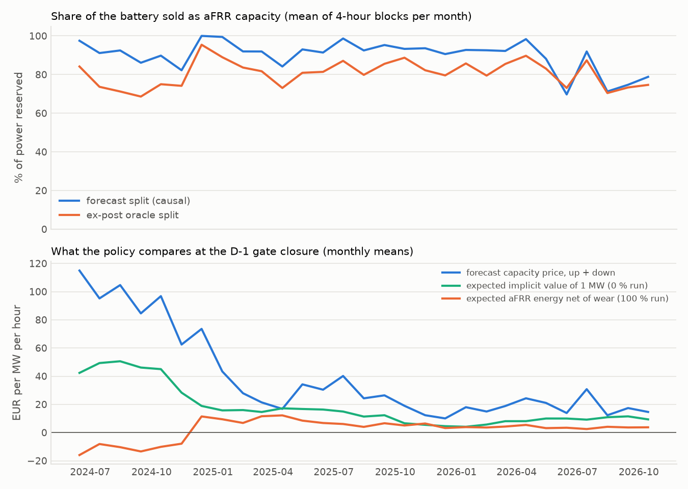
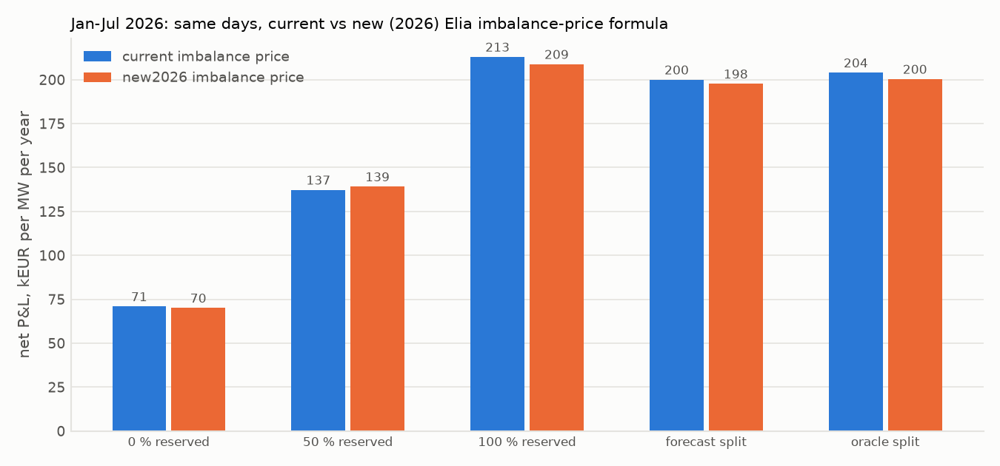
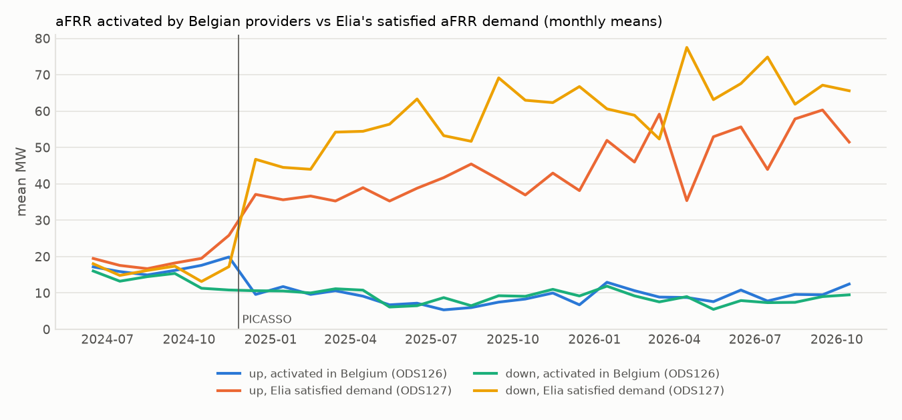

# Belgian battery revenue: aFRR capacity, aFRR energy and implicit balancing on one battery

_Generated by `scripts/research/reserve_study.py` on 2026-10-26 04:24 UTC from `data/public`: Elia Open Data (CC BY 4.0, attribution: Elia Transmission Belgium SA) and day-ahead prices from Bundesnetzagentur | SMARD.de via Energy-Charts (Fraunhofer ISE), CC BY 4.0. Every number below is recomputed by that script; rerun it to refresh._

## Headline

- Implicit balancing only (0 % reserved) earned 346.5 (2024H2), 108.7 (2025), 76.2 (2026YTD) kEUR/MW/year net of wear.
- Selling the whole battery as symmetric aFRR (100 % reserved) earned 720.1 (2024H2), 282.1 (2025), 198.0 (2026YTD).
- The causal per-block split (forecast policy) earned 695.2 (2024H2), 271.4 (2025), 181.9 (2026YTD).
- 100 % reserve stack by period (2024H2 / 2025 / 2026YTD): aFRR capacity 783.4 / 219.7 / 164.7, aFRR energy 83.2 / 116.8 / 104.0, undelivered energy settled at the imbalance price -140.9 / -50.7 / -67.0 kEUR/MW/year; aFRR energy was 10% / 35% / 39% of the reserve payments (capacity + energy).
- Jan-Jul 2026, same days: implicit-only 70.9 (current formula) vs 70.1 (new 2026 formula); forecast split 200.0 vs 197.7.

## Setup

- **Battery**: 1 MW / 2 MWh, one-way efficiencies 0.95 / 0.95, SOC band 5%-95%, degradation 8 EUR per MWh discharged (all discharge, including aFRR). Results are per MW of battery power; a 1 MW battery stands for a share of a pooled portfolio (Elia's minimum aFRR bid is 1 MW).
- **Period**: simulated 2024-05-22 to 2026-10-25 (local time, minute resolution, quarter-hour settlement); reported from 2024-06-01. Periods: **2024H2** = 2024-06-01 to 2025-01-01 (high capacity prices, PICASSO from 26 Nov); **2025** = 2025-01-01 to 2026-01-01 (capacity-price collapse); **2026YTD** = 2026-01-01 to 2026-10-25 (partial recovery).
- **Mechanism**: implicit energy settled at the published current-formula imbalance price (ODS134) for the full period; the Jan-Jul 2026 window is also settled at the new-formula price (ODS212, Elia's simulation of the design planned for 24 Nov 2026) on the same days.
- **Publication lag**: minute rows usable 1 minute after they end; final quarter-hour prices 5 minutes after the quarter-hour. The capacity split of delivery day D is decided at the auction gate closure, 09:00 local on D-1, with auction results assumed public one hour later.
- **Implicit layer**: `ThresholdStrategy` (core baseline, default parameters; running quarter-hour price estimate vs adaptive bands from published prices) restricted to the power and SOC headroom the reservation leaves free.

## Modelling choices and approximations

- **aFRR capacity** is procured by Elia per direction for six 4-hour blocks per day (D-1 auction, pay-as-bid). Clearing proxy: the battery is paid the block's awarded-volume-weighted average price (VWAP of ODS125/ODS207 awards) and every offered MW is assumed awarded. A pay-as-bid award is uncertain; the sensitivity table shows the marginal price (upper bound) and an explicit pay-as-bid model (bid = causal VWAP forecast, awarded only if it does not exceed the realised highest accepted bid).
- **Headroom**: implicit power is limited to `-(P - down) <= u <= P - up`, and implicit trading never moves the SOC outside `[soc_min + up*T/eta_d, soc_max - down*T*eta_c]` with T = 15 minutes (the repository's aFRR sustain convention, mirroring the 15-minute limited-energy-reservoir criterion SOGL Art. 156 sets for FCR; Elia's aFRR terms do not publish a battery-specific duration in the sources checked, so a 60-minute sensitivity is shown). When activation pushes the SOC out of that band the free implicit power restores it.
- **aFRR activation (approximation)**: the reserved MW are activated pro rata to Belgian aFRR activation, `ratio = activated / awarded` per minute and direction, clipped to [0, 1]. The numerator is ODS126 ('aFRR volumes activated in the Belgian LFC area', which includes activations for other TSOs via PICASSO), not ODS127 (Elia's satisfied aFRR demand, partly served by foreign bids); the validation section shows why the choice matters after PICASSO. Activated energy is paid the published quarter-hour aFRR price (ODS166; up earns it, down pays it). Before PICASSO (26 Nov 2024) aFRR energy was pay-as-bid: the battery is assumed to bid at the day-ahead price +/- 10 EUR/MWh and is paid its bid.
- **BRP neutrality**: the BRP perimeter is corrected by the requested aFRR energy, so activated energy carries no imbalance exposure; only implicit energy (and any undelivered aFRR energy) is settled at the imbalance price. Activation-control and availability penalties are ignored (0 EUR/MWh); undelivered energy is reported and charged at the imbalance price.
- **Allocation**: fixed splits reserve 0 %, 50 % or 100 % of the power symmetrically (up and down). The **forecast split** chooses per block among those three at the D-1 gate closure: value = forecast capacity price (mean of the same block over the last 7 published auctions) x MW x hours + the mean non-capacity P&L (aFRR energy, implicit balancing, shortfalls, degradation) that each fixed split realised in the same block of day over the last 7 settled days. The **oracle split** picks, per block, the fixed split that realised the most in that block and is then re-simulated; it is an ex-post benchmark, not tradable and, because of SOC coupling, not a strict upper bound. The forecast policy passes a perturbation test (`check_allocation_causality`) and the oracle fails it.

## Capacity prices: collapse and partial recovery

Monthly means of the 4-hour blocks, EUR/MW/h:

| month | VWAP up | VWAP down | marginal up | marginal down | awarded up MW | awarded down MW |
| --- | ---: | ---: | ---: | ---: | ---: | ---: |
| 2024-06 | 69.1 | 46.8 | 91.6 | 72.2 | 118.3 | 117.7 |
| 2024-07 | 60.8 | 32.4 | 86.7 | 52.4 | 118.1 | 117.5 |
| 2024-08 | 67.4 | 34.3 | 112.6 | 59.4 | 118.2 | 117.3 |
| 2024-09 | 69.9 | 19.5 | 105.8 | 34.3 | 118.1 | 117.1 |
| 2024-10 | 68.6 | 23.0 | 94.9 | 39.0 | 112.5 | 114.0 |
| 2024-11 | 53.7 | 7.9 | 72.4 | 16.1 | 111.9 | 112.3 |
| 2024-12 | 64.5 | 7.7 | 90.6 | 23.8 | 111.2 | 111.8 |
| 2025-01 | 35.3 | 6.1 | 48.4 | 11.6 | 112.5 | 109.0 |
| 2025-02 | 23.4 | 3.1 | 29.0 | 5.9 | 110.1 | 111.7 |
| 2025-03 | 13.1 | 6.8 | 15.5 | 13.6 | 107.2 | 110.2 |
| 2025-04 | 10.4 | 6.2 | 16.1 | 15.5 | 103.6 | 108.6 |
| 2025-05 | 16.5 | 20.1 | 36.3 | 53.7 | 104.2 | 110.0 |
| 2025-06 | 20.3 | 12.9 | 35.8 | 34.0 | 105.9 | 110.6 |
| 2025-07 | 26.7 | 9.8 | 34.7 | 20.9 | 98.0 | 104.5 |
| 2025-08 | 14.5 | 10.9 | 20.9 | 27.8 | 98.4 | 103.5 |
| 2025-09 | 12.9 | 11.9 | 17.9 | 25.2 | 100.5 | 104.5 |
| 2025-10 | 13.0 | 4.8 | 16.4 | 9.5 | 98.9 | 102.5 |
| 2025-11 | 8.3 | 4.6 | 10.7 | 8.3 | 101.6 | 103.8 |
| 2025-12 | 6.7 | 2.3 | 7.9 | 3.4 | 101.4 | 105.0 |
| 2026-01 | 17.0 | 2.9 | 23.2 | 5.6 | 101.3 | 105.1 |
| 2026-02 | 11.3 | 2.3 | 13.1 | 3.9 | 103.5 | 103.8 |
| 2026-03 | 11.4 | 9.1 | 13.4 | 24.9 | 101.1 | 102.3 |
| 2026-04 | 14.8 | 8.7 | 19.0 | 12.7 | 100.6 | 102.1 |
| 2026-05 | 12.6 | 8.5 | 14.3 | 11.3 | 95.9 | 101.0 |
| 2026-06 | 10.1 | 4.6 | 12.5 | 6.3 | 99.1 | 101.4 |
| 2026-07 | 21.1 | 8.8 | 26.6 | 13.8 | 98.4 | 97.4 |
| 2026-08 | 8.5 | 3.1 | 9.9 | 4.4 | 96.5 | 96.6 |
| 2026-09 | 14.2 | 3.4 | 16.9 | 4.7 | 98.1 | 96.1 |
| 2026-10 | 11.8 | 2.3 | 13.5 | 2.8 | 100.1 | 99.6 |

## Revenue stack by period (current imbalance formula)

kEUR per MW of battery power per year (annualised over the period; costs negative).

### 2024H2: high capacity prices, PICASSO from 26 Nov

| policy | aFRR capacity | aFRR energy | implicit balancing | shortfall at imbalance price | degradation | net P&L | cycles/day | mean reserved MW (up/down) |
| --- | ---: | ---: | ---: | ---: | ---: | ---: | ---: | --- |
| 0 % reserved (implicit only) | 0.0 | 0.0 | 355.8 | 0.0 | -9.3 | 346.5 | 1.77 | 0.00 / 0.00 |
| 50 % reserved | 391.7 | 41.6 | 121.9 | 0.0 | -7.9 | 547.3 | 1.51 | 0.50 / 0.50 |
| 100 % reserved | 783.4 | 83.2 | 0.0 | -140.9 | -5.5 | 720.1 | 1.04 | 1.00 / 1.00 |
| forecast split (causal) | 718.7 | 74.7 | 17.5 | -109.6 | -6.1 | 695.2 | 1.17 | 0.91 / 0.91 |
| ex-post oracle split | 634.7 | 60.2 | 164.2 | -61.7 | -7.7 | 789.7 | 1.46 | 0.77 / 0.77 |

Best fixed split in hindsight for 2024H2: 100 % reserved at 720.1 kEUR/MW/year; the forecast split earns 97% of it.

### 2025: capacity-price collapse

| policy | aFRR capacity | aFRR energy | implicit balancing | shortfall at imbalance price | degradation | net P&L | cycles/day | mean reserved MW (up/down) |
| --- | ---: | ---: | ---: | ---: | ---: | ---: | ---: | --- |
| 0 % reserved (implicit only) | 0.0 | 0.0 | 115.2 | 0.0 | -6.5 | 108.7 | 1.24 | 0.00 / 0.00 |
| 50 % reserved | 109.9 | 58.4 | 35.0 | 0.0 | -5.5 | 197.8 | 1.04 | 0.50 / 0.50 |
| 100 % reserved | 219.7 | 116.8 | 0.0 | -50.7 | -3.8 | 282.1 | 0.72 | 1.00 / 1.00 |
| forecast split (causal) | 207.6 | 105.7 | 9.3 | -47.1 | -4.2 | 271.4 | 0.79 | 0.93 / 0.93 |
| ex-post oracle split | 189.0 | 91.8 | 50.2 | -47.0 | -5.2 | 278.7 | 0.99 | 0.83 / 0.83 |

Best fixed split in hindsight for 2025: 100 % reserved at 282.1 kEUR/MW/year; the forecast split earns 96% of it.

### 2026YTD: partial recovery

| policy | aFRR capacity | aFRR energy | implicit balancing | shortfall at imbalance price | degradation | net P&L | cycles/day | mean reserved MW (up/down) |
| --- | ---: | ---: | ---: | ---: | ---: | ---: | ---: | --- |
| 0 % reserved (implicit only) | 0.0 | 0.0 | 81.4 | 0.0 | -5.2 | 76.2 | 0.98 | 0.00 / 0.00 |
| 50 % reserved | 82.4 | 52.0 | 6.7 | 0.0 | -5.0 | 136.0 | 0.95 | 0.50 / 0.50 |
| 100 % reserved | 164.7 | 104.0 | 0.0 | -67.0 | -3.8 | 198.0 | 0.72 | 1.00 / 1.00 |
| forecast split (causal) | 141.8 | 86.5 | 7.7 | -49.7 | -4.4 | 181.9 | 0.84 | 0.85 / 0.85 |
| ex-post oracle split | 135.7 | 79.3 | 29.3 | -49.0 | -5.0 | 190.4 | 0.94 | 0.80 / 0.80 |

Best fixed split in hindsight for 2026YTD: 100 % reserved at 198.0 kEUR/MW/year; the forecast split earns 92% of it.

### Whole reported period (2024-06-01 to 2026-10-25)

| policy | aFRR capacity | aFRR energy | implicit balancing | shortfall at imbalance price | degradation | net P&L | cycles/day | mean reserved MW (up/down) |
| --- | ---: | ---: | ---: | ---: | ---: | ---: | ---: | --- |
| 0 % reserved (implicit only) | 0.0 | 0.0 | 162.5 | 0.0 | -6.7 | 155.8 | 1.28 | 0.00 / 0.00 |
| 50 % reserved | 169.4 | 52.1 | 46.7 | 0.0 | -5.9 | 262.3 | 1.12 | 0.50 / 0.50 |
| 100 % reserved | 338.8 | 104.2 | 0.0 | -78.2 | -4.2 | 360.6 | 0.80 | 1.00 / 1.00 |
| forecast split (causal) | 310.2 | 91.6 | 10.8 | -63.2 | -4.7 | 344.6 | 0.90 | 0.90 / 0.90 |
| ex-post oracle split | 279.8 | 79.9 | 70.9 | -51.3 | -5.7 | 373.6 | 1.09 | 0.81 / 0.81 |

## Allocation over time

Shares in % of blocks-weighted power; values in EUR per MW per hour as seen at the gate closure.

| month | forecast reserved % | oracle reserved % | same choice as oracle % | forecast capacity price up+down | expected implicit value 0 % | expected aFRR energy 100 % |
| --- | ---: | ---: | ---: | ---: | ---: | ---: |
| 2024-06 | 97.5 | 84.2 | 78.9 | 114.9 | 42.3 | -16.0 |
| 2024-07 | 91.1 | 73.7 | 60.2 | 95.2 | 49.3 | -8.1 |
| 2024-08 | 92.5 | 71.2 | 59.1 | 104.6 | 50.6 | -10.4 |
| 2024-09 | 86.1 | 68.6 | 53.9 | 84.6 | 46.1 | -13.4 |
| 2024-10 | 89.8 | 75.0 | 64.0 | 96.8 | 45.0 | -10.1 |
| 2024-11 | 82.2 | 74.2 | 57.8 | 62.4 | 28.3 | -7.9 |
| 2024-12 | 100.0 | 95.4 | 94.6 | 73.6 | 18.9 | 11.4 |
| 2025-01 | 99.5 | 89.0 | 85.5 | 43.4 | 15.7 | 9.4 |
| 2025-02 | 92.0 | 83.6 | 69.6 | 27.9 | 16.0 | 6.8 |
| 2025-03 | 91.9 | 81.7 | 71.5 | 21.4 | 14.6 | 11.6 |
| 2025-04 | 84.2 | 73.1 | 58.9 | 16.8 | 17.2 | 12.2 |
| 2025-05 | 93.0 | 80.9 | 70.4 | 34.2 | 16.7 | 8.5 |
| 2025-06 | 91.4 | 81.4 | 70.0 | 30.4 | 16.3 | 6.8 |
| 2025-07 | 98.7 | 87.1 | 81.2 | 40.1 | 14.9 | 6.1 |
| 2025-08 | 92.5 | 79.8 | 73.1 | 24.3 | 11.3 | 4.0 |
| 2025-09 | 95.3 | 85.6 | 77.8 | 26.4 | 12.3 | 6.6 |
| 2025-10 | 93.3 | 88.7 | 78.0 | 19.0 | 6.6 | 5.0 |
| 2025-11 | 93.6 | 82.2 | 72.2 | 12.3 | 5.5 | 6.4 |
| 2025-12 | 90.6 | 79.6 | 66.1 | 10.0 | 4.5 | 3.2 |
| 2026-01 | 92.7 | 85.8 | 74.7 | 18.0 | 4.1 | 3.9 |
| 2026-02 | 92.6 | 79.5 | 68.5 | 14.9 | 5.7 | 3.6 |
| 2026-03 | 92.2 | 85.5 | 74.2 | 18.8 | 8.1 | 4.3 |
| 2026-04 | 98.3 | 89.7 | 86.7 | 24.3 | 8.1 | 5.4 |
| 2026-05 | 88.2 | 83.1 | 76.3 | 21.0 | 10.0 | 3.1 |
| 2026-06 | 69.7 | 73.1 | 57.2 | 13.9 | 10.0 | 3.4 |
| 2026-07 | 91.9 | 87.4 | 75.3 | 30.8 | 9.2 | 2.5 |
| 2026-08 | 71.2 | 70.4 | 57.0 | 12.3 | 10.9 | 4.1 |
| 2026-09 | 74.7 | 73.3 | 63.9 | 17.4 | 11.5 | 3.6 |
| 2026-10 | 78.8 | 74.7 | 63.2 | 14.6 | 9.3 | 3.7 |

## Jan-Jul 2026 under both imbalance mechanisms

Same days (2026-01-01 to 2026-08-01 UTC), separate runs per mechanism (the forecast policy learns its implicit-value estimate under the mechanism it is settled with; first days are a warm-up without history, so these figures differ slightly from the same months inside the full-period run).

### current

| policy | aFRR capacity | aFRR energy | implicit balancing | shortfall at imbalance price | degradation | net P&L | cycles/day | mean reserved MW (up/down) |
| --- | ---: | ---: | ---: | ---: | ---: | ---: | ---: | --- |
| 0 % reserved (implicit only) | 0.0 | 0.0 | 76.3 | 0.0 | -5.4 | 70.9 | 1.02 | 0.00 / 0.00 |
| 50 % reserved | 90.1 | 49.5 | 2.8 | 0.0 | -5.1 | 137.3 | 0.96 | 0.50 / 0.50 |
| 100 % reserved | 180.2 | 99.0 | 0.0 | -62.4 | -3.7 | 213.0 | 0.71 | 1.00 / 1.00 |
| forecast split (causal) | 163.1 | 85.2 | 1.8 | -45.9 | -4.2 | 200.0 | 0.81 | 0.88 / 0.88 |
| ex-post oracle split | 154.2 | 73.7 | 24.0 | -43.1 | -4.8 | 204.0 | 0.91 | 0.83 / 0.83 |

### new2026

| policy | aFRR capacity | aFRR energy | implicit balancing | shortfall at imbalance price | degradation | net P&L | cycles/day | mean reserved MW (up/down) |
| --- | ---: | ---: | ---: | ---: | ---: | ---: | ---: | --- |
| 0 % reserved (implicit only) | 0.0 | 0.0 | 75.9 | 0.0 | -5.8 | 70.1 | 1.10 | 0.00 / 0.00 |
| 50 % reserved | 90.1 | 49.5 | 4.9 | 0.0 | -5.3 | 139.2 | 1.02 | 0.50 / 0.50 |
| 100 % reserved | 180.2 | 99.0 | 0.0 | -66.6 | -3.7 | 208.9 | 0.71 | 1.00 / 1.00 |
| forecast split (causal) | 164.2 | 84.3 | 5.7 | -52.1 | -4.4 | 197.7 | 0.83 | 0.88 / 0.88 |
| ex-post oracle split | 154.0 | 71.7 | 23.9 | -44.3 | -4.9 | 200.4 | 0.93 | 0.83 / 0.83 |

## Validation of the activation approximation

Before PICASSO the two publications agree (Belgian demand was met by Belgian providers). Afterwards Elia's satisfied demand is several times the volume activated in Belgium, because cheaper foreign bids serve part of it: using ODS127 would overstate a Belgian provider's activation. Mean MW:

| month | up ODS126 (activated in BE) | up ODS127 (satisfied demand) | down ODS126 | down ODS127 |
| --- | ---: | ---: | ---: | ---: |
| 2024-06 | 17.2 | 19.5 | 16.0 | 18.0 |
| 2024-07 | 15.9 | 17.6 | 13.2 | 14.8 |
| 2024-08 | 15.0 | 16.7 | 14.5 | 16.2 |
| 2024-09 | 16.2 | 18.2 | 15.4 | 17.4 |
| 2024-10 | 17.6 | 19.5 | 11.3 | 13.2 |
| 2024-11 | 19.9 | 25.9 | 10.8 | 17.2 |
| 2024-12 | 9.6 | 37.1 | 10.6 | 46.8 |
| 2025-01 | 11.8 | 35.6 | 10.5 | 44.5 |
| 2025-02 | 9.6 | 36.7 | 10.0 | 44.0 |
| 2025-03 | 10.6 | 35.3 | 11.2 | 54.2 |
| 2025-04 | 9.1 | 39.0 | 10.8 | 54.5 |
| 2025-05 | 6.7 | 35.3 | 6.1 | 56.4 |
| 2025-06 | 7.2 | 38.8 | 6.5 | 63.3 |
| 2025-07 | 5.4 | 41.7 | 8.7 | 53.3 |
| 2025-08 | 6.0 | 45.5 | 6.5 | 51.7 |
| 2025-09 | 7.5 | 41.3 | 9.2 | 69.1 |
| 2025-10 | 8.3 | 36.9 | 9.1 | 63.0 |
| 2025-11 | 10.0 | 43.0 | 11.0 | 62.4 |
| 2025-12 | 6.7 | 38.1 | 9.2 | 66.8 |
| 2026-01 | 12.9 | 52.0 | 11.9 | 60.6 |
| 2026-02 | 10.6 | 46.0 | 9.2 | 58.9 |
| 2026-03 | 8.9 | 59.2 | 7.5 | 52.3 |
| 2026-04 | 8.8 | 35.4 | 9.0 | 77.5 |
| 2026-05 | 7.6 | 53.0 | 5.5 | 63.2 |
| 2026-06 | 10.8 | 55.7 | 7.9 | 67.6 |
| 2026-07 | 7.8 | 44.0 | 7.3 | 74.9 |
| 2026-08 | 9.6 | 57.9 | 7.4 | 61.9 |
| 2026-09 | 9.5 | 60.3 | 9.0 | 67.1 |
| 2026-10 | 12.5 | 51.5 | 9.5 | 65.6 |

Per reserved MW (before SOC limits): mean activation ratio, share of minutes where Belgian activation exceeded the awarded volume (clipped), activation-weighted aFRR energy price (EUR/MWh) and energy revenue (EUR per reserved MW per day; down = minus price x energy).

| variant | period | mean ratio up | mean ratio down | minutes ratio>1 (up) | price when active up | price when active down | EUR/MW/day up | EUR/MW/day down |
| --- | --- | ---: | ---: | ---: | ---: | ---: | ---: | ---: |
| pro-rata, QH price (main) | 2024H2 | 0.135 | 0.103 | 2.7 % | 103.5 | 43.4 | 335 | -107 |
| pro-rata, QH price (main) | 2025 | 0.076 | 0.077 | 1.2 % | 185.0 | 9.4 | 337 | -17 |
| pro-rata, QH price (main) | 2026YTD | 0.092 | 0.075 | 1.8 % | 182.3 | 65.5 | 403 | -119 |
| pro-rata, minute price | 2024H2 | 0.135 | 0.103 | 2.7 % | 105.9 | 40.5 | 343 | -100 |
| pro-rata, minute price | 2025 | 0.076 | 0.077 | 1.2 % | 205.7 | -4.5 | 375 | 8 |
| pro-rata, minute price | 2026YTD | 0.092 | 0.075 | 1.8 % | 200.9 | 54.5 | 444 | -99 |
| merit-order (bid = DA +/- 10) | 2024H2 | 0.528 | 0.520 | 2.7 % | 89.6 | 55.3 | 1136 | -690 |
| merit-order (bid = DA +/- 10) | 2025 | 0.213 | 0.337 | 1.2 % | 159.9 | 35.7 | 818 | -288 |
| merit-order (bid = DA +/- 10) | 2026YTD | 0.228 | 0.266 | 1.8 % | 166.9 | 71.9 | 914 | -459 |
| pro-rata, published price pre-PICASSO | 2024H2 | 0.135 | 0.103 | 2.7 % | 211.6 | -230.7 | 684 | 568 |
| pro-rata, published price pre-PICASSO | 2025 | 0.076 | 0.077 | 1.2 % | 185.0 | 9.4 | 337 | -17 |
| pro-rata, published price pre-PICASSO | 2026YTD | 0.092 | 0.075 | 1.8 % | 182.3 | 65.5 | 403 | -119 |

Reading: the minute-price variant reconstructs instantaneous prices from the cumulative ODS165 values and shows activation is concentrated in the more expensive minutes of a quarter-hour, so the main (QH-price) variant is conservative. The merit-order variant (fully activated whenever the price clears a bid at the day-ahead price +/- 10 EUR/MWh) brackets the pro-rata view from above in activated volume. Before PICASSO the published (marginal) price would hugely overstate pay-as-bid revenue, which is why it is only shown as an upper bound.

### No-look-ahead audits on real data

On 2025-03-01 + 12 days with the cut at the gate closure 2025-03-09 08:00:00+00:00: every market value not yet published at the cut and every auction result published after it is replaced by noise, and the whole pipeline (reference runs, forecasts, choice) is rerun.

- Forecast split: passed (60 blocks decided by the cut, 0 changed).
- Ex-post oracle split: fails, as it must (3 block(s) changed).
- Implicit layer with live aFRR activation (50 % reserved): passed over the first 12069 minutes that cannot depend on the perturbed data.

## Sensitivities (net P&L, kEUR/MW/year, current formula)

| variant | policy | 2024H2 | 2025 | 2026YTD | full |
| --- | --- | ---: | ---: | ---: | ---: |
| main assumptions | 0 % reserved (implicit only) | 346.5 | 108.7 | 76.2 | 155.8 |
| main assumptions | 100 % reserved | 720.1 | 282.1 | 198.0 | 360.6 |
| main assumptions | 50 % reserved | 547.3 | 197.8 | 136.0 | 262.3 |
| main assumptions | forecast split (causal) | 695.2 | 271.4 | 181.9 | 344.6 |
| capacity paid at marginal (upper bound) | 0 % reserved (implicit only) | 346.5 | 108.7 | 76.2 | 155.8 |
| capacity paid at marginal (upper bound) | 50 % reserved | 751.9 | 278.0 | 165.8 | 355.7 |
| capacity paid at marginal (upper bound) | 100 % reserved | 1,129.4 | 442.3 | 257.5 | 547.5 |
| capacity paid at marginal (upper bound) | forecast split (causal) | 1,071.8 | 420.1 | 234.1 | 516.3 |
| capacity pay-as-bid at forecast VWAP | 0 % reserved (implicit only) | 346.5 | 108.7 | 76.2 | 155.8 |
| capacity pay-as-bid at forecast VWAP | 50 % reserved | 440.0 | 155.0 | 100.5 | 206.2 |
| capacity pay-as-bid at forecast VWAP | 100 % reserved | 510.7 | 193.6 | 119.7 | 246.0 |
| capacity pay-as-bid at forecast VWAP | forecast split (causal) | 506.6 | 192.1 | 114.8 | 242.7 |
| sustain 60 min instead of 15 | 0 % reserved (implicit only) | 346.5 | 108.7 | 76.2 | 155.8 |
| sustain 60 min instead of 15 | 50 % reserved | 483.9 | 173.2 | 113.4 | 228.9 |
| sustain 60 min instead of 15 | 100 % reserved | 666.5 | 251.0 | 174.4 | 326.6 |
| sustain 60 min instead of 15 | forecast split (causal) | 648.1 | 243.9 | 157.1 | 313.2 |
| activation merit-order (bid = DA +/- 10) | 0 % reserved (implicit only) | 346.5 | 108.7 | 76.2 | 155.8 |
| activation merit-order (bid = DA +/- 10) | 50 % reserved | 519.7 | 236.4 | 145.0 | 274.6 |
| activation merit-order (bid = DA +/- 10) | 100 % reserved | 659.2 | 349.6 | 230.4 | 384.9 |
| activation merit-order (bid = DA +/- 10) | forecast split (causal) | 618.4 | 338.7 | 206.1 | 362.1 |
| aFRR energy at reconstructed minute price | 0 % reserved (implicit only) | 346.5 | 108.7 | 76.2 | 155.8 |
| aFRR energy at reconstructed minute price | 50 % reserved | 550.0 | 209.4 | 147.2 | 271.6 |
| aFRR energy at reconstructed minute price | 100 % reserved | 725.7 | 305.2 | 220.3 | 379.2 |
| aFRR energy at reconstructed minute price | forecast split (causal) | 700.7 | 295.4 | 203.0 | 363.1 |
| pre-PICASSO energy at published price (upper bound) | 0 % reserved (implicit only) | 346.5 | 108.7 | 76.2 | 155.8 |
| pre-PICASSO energy at published price (upper bound) | 50 % reserved | 734.5 | 197.8 | 136.0 | 308.0 |
| pre-PICASSO energy at published price (upper bound) | 100 % reserved | 1,094.5 | 282.1 | 198.0 | 452.1 |
| pre-PICASSO energy at published price (upper bound) | forecast split (causal) | 1,090.9 | 271.4 | 181.9 | 441.3 |
| candidates incl. up-only / down-only | 0 % reserved (implicit only) | 346.5 | 108.7 | 76.2 | 155.8 |
| candidates incl. up-only / down-only | 50 % reserved | 547.3 | 197.8 | 136.0 | 262.3 |
| candidates incl. up-only / down-only | 100 % reserved | 720.1 | 282.1 | 198.0 | 360.6 |
| candidates incl. up-only / down-only | forecast split (causal) | 737.2 | 270.9 | 182.5 | 354.9 |
| forecast lookback 14 days | 0 % reserved (implicit only) | 346.5 | 108.7 | 76.2 | 155.8 |
| forecast lookback 14 days | 50 % reserved | 547.3 | 197.8 | 136.0 | 262.3 |
| forecast lookback 14 days | 100 % reserved | 720.1 | 282.1 | 198.0 | 360.6 |
| forecast lookback 14 days | forecast split (causal) | 707.7 | 273.9 | 184.1 | 349.4 |
| undelivered energy neither paid nor charged | 0 % reserved (implicit only) | 346.5 | 108.7 | 76.2 | 155.8 |
| undelivered energy neither paid nor charged | 50 % reserved | 547.3 | 197.8 | 136.0 | 262.3 |
| undelivered energy neither paid nor charged | 100 % reserved | 806.5 | 280.6 | 196.0 | 380.4 |
| undelivered energy neither paid nor charged | forecast split (causal) | 793.2 | 270.6 | 180.0 | 367.6 |

## Limitations

- Provider-level aFRR activations are not public: the pro-rata ratio is an average-provider proxy. Under PICASSO's merit order a battery's activation depends on its energy bid; the merit-order sensitivity brackets the effect. Free (non-contracted) aFRR energy bids share the activated volume, which the ratio ignores.
- aFRR energy is settled at quarter-hour (ODS166) prices, not 4-second cross-border marginal prices; within-QH price/activation correlation is only covered by the minute-price sensitivity.
- Capacity: the battery is a price-taker at the published VWAP and always awarded (main case). Its own bids do not move the auction, and the D-1 bid does not include a strategic mark-up.
- Pre-PICASSO energy remuneration (pay-as-bid) uses an assumed bid (day-ahead or trailing imbalance price +/- 10 EUR/MWh); the true bids of a battery operator are unknown.
- Headroom uses a 15-minute sustain rule and restores the SOC with free implicit power; at 100 % reservation there is no free power, so SOC drift leads to undelivered energy, settled at the imbalance price. Real operators would restore the SOC with intraday or day-ahead trades (not modelled), so the 100 % row is a lower bound for a pure reserve strategy.
- No price impact: neither the capacity auction nor the imbalance price reacts to the battery (1 MW).
- Activation-control / availability penalties and the aFRR energy-bid gate closure (25 minutes before the quarter-hour) are not modelled; reserved MW are assumed always offered in the energy market.
- The implicit layer is a simple causal threshold rule; a better implicit strategy raises the value of the unreserved MW and shifts the optimal split towards implicit balancing.
- The new-formula window uses Elia's published simulation of the 2026 design (ODS211/ODS212), which assumes unchanged market behaviour.

