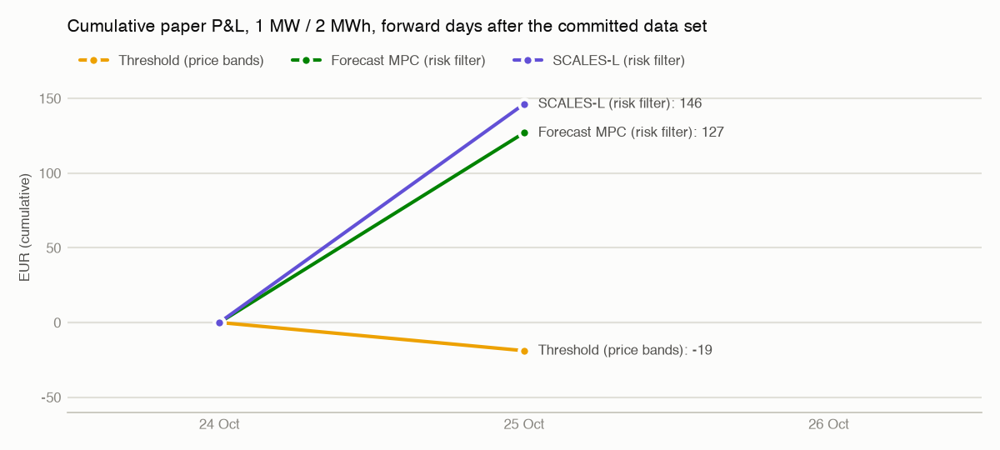

# Forward track record (paper)

> Generated by `scripts/ops/track_record.py` from `daily_pnl.csv` and `qh/`; do not edit by hand.
> Paper money: a simulation on published data. No order or bid is submitted to any market.

Out-of-sample record of the frozen live strategies on every complete Belgian delivery day after the end of the
committed data set: the forecasters were fitted on data up to 2026-10-24 and are never refitted. Each day is
simulated minute by minute with the backtest engine and publication model on Elia's published data.

Days recorded: **1** (2026-10-25); last update 2026-10-26T14:42:46Z.

| Strategy | Days | Cumulative P&L (EUR) | EUR/MW/yr to date | Mean day (EUR) | Cycles/day | Positive days | Best day | Worst day |
| --- | ---: | ---: | ---: | ---: | ---: | ---: | ---: | ---: |
| Threshold (price bands) | 1 | -18.89 | -6,622 | -18.89 | 0.14 | 0 % | -18.89 (2026-10-25) | -18.89 (2026-10-25) |
| Forecast MPC (risk filter) | 1 | 126.99 | 44,529 | 126.99 | 1.60 | 100 % | 126.99 (2026-10-25) | 126.99 (2026-10-25) |
| SCALES-L (risk filter) | 1 | 146.29 | 51,294 | 146.29 | 1.61 | 100 % | 146.29 (2026-10-25) | 146.29 (2026-10-25) |

EUR/MW/yr annualises the P&L to date (1 day); until the record covers
several months it is dominated by day-to-day noise and should not be compared with the backtest figures.

## Daily P&L (EUR, latest 14 days)

| Day | Threshold (price bands) | Forecast MPC (risk filter) | SCALES-L (risk filter) |
| --- | ---: | ---: | ---: |
| 2026-10-25 | -18.89 | 126.99 | 146.29 |

## Method

- Battery: 1 MW / 2 MWh, efficiency 0.95 x 0.95, SOC band 5-95 %, degradation 8 EUR per MWh discharged; price taker (no own price impact).
- Engine: `euroflex_bess_lab.realtime.simulate`, one decision per minute; minute data usable 1 minute after the minute ends, final quarter-hour prices 5 minutes after the quarter-hour, day-ahead prices from 13:00 on D-1. The live paper-trading engine takes identical decisions on identical data (`euroflex live replay`, `docs/live_paper_trading.md`).
- Continuity: the state of charge carries over from day to day; each day sees a 28-day history window in which the strategy does not trade.
- Settlement: current formula (ODS134 price) before the new-formula go-live (2026-11-24T09:00:00Z, planned, subject to CREG approval), new formula (ODS212 price) from it.
- Models: deployment forecasters fitted on 2026-04-24 to 2026-10-24 (models id `da8a2764093e4383`, `models/reference_manifest.json`); a run with different models is refused unless explicitly allowed.
- Data: Elia's historical datasets as first published (most quarter-hours are not yet validated at that point; recorded days are not restated). Days after the committed `data/public` set are downloaded into the gitignored `data/raw/track_record` cache.

Strategies:

- Threshold (price bands) (backtest `threshold_price`): charge below the 25 % / discharge above the 75 % quantile of the last 14 days of final prices, read against the running quarter-hour price of the formula in force.
- Forecast MPC (risk filter) (backtest `forecast_mpc_risk`): rolling stochastic MPC on the current-formula price forecaster (30 % / 70 % quantile filter); retired at the new-formula go-live because its model prices the current formula.
- SCALES-L (risk filter) (backtest `prism_risk`): mechanism-aware state forecasts priced by the settlement operator, same MPC core; the zero-history new-formula forecaster fused with the live running price after the go-live.

Files: `daily_pnl.csv` (one row per day and strategy), `qh/<YYYY-MM>.csv` (quarter-hour ledger),
`summary.json` (machine-readable summary). Update with `python scripts/ops/track_record.py update`; see
`docs/track_record.md`.

Data: Elia Transmission Belgium SA, Elia Open Data (CC BY 4.0); Bundesnetzagentur | SMARD.de via Energy-Charts (CC BY 4.0).
