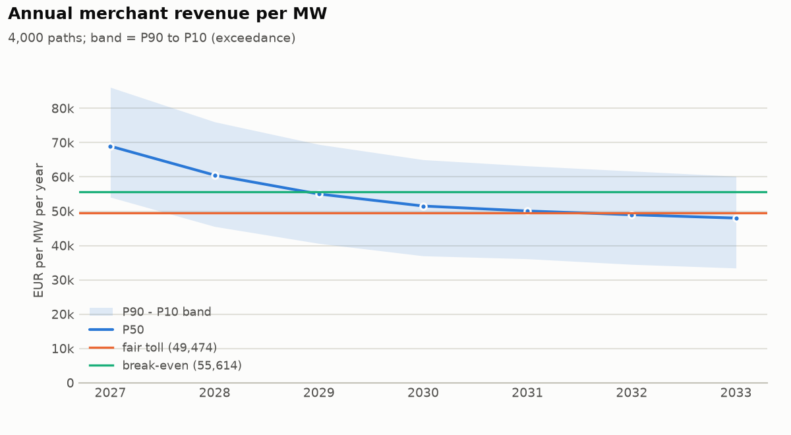
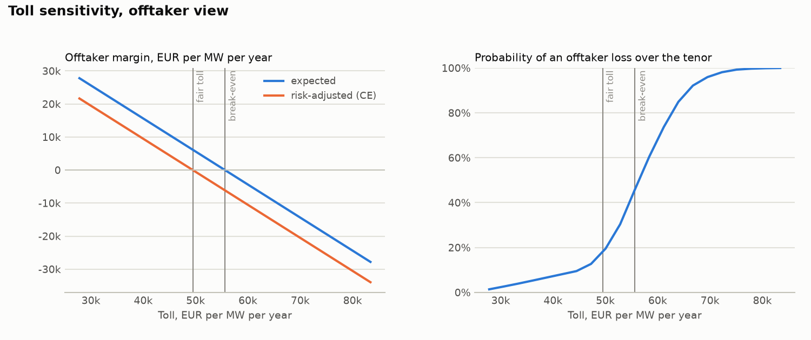

# Belgian 1 MW / 2 MWh battery: contract valuation from real-data ledgers (latest 12 months)

## Headline numbers

- Fair flat toll (offtaker certainty equivalent): **49,474 EUR/MW/yr** (4.12 EUR/kW/month); risk-neutral break-even 55,614; owner reservation 43,335; deal zone 43,335 .. 49,474.
- At the fair toll the offtaker expects 6,139 EUR/MW/yr margin, loses money over the tenor on 17.4 % of paths and in 35.4 % of contract years.
- Revenue floor at 36,000 EUR/MW/yr: fair premium 2,237 EUR/MW/yr; zero-premium alternative: owner gives 56.3 % of revenue above 56,000.
- Partial toll (50 % fixed, owner keeps 80 % of the merchant half): fair toll on the fixed share 59,369 EUR/MW/yr.
- Revenue swap on `index`: fair fixed leg 42,551 EUR/MW/yr, hedge effectiveness 97.5 %.
- Value attribution: oracle 250,999 -> contractable 81,350 EUR/MW/yr (32.4 % of the oracle).

## Inputs

| role | source | market | mechanism | strategy | battery | publication lag | wear cost | fleet MW | availability |
| --- | --- | --- | --- | --- | --- | --- | --- | --- | ---: |
| oracle | artifacts/valuation_inputs/recent/be_oracle_oracle_qh.parquet | BE | current | oracle_qh | 1 MW / 2 MWh | - | 8 EUR/MWh | 0 | 100% |
| current | artifacts/valuation_inputs/recent/be_current_scales_l_risk.parquet | BE | current | scales_l_risk | 1 MW / 2 MWh | - | 8 EUR/MWh | 0 | 100% |
| new2026 | artifacts/valuation_inputs/recent/be_new2026_scales_l_live_risk.parquet | BE | new2026 | scales_l_live_risk | 1 MW / 2 MWh | - | 8 EUR/MWh | 0 | 100% |
| index | artifacts/valuation_inputs/recent/be_index_threshold_price.parquet | BE | current | threshold_price | 1 MW / 2 MWh | - | 8 EUR/MWh | 0 | 100% |

## 1. Historical revenue per ledger

Complete local delivery days only (coverage >= 98 %); EUR per MW of battery power.

| ledger | mechanism | period (local days) | days | net EUR/MW/yr | gross EUR/MW/yr | wear EUR/MW/yr | season-weighted net | daily mean / std | daily P05 | neg. days | top-10% days share | cycles/day |
| --- | --- | --- | ---: | ---: | ---: | ---: | ---: | ---: | ---: | ---: | ---: | ---: |
| oracle | current | 2025-11-02 .. 2026-10-24 | 357 | 233,350 | 251,999 | 18,649 | 233,276 | 639 / 1,038 | 154 | 0.3 % | 29.0 % | 3.19 |
| current | current | 2025-11-02 .. 2026-10-24 | 357 | 81,180 | 89,974 | 8,794 | 81,200 | 222 / 162 | 12 | 3.9 % | 24.8 % | 1.50 |
| new2026 | new2026 | 2026-01-02 .. 2026-07-31 | 211 | 81,655 | 91,777 | 10,122 | n/a | 224 / 164 | 32 | 2.4 % | 26.7 % | 1.73 |
| index | current | 2025-11-02 .. 2026-10-24 | 357 | 70,004 | 75,307 | 5,303 | 69,942 | 192 / 183 | -28 | 11.2 % | 29.6 % | 0.91 |

## 2. Value attribution

Sequential waterfall: each step re-runs the same battery with one more factor, so each effect is conditional on the steps before it.

Basis: net (P&L net of wear); common period 2026-01-01 .. 2026-08-01 (Europe/Brussels delivery days; 2026-01-01T00:00:00+00:00 to 2026-08-01T00:00:00+00:00 UTC; 20,352 intervals of 15 min, 0.58 years); power 1 MW.

| step | kind | source | effect EUR/MW/yr | level EUR/MW/yr | share of anchor | days with negative effect |
| --- | --- | --- | ---: | ---: | ---: | ---: |
| Oracle (perfect foresight) | anchor | ledger |  | 250,999 | 100.0 % |  |
| Decision / forecast gap | effect | ledger | -167,347 | 83,653 | -66.7 % | 99.5 % |
| Mechanism effect | effect | ledger | -2,303 | 81,350 | -0.9 % | 51.6 % |
| Contractable P&L | total | derived |  | 81,350 | 32.4 % |  |

Notes:
- ledgers were aligned on their common intervals; see dropped_intervals

Levels are annualised over the common period of all ledgers (no seasonal adjustment); a period shorter than a year inherits its seasons.


Mechanism effect split into *repricing* (same dispatch settled at new-formula prices) and *re-optimisation* (strategy re-run under the new formula):

Basis: net (P&L net of wear); common period 2026-01-01 .. 2026-08-01 (Europe/Brussels delivery days; 2026-01-01T00:00:00+00:00 to 2026-08-01T00:00:00+00:00 UTC; 20,352 intervals of 15 min, 0.58 years); power 1 MW.

| step | kind | source | effect EUR/MW/yr | level EUR/MW/yr | share of anchor | days with negative effect |
| --- | --- | --- | ---: | ---: | ---: | ---: |
| Strategy under the current formula | anchor | ledger |  | 83,653 | 100.0 % |  |
| Repricing effect (same dispatch, new-formula prices) | effect | ledger | -33,435 | 50,218 | -40.0 % | 84.5 % |
| Re-optimisation effect (strategy run under the new formula) | effect | ledger | 31,132 | 81,350 | 37.2 % | 13.1 % |
| Strategy under the new formula | total | derived |  | 81,350 | 97.2 % |  |

Notes:
- ledgers were aligned on their common intervals; see dropped_intervals

## 3. Revenue scenarios

The `new2026` ledger covers only 211 complete days, so the `new2026` regime history is the `current` history scaled by the paired-overlap ratio 0.972 (211 common days, 2026-01-02 .. 2026-07-31; observed `new2026` days are kept as observed).

Skill share 13.8 % = 1 - (benchmark index P&L / strategy P&L) on the `current` history. The index is resampled jointly with the asset (same days); under `new2026` it is scaled by the same mechanism ratio (0.972) as the asset.

- Series: `asset`; tenor 2027-2033 (7 years), 4,000 paths, seed 20261124.
- Bootstrap: block, block 7 days, seasonal window +/- 30 days, weekday-aligned: True.
- Regimes (share of path-years): `current` 10.0 %, `new2026` 90.0 %; persistence 1.0.
- Saturation: curve current: capacity_value_curve[current], new2026: capacity_value_curve[new2026]; reference fleet 500 MW; fleet path 2027=800, 2028=1,300, 2029=1,700, 2030=2,000, 2033=2,400 MW (path log-sigma 0.25, year log-sigma 0).
- Skill decay: share 14%, 10% per year.
- Capacity fade 0.0 % per year; availability factor 1; market-level shock log-sigma 0.15 (persistence 0.5).
- Pooled annual revenue P90 / P50 / P10: 38,738 / 53,875 / 72,169 EUR/MW/yr; tenor-average P90 / P50 / P10: 44,041 / 55,375 / 64,497.

| year | mean | std | P90 | P50 | P10 | saturation x | fleet MW (mean) |
| --- | ---: | ---: | ---: | ---: | ---: | ---: | ---: |
| 2027 | 69,719 | 12,776 | 54,098 | 68,959 | 86,115 | 0.888 | 799 |
| 2028 | 60,536 | 12,246 | 45,549 | 60,521 | 76,050 | 0.773 | 1,299 |
| 2029 | 54,948 | 12,007 | 40,610 | 55,024 | 69,470 | 0.711 | 1,698 |
| 2030 | 51,220 | 11,586 | 36,991 | 51,527 | 65,019 | 0.676 | 1,998 |
| 2031 | 49,578 | 11,491 | 36,136 | 50,079 | 63,216 | 0.663 | 2,131 |
| 2032 | 48,347 | 11,350 | 34,503 | 48,979 | 61,702 | 0.652 | 2,264 |
| 2033 | 47,327 | 11,241 | 33,444 | 48,007 | 60,191 | 0.641 | 2,397 |

P90 / P50 / P10 follow the exceedance convention: P90 is exceeded with 90 % probability.



## 4. Contracts

Offtaker: mean-CVaR (weight 0.3 on CVaR 10%), discount rate 8.0%. Owner: mean-CVaR (weight 0.6 on CVaR 10%), discount rate 8.0%. Prices in EUR per MW per year; present values use mid-year discounting.

### 4.1 Fixed toll

*Fixed toll: owner receives a fixed fee, offtaker takes the merchant revenue.* Series `asset`, 2027-2033, deal size 1 MW.

| item | value |
| --- | --- |
| terms | toll 49,474 EUR/MW/yr; escalation per year 0.0 %; owner capture if merchant 100.0 %; deal size MW 1 |
| fair toll | 49,474 EUR/MW/yr (4.12 EUR/kW/month) |
| break-even (risk-neutral, zero expected offtaker margin) | 55,614 EUR/MW/yr |
| offtaker reservation | 49,474 EUR/MW/yr |
| owner reservation | 43,335 EUR/MW/yr |
| deal zone | 43,335 .. 49,474 |
| price direction | offtaker pays (offtaker reservation = maximum, owner reservation = minimum) |
| expected offtaker margin | 6,139 EUR/MW/yr (annuity); PV 33,218 EUR for 1 MW |
| probability of offtaker loss (tenor PV) | 17.4 % |
| share of loss-making offtaker years | 35.4 % |

Both counterparties' views (per MW, present values at each party's discount rate):

|  | offtaker | owner |
| --- | --- | --- |
| risk preference | mean-CVaR (weight 0.3 on CVaR 10%), discount rate 8.0% | mean-CVaR (weight 0.6 on CVaR 10%), discount rate 8.0% |
| benchmark | no deal (zero cash) | merchant (100% capture of simulated revenue) |
| expected PV, EUR/MW | 33,218 | 267,686 |
| certainty-equivalent PV, EUR/MW | 0 | 267,686 |
| risk premium (E - CE), EUR/MW | 33,218 | 0 |
| CVaR of PV, EUR/MW | -77,509 | 267,686 |
| risk-adjusted gain vs benchmark, EUR/MW/yr | 0 | 6,139 |
| probability worse off than benchmark | 17.4 % | 82.5 % |
| annual cash P90 / P50 / P10, EUR/MW/yr | -10,736 / 4,401 / 22,695 | 49,474 / 49,474 / 49,474 |



A flat toll against declining merchant revenue loses money in late years. With a toll escalating at -6% per year the fair first-year toll is 58,012 EUR/MW/yr and the share of loss-making offtaker years falls from 35.4 % to 27.8 %.

### 4.2 Revenue floor

*Revenue floor: owner keeps merchant revenue, offtaker tops annual revenue up to the floor.* Series `asset`, 2027-2033, deal size 1 MW.

| item | value |
| --- | --- |
| terms | floor 36,000 EUR/MW/yr; premium 2,237 EUR/MW/yr; upside share 0.0 %; upside threshold 36,000 EUR/MW/yr; deal size MW 1 |
| fair floor premium | 2,237 EUR/MW/yr (0.19 EUR/kW/month) |
| break-even (risk-neutral, zero expected offtaker margin) | 616 EUR/MW/yr |
| offtaker reservation | 2,237 EUR/MW/yr |
| owner reservation | 3,715 EUR/MW/yr |
| deal zone | 2,237 .. 3,715 |
| price direction | owner pays (offtaker reservation = minimum premium, owner reservation = maximum premium) |
| expected offtaker margin | 1,621 EUR/MW/yr (annuity); PV 8,772 EUR for 1 MW |
| probability of offtaker loss (tenor PV) | 8.0 % |
| share of loss-making offtaker years | 6.3 % |
| probability the floor pays in a year | 7.6 % |
| expected floor payout | 684 EUR/MW/yr |
| expected upside paid to the provider | 0 EUR/MW/yr |
| largest annual floor payout | 28,575 EUR/MW/yr |

Both counterparties' views (per MW, present values at each party's discount rate):

|  | offtaker | owner |
| --- | --- | --- |
| risk preference | mean-CVaR (weight 0.3 on CVaR 10%), discount rate 8.0% | mean-CVaR (weight 0.6 on CVaR 10%), discount rate 8.0% |
| benchmark | no deal (zero cash) | merchant without floor |
| expected PV, EUR/MW | 8,772 | 292,132 |
| certainty-equivalent PV, EUR/MW | 0 | 242,462 |
| risk premium (E - CE), EUR/MW | 8,772 | 49,670 |
| CVaR of PV, EUR/MW | -20,467 | 209,348 |
| risk-adjusted gain vs benchmark, EUR/MW/yr | 0 | 1,477 |
| probability worse off than benchmark | 8.0 % | 92.0 % |
| annual cash P90 / P50 / P10, EUR/MW/yr | 2,237 / 2,237 / 2,237 | 36,501 / 51,638 / 69,932 |

Zero-premium version (upside sharing pays for the floor):

*Revenue floor: owner keeps merchant revenue, offtaker tops annual revenue up to the floor.* Series `asset`, 2027-2033, deal size 1 MW.

| item | value |
| --- | --- |
| terms | floor 36,000 EUR/MW/yr; premium 0 EUR/MW/yr; upside share 56.3 %; upside threshold 56,000 EUR/MW/yr; deal size MW 1 |
| fair floor premium | 0 EUR/MW/yr (0.00 EUR/kW/month) |
| break-even (risk-neutral, zero expected offtaker margin) | -2,362 EUR/MW/yr |
| offtaker reservation | 0 EUR/MW/yr |
| owner reservation | 2,328 EUR/MW/yr |
| deal zone | 0 .. 2,328 |
| price direction | owner pays (offtaker reservation = minimum premium, owner reservation = maximum premium) |
| expected offtaker margin | 2,362 EUR/MW/yr (annuity); PV 12,781 EUR for 1 MW |
| probability of offtaker loss (tenor PV) | 9.7 % |
| share of loss-making offtaker years | 7.6 % |
| probability the floor pays in a year | 7.6 % |
| expected floor payout | 684 EUR/MW/yr |
| expected upside paid to the provider | 2,632 EUR/MW/yr |
| largest annual floor payout | 28,575 EUR/MW/yr |

Both counterparties' views (per MW, present values at each party's discount rate):

|  | offtaker | owner |
| --- | --- | --- |
| risk preference | mean-CVaR (weight 0.3 on CVaR 10%), discount rate 8.0% | mean-CVaR (weight 0.6 on CVaR 10%), discount rate 8.0% |
| benchmark | no deal (zero cash) | merchant without floor |
| expected PV, EUR/MW | 12,781 | 288,123 |
| certainty-equivalent PV, EUR/MW | 0 | 247,066 |
| risk premium (E - CE), EUR/MW | 12,781 | 41,056 |
| CVaR of PV, EUR/MW | -29,823 | 219,695 |
| risk-adjusted gain vs benchmark, EUR/MW/yr | 0 | 2,328 |
| probability worse off than benchmark | 9.7 % | 90.3 % |
| annual cash P90 / P50 / P10, EUR/MW/yr | 0 / 0 / 9,107 | 38,738 / 53,875 / 63,062 |

### 4.3 Partial toll

*Partial toll: 50% of capacity at a fixed toll, 50% merchant with the owner keeping 80% of that merchant revenue.* Series `asset`, 2027-2033, deal size 1 MW.

| item | value |
| --- | --- |
| terms | fixed share of capacity 50.0 %; owner share of merchant revenue 80.0 %; toll 59,369 EUR/MW/yr; escalation per year 0.0 %; owner capture if merchant 100.0 %; deal size MW 1 |
| fair toll on the fixed share | 59,369 EUR/MW/yr (4.95 EUR/kW/month) |
| break-even (risk-neutral, zero expected offtaker margin) | 66,736 EUR/MW/yr |
| offtaker reservation | 59,369 EUR/MW/yr |
| owner reservation | 52,002 EUR/MW/yr |
| deal zone | 52,002 .. 59,369 |
| price direction | offtaker pays (offtaker reservation = maximum, owner reservation = minimum) |
| expected offtaker margin | 3,684 EUR/MW/yr (annuity); PV 19,931 EUR for 1 MW |
| probability of offtaker loss (tenor PV) | 17.4 % |
| share of loss-making offtaker years | 35.4 % |
| fixed share of the owner's expected cash | 57.6 % |

Both counterparties' views (per MW, present values at each party's discount rate):

|  | offtaker | owner |
| --- | --- | --- |
| risk preference | mean-CVaR (weight 0.3 on CVaR 10%), discount rate 8.0% | mean-CVaR (weight 0.6 on CVaR 10%), discount rate 8.0% |
| benchmark | no deal (zero cash) | merchant (100% capture of simulated revenue) |
| expected PV, EUR/MW | 19,931 | 280,973 |
| certainty-equivalent PV, EUR/MW | 0 | 254,399 |
| risk premium (E - CE), EUR/MW | 19,931 | 26,575 |
| CVaR of PV, EUR/MW | -46,505 | 236,682 |
| risk-adjusted gain vs benchmark, EUR/MW/yr | 0 | 3,684 |
| probability worse off than benchmark | 17.4 % | 82.5 % |
| annual cash P90 / P50 / P10, EUR/MW/yr | -6,441 / 2,641 / 13,617 | 45,180 / 51,235 / 58,552 |

The toll per *tolled* MW exceeds the full toll because the offtaker also keeps 20 % of the merchant half; in its valuation that fee income subsidises the fixed payment. If the fee only covers trading costs, raise the offtaker's required margin instead.

### 4.4 Revenue swap

*Revenue swap on 100% notional: owner pays the `index` revenue index and receives a fixed amount.* Series `asset`, 2027-2033, deal size 1 MW.

| item | value |
| --- | --- |
| terms | notional 100.0 %; fixed leg 42,551 EUR/MW/yr; reference index index; owner capture if merchant 100.0 %; deal size MW 1 |
| fair fixed leg | 42,551 EUR/MW/yr (3.55 EUR/kW/month) |
| break-even (risk-neutral, zero expected offtaker margin) | 47,820 EUR/MW/yr |
| offtaker reservation | 42,551 EUR/MW/yr |
| owner reservation | 37,338 EUR/MW/yr |
| deal zone | 37,338 .. 42,551 |
| price direction | offtaker pays (offtaker reservation = maximum, owner reservation = minimum) |
| expected offtaker margin | 5,269 EUR/MW/yr (annuity); PV 28,506 EUR for 1 MW |
| probability of offtaker loss (tenor PV) | 17.5 % |
| share of loss-making offtaker years | 35.5 % |
| hedge effectiveness (PV variance reduction) | 97.5 % |
| annual correlation, index vs asset | 0.991 |
| basis risk (std of asset minus index) | 2,560 EUR/MW/yr |

Both counterparties' views (per MW, present values at each party's discount rate):

|  | offtaker | owner |
| --- | --- | --- |
| risk preference | mean-CVaR (weight 0.3 on CVaR 10%), discount rate 8.0% | mean-CVaR (weight 0.6 on CVaR 10%), discount rate 8.0% |
| benchmark | no deal (zero cash) | merchant (100% capture of `asset`) |
| expected PV, EUR/MW | 28,506 | 272,398 |
| certainty-equivalent PV, EUR/MW | 0 | 262,674 |
| risk premium (E - CE), EUR/MW | 28,506 | 9,724 |
| CVaR of PV, EUR/MW | -66,515 | 256,191 |
| risk-adjusted gain vs benchmark, EUR/MW/yr | 0 | 5,213 |
| probability worse off than benchmark | 17.5 % | 82.5 % |
| annual cash P90 / P50 / P10, EUR/MW/yr | -9,356 / 3,779 / 19,677 | 47,130 / 49,983 / 53,504 |

## Assumptions and limitations

- Revenue paths resample *historical days* of the ledgers; they cannot contain market states that never occurred in the history. The market-level shock (log-sigma 0.15, persistence 0.5) is an explicit, uncalibrated allowance for inter-annual spread uncertainty.
- Saturation scales all days of a year by the capacity-value ratio V(Q)/V(Q_ref); curve source: be_nash_capacity_curve.csv (one curve per formula: current, new2026). Fleet path 2027=800, 2028=1,300, 2029=1,700, 2030=2,000, 2033=2,400 MW (reference 500 MW) is an assumption to replace.
- Regime weights current=0.1,new2026=0.9: probability that the realised behaviour of each settlement regime applies for the whole tenor (persistence 1).
- Contract values are on net P&L (`pnl_eur`: revenue minus the ledger's degradation charge), i.e. a toll with a throughput charge at the ledger's EUR/MWh wear rate; use the CLI `--value revenue` for gross.
- No credit risk, collateral, tax, inflation indexation or operating costs; the risk profiles are illustrative, not calibrated to any company.

## Reproduce

```bash
.venv/bin/python scripts/research/valuation_demo.py <ledger arguments>
```

Seed 20261124; 4,000 paths; tenor 2027-2033.

## Inputs and judgement calls of this run

Built by `scripts/research/valuation_belgium.py` from committed ledgers in `reports/ledgers/`:

- revenue scope: implicit balancing only (SCALES-L); current-regime history from 2025-11-01;
- ledgers: current: realtime_prism_risk_current_A + realtime_prism_risk_current_B + realtime_prism_risk_current_C, new2026: realtime_prism_live_risk_new2026_B, oracle: realtime_oracle_qh_current_A + realtime_oracle_qh_current_B + realtime_oracle_qh_current_C, index: realtime_threshold_price_current_A + realtime_threshold_price_current_B + realtime_threshold_price_current_C;
- the new-formula ledger covers Jan-Jul 2026 (Elia's simulation) and is stretched over the current history by
  the paired-overlap ratio;
- saturation: symmetric-Nash per-MW value versus total implicitly reacting MW (four fleets, Jan-Jul 2026,
  `reports/impact.md`), one curve per formula.

Judgement calls (not data): implicitly reacting Belgian fleet 500 MW in 2026 and 2027=800, 2028=1300, 2029=1700, 2030=2000, 2033=2400 MW afterwards (about half of an
operational fleet growing from ~1 GW towards ~4 GW by 2030); regime weights current=0.1, new2026=0.9 for the tenor. Change them on the command line before quoting a number.
