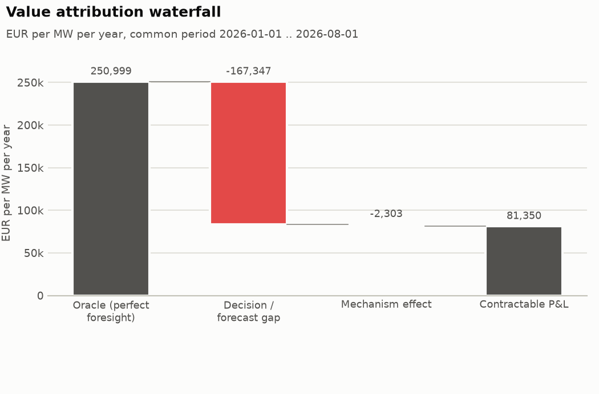
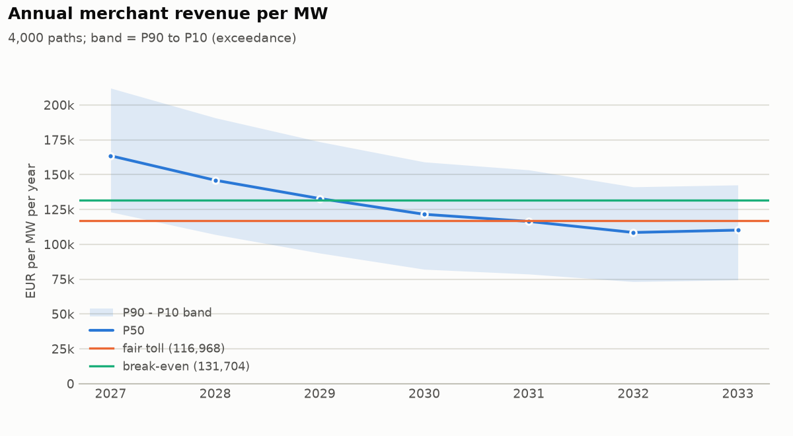
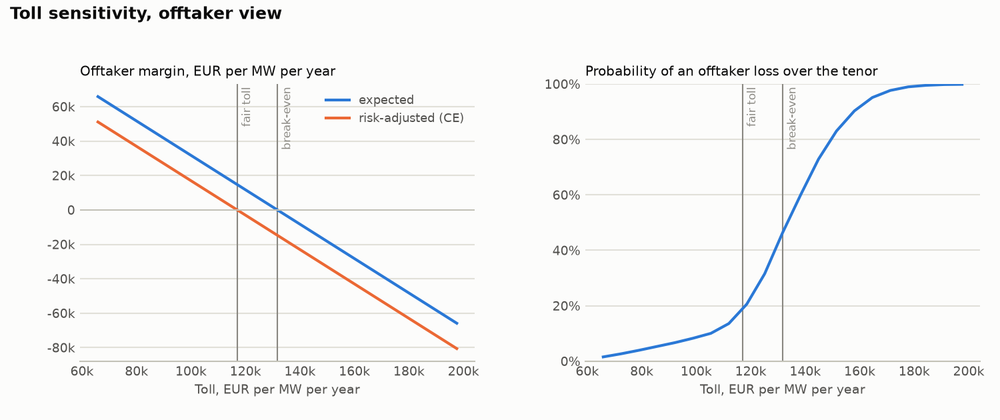

# Sensitivity: the same valuation on the full Jun 2024-Oct 2026 history

## Headline numbers

- Fair flat toll (offtaker certainty equivalent): **116,968 EUR/MW/yr** (9.75 EUR/kW/month); risk-neutral break-even 131,704; owner reservation 102,232; deal zone 102,232 .. 116,968.
- At the fair toll the offtaker expects 14,736 EUR/MW/yr margin, loses money over the tenor on 18.6 % of paths and in 38.8 % of contract years.
- Revenue floor at 86,000 EUR/MW/yr: fair premium 5,980 EUR/MW/yr; zero-premium alternative: owner gives 54.9 % of revenue above 132,000.
- Partial toll (50 % fixed, owner keeps 80 % of the merchant half): fair toll on the fixed share 140,362 EUR/MW/yr.
- Revenue swap on `index`: fair fixed leg 86,056 EUR/MW/yr, hedge effectiveness 92.3 %.
- Value attribution: oracle 250,999 -> contractable 81,350 EUR/MW/yr (32.4 % of the oracle).

## Inputs

| role | source | market | mechanism | strategy | battery | publication lag | wear cost | fleet MW | availability |
| --- | --- | --- | --- | --- | --- | --- | --- | --- | ---: |
| oracle | artifacts/valuation_inputs/full/be_oracle_oracle_qh.parquet | BE | current | oracle_qh | 1 MW / 2 MWh | - | 8 EUR/MWh | 0 | 100% |
| current | artifacts/valuation_inputs/full/be_current_scales_l_risk.parquet | BE | current | scales_l_risk | 1 MW / 2 MWh | - | 8 EUR/MWh | 0 | 100% |
| new2026 | artifacts/valuation_inputs/full/be_new2026_scales_l_live_risk.parquet | BE | new2026 | scales_l_live_risk | 1 MW / 2 MWh | - | 8 EUR/MWh | 0 | 100% |
| index | artifacts/valuation_inputs/full/be_index_threshold_price.parquet | BE | current | threshold_price | 1 MW / 2 MWh | - | 8 EUR/MWh | 0 | 100% |

## 1. Historical revenue per ledger

Complete local delivery days only (coverage >= 98 %); EUR per MW of battery power.

| ledger | mechanism | period (local days) | days | net EUR/MW/yr | gross EUR/MW/yr | wear EUR/MW/yr | season-weighted net | daily mean / std | daily P05 | neg. days | top-10% days share | cycles/day |
| --- | --- | --- | ---: | ---: | ---: | ---: | ---: | ---: | ---: | ---: | ---: | ---: |
| oracle | current | 2024-06-02 .. 2026-10-24 | 875 | 435,234 | 457,177 | 21,943 | 416,796 | 1,192 / 1,163 | 264 | 0.1 % | 31.7 % | 3.75 |
| current | current | 2024-06-02 .. 2026-10-24 | 875 | 210,511 | 222,579 | 12,068 | 197,903 | 576 / 624 | 42 | 1.8 % | 36.8 % | 2.07 |
| new2026 | new2026 | 2026-01-02 .. 2026-07-31 | 211 | 81,655 | 91,777 | 10,122 | n/a | 224 / 164 | 32 | 2.4 % | 26.7 % | 1.73 |
| index | current | 2024-06-02 .. 2026-10-24 | 875 | 154,661 | 161,395 | 6,734 | 145,682 | 423 / 522 | -3 | 5.6 % | 40.8 % | 1.15 |

## 2. Value attribution

Sequential waterfall: each step re-runs the same battery with one more factor, so each effect is conditional on the steps before it.

Basis: net (P&L net of wear); common period 2026-01-01 .. 2026-08-01 (Europe/Brussels delivery days; 2026-01-01T00:00:00+00:00 to 2026-08-01T00:00:00+00:00 UTC; 20,352 intervals of 15 min, 0.58 years); power 1 MW.

| step | kind | source | effect EUR/MW/yr | level EUR/MW/yr | share of anchor | days with negative effect |
| --- | --- | --- | ---: | ---: | ---: | ---: |
| Oracle (perfect foresight) | anchor | ledger |  | 250,999 | 100.0 % |  |
| Decision / forecast gap | effect | ledger | -167,347 | 83,653 | -66.7 % | 99.5 % |
| Mechanism effect | effect | ledger | -2,303 | 81,350 | -0.9 % | 51.6 % |
| Contractable P&L | total | derived |  | 81,350 | 32.4 % |  |

Notes:
- ledgers were aligned on their common intervals; see dropped_intervals

Levels are annualised over the common period of all ledgers (no seasonal adjustment); a period shorter than a year inherits its seasons.



Mechanism effect split into *repricing* (same dispatch settled at new-formula prices) and *re-optimisation* (strategy re-run under the new formula):

Basis: net (P&L net of wear); common period 2026-01-01 .. 2026-08-01 (Europe/Brussels delivery days; 2026-01-01T00:00:00+00:00 to 2026-08-01T00:00:00+00:00 UTC; 20,352 intervals of 15 min, 0.58 years); power 1 MW.

| step | kind | source | effect EUR/MW/yr | level EUR/MW/yr | share of anchor | days with negative effect |
| --- | --- | --- | ---: | ---: | ---: | ---: |
| Strategy under the current formula | anchor | ledger |  | 83,653 | 100.0 % |  |
| Repricing effect (same dispatch, new-formula prices) | effect | ledger | -33,435 | 50,218 | -40.0 % | 84.5 % |
| Re-optimisation effect (strategy run under the new formula) | effect | ledger | 31,132 | 81,350 | 37.2 % | 13.1 % |
| Strategy under the new formula | total | derived |  | 81,350 | 97.2 % |  |

Notes:
- ledgers were aligned on their common intervals; see dropped_intervals

## 3. Revenue scenarios

The `new2026` ledger covers only 211 complete days, so the `new2026` regime history is the `current` history scaled by the paired-overlap ratio 0.972 (211 common days, 2026-01-02 .. 2026-07-31; observed `new2026` days are kept as observed).

Skill share 26.5 % = 1 - (benchmark index P&L / strategy P&L) on the `current` history. The index is resampled jointly with the asset (same days); under `new2026` it is scaled by the same mechanism ratio (0.972) as the asset.

- Series: `asset`; tenor 2027-2033 (7 years), 4,000 paths, seed 20261124.
- Bootstrap: block, block 7 days, seasonal window +/- 30 days, weekday-aligned: True.
- Regimes (share of path-years): `current` 10.0 %, `new2026` 90.0 %; persistence 1.0.
- Saturation: curve current: capacity_value_curve[current], new2026: capacity_value_curve[new2026]; reference fleet 500 MW; fleet path 2027=800, 2028=1,300, 2029=1,700, 2030=2,000, 2033=2,400 MW (path log-sigma 0.25, year log-sigma 0).
- Skill decay: share 27%, 10% per year.
- Capacity fade 0.0 % per year; availability factor 1; market-level shock log-sigma 0.15 (persistence 0.5).
- Pooled annual revenue P90 / P50 / P10: 85,925 / 126,259 / 176,770 EUR/MW/yr; tenor-average P90 / P50 / P10: 102,408 / 130,628 / 153,510.

| year | mean | std | P90 | P50 | P10 | saturation x | fleet MW (mean) |
| --- | ---: | ---: | ---: | ---: | ---: | ---: | ---: |
| 2027 | 165,635 | 35,038 | 123,232 | 163,535 | 212,071 | 0.888 | 799 |
| 2028 | 147,495 | 33,805 | 107,048 | 145,994 | 190,785 | 0.773 | 1,299 |
| 2029 | 133,180 | 32,400 | 93,707 | 132,860 | 173,605 | 0.711 | 1,698 |
| 2030 | 121,389 | 30,793 | 82,091 | 121,554 | 159,102 | 0.676 | 1,998 |
| 2031 | 116,236 | 30,118 | 78,672 | 116,439 | 153,403 | 0.663 | 2,131 |
| 2032 | 108,036 | 27,963 | 73,217 | 108,504 | 141,220 | 0.652 | 2,264 |
| 2033 | 109,251 | 28,220 | 74,506 | 110,195 | 142,606 | 0.641 | 2,397 |

P90 / P50 / P10 follow the exceedance convention: P90 is exceeded with 90 % probability.



## 4. Contracts

Offtaker: mean-CVaR (weight 0.3 on CVaR 10%), discount rate 8.0%. Owner: mean-CVaR (weight 0.6 on CVaR 10%), discount rate 8.0%. Prices in EUR per MW per year; present values use mid-year discounting.

### 4.1 Fixed toll

*Fixed toll: owner receives a fixed fee, offtaker takes the merchant revenue.* Series `asset`, 2027-2033, deal size 1 MW.

| item | value |
| --- | --- |
| terms | toll 116,968 EUR/MW/yr; escalation per year 0.0 %; owner capture if merchant 100.0 %; deal size MW 1 |
| fair toll | 116,968 EUR/MW/yr (9.75 EUR/kW/month) |
| break-even (risk-neutral, zero expected offtaker margin) | 131,704 EUR/MW/yr |
| offtaker reservation | 116,968 EUR/MW/yr |
| owner reservation | 102,232 EUR/MW/yr |
| deal zone | 102,232 .. 116,968 |
| price direction | offtaker pays (offtaker reservation = maximum, owner reservation = minimum) |
| expected offtaker margin | 14,736 EUR/MW/yr (annuity); PV 79,732 EUR for 1 MW |
| probability of offtaker loss (tenor PV) | 18.6 % |
| share of loss-making offtaker years | 38.8 % |

Both counterparties' views (per MW, present values at each party's discount rate):

|  | offtaker | owner |
| --- | --- | --- |
| risk preference | mean-CVaR (weight 0.3 on CVaR 10%), discount rate 8.0% | mean-CVaR (weight 0.6 on CVaR 10%), discount rate 8.0% |
| benchmark | no deal (zero cash) | merchant (100% capture of simulated revenue) |
| expected PV, EUR/MW | 79,732 | 632,869 |
| certainty-equivalent PV, EUR/MW | 0 | 632,869 |
| risk premium (E - CE), EUR/MW | 79,732 | 0 |
| CVaR of PV, EUR/MW | -186,041 | 632,869 |
| risk-adjusted gain vs benchmark, EUR/MW/yr | 0 | 14,736 |
| probability worse off than benchmark | 18.6 % | 81.4 % |
| annual cash P90 / P50 / P10, EUR/MW/yr | -31,043 / 9,291 / 59,802 | 116,968 / 116,968 / 116,968 |



A flat toll against declining merchant revenue loses money in late years. With a toll escalating at -6% per year the fair first-year toll is 137,153 EUR/MW/yr and the share of loss-making offtaker years falls from 38.8 % to 32.0 %.

### 4.2 Revenue floor

*Revenue floor: owner keeps merchant revenue, offtaker tops annual revenue up to the floor.* Series `asset`, 2027-2033, deal size 1 MW.

| item | value |
| --- | --- |
| terms | floor 86,000 EUR/MW/yr; premium 5,980 EUR/MW/yr; upside share 0.0 %; upside threshold 86,000 EUR/MW/yr; deal size MW 1 |
| fair floor premium | 5,980 EUR/MW/yr (0.50 EUR/kW/month) |
| break-even (risk-neutral, zero expected offtaker margin) | 1,777 EUR/MW/yr |
| offtaker reservation | 5,980 EUR/MW/yr |
| owner reservation | 9,724 EUR/MW/yr |
| deal zone | 5,980 .. 9,724 |
| price direction | owner pays (offtaker reservation = minimum premium, owner reservation = maximum premium) |
| expected offtaker margin | 4,203 EUR/MW/yr (annuity); PV 22,739 EUR for 1 MW |
| probability of offtaker loss (tenor PV) | 8.5 % |
| share of loss-making offtaker years | 7.7 % |
| probability the floor pays in a year | 10.0 % |
| expected floor payout | 1,979 EUR/MW/yr |
| expected upside paid to the provider | 0 EUR/MW/yr |
| largest annual floor payout | 70,051 EUR/MW/yr |

Both counterparties' views (per MW, present values at each party's discount rate):

|  | offtaker | owner |
| --- | --- | --- |
| risk preference | mean-CVaR (weight 0.3 on CVaR 10%), discount rate 8.0% | mean-CVaR (weight 0.6 on CVaR 10%), discount rate 8.0% |
| benchmark | no deal (zero cash) | merchant without floor |
| expected PV, EUR/MW | 22,739 | 689,862 |
| certainty-equivalent PV, EUR/MW | 0 | 573,398 |
| risk premium (E - CE), EUR/MW | 22,739 | 116,465 |
| CVaR of PV, EUR/MW | -53,057 | 495,754 |
| risk-adjusted gain vs benchmark, EUR/MW/yr | 0 | 3,744 |
| probability worse off than benchmark | 8.5 % | 91.5 % |
| annual cash P90 / P50 / P10, EUR/MW/yr | 5,905 / 5,980 / 5,980 | 80,020 / 120,279 / 170,790 |

Zero-premium version (upside sharing pays for the floor):

*Revenue floor: owner keeps merchant revenue, offtaker tops annual revenue up to the floor.* Series `asset`, 2027-2033, deal size 1 MW.

| item | value |
| --- | --- |
| terms | floor 86,000 EUR/MW/yr; premium 0 EUR/MW/yr; upside share 54.9 %; upside threshold 132,000 EUR/MW/yr; deal size MW 1 |
| fair floor premium | 0 EUR/MW/yr (-0.00 EUR/kW/month) |
| break-even (risk-neutral, zero expected offtaker margin) | -6,199 EUR/MW/yr |
| offtaker reservation | 0 EUR/MW/yr |
| owner reservation | 6,095 EUR/MW/yr |
| deal zone | 0 .. 6,095 |
| price direction | owner pays (offtaker reservation = minimum premium, owner reservation = maximum premium) |
| expected offtaker margin | 6,199 EUR/MW/yr (annuity); PV 33,542 EUR for 1 MW |
| probability of offtaker loss (tenor PV) | 13.2 % |
| share of loss-making offtaker years | 56.6 % |
| probability the floor pays in a year | 10.0 % |
| expected floor payout | 1,979 EUR/MW/yr |
| expected upside paid to the provider | 7,074 EUR/MW/yr |
| largest annual floor payout | 70,051 EUR/MW/yr |

Both counterparties' views (per MW, present values at each party's discount rate):

|  | offtaker | owner |
| --- | --- | --- |
| risk preference | mean-CVaR (weight 0.3 on CVaR 10%), discount rate 8.0% | mean-CVaR (weight 0.6 on CVaR 10%), discount rate 8.0% |
| benchmark | no deal (zero cash) | merchant without floor |
| expected PV, EUR/MW | 33,542 | 679,059 |
| certainty-equivalent PV, EUR/MW | 0 | 586,117 |
| risk premium (E - CE), EUR/MW | 33,542 | 92,943 |
| CVaR of PV, EUR/MW | -78,265 | 524,155 |
| risk-adjusted gain vs benchmark, EUR/MW/yr | 0 | 6,095 |
| probability worse off than benchmark | 13.2 % | 86.9 % |
| annual cash P90 / P50 / P10, EUR/MW/yr | -75 / 0 / 24,594 | 86,000 / 126,259 / 152,175 |

### 4.3 Partial toll

*Partial toll: 50% of capacity at a fixed toll, 50% merchant with the owner keeping 80% of that merchant revenue.* Series `asset`, 2027-2033, deal size 1 MW.

| item | value |
| --- | --- |
| terms | fixed share of capacity 50.0 %; owner share of merchant revenue 80.0 %; toll 140,362 EUR/MW/yr; escalation per year 0.0 %; owner capture if merchant 100.0 %; deal size MW 1 |
| fair toll on the fixed share | 140,362 EUR/MW/yr (11.70 EUR/kW/month) |
| break-even (risk-neutral, zero expected offtaker margin) | 158,045 EUR/MW/yr |
| offtaker reservation | 140,362 EUR/MW/yr |
| owner reservation | 122,678 EUR/MW/yr |
| deal zone | 122,678 .. 140,362 |
| price direction | offtaker pays (offtaker reservation = maximum, owner reservation = minimum) |
| expected offtaker margin | 8,842 EUR/MW/yr (annuity); PV 47,839 EUR for 1 MW |
| probability of offtaker loss (tenor PV) | 18.6 % |
| share of loss-making offtaker years | 38.8 % |
| fixed share of the owner's expected cash | 57.7 % |

Both counterparties' views (per MW, present values at each party's discount rate):

|  | offtaker | owner |
| --- | --- | --- |
| risk preference | mean-CVaR (weight 0.3 on CVaR 10%), discount rate 8.0% | mean-CVaR (weight 0.6 on CVaR 10%), discount rate 8.0% |
| benchmark | no deal (zero cash) | merchant (100% capture of simulated revenue) |
| expected PV, EUR/MW | 47,839 | 664,762 |
| certainty-equivalent PV, EUR/MW | 0 | 600,977 |
| risk premium (E - CE), EUR/MW | 47,839 | 63,786 |
| CVaR of PV, EUR/MW | -111,625 | 558,453 |
| risk-adjusted gain vs benchmark, EUR/MW/yr | 0 | 8,842 |
| probability worse off than benchmark | 18.6 % | 81.4 % |
| annual cash P90 / P50 / P10, EUR/MW/yr | -18,626 / 5,575 / 35,881 | 104,551 / 120,684 / 140,889 |

The toll per *tolled* MW exceeds the full toll because the offtaker also keeps 20 % of the merchant half; in its valuation that fee income subsidises the fixed payment. If the fee only covers trading costs, raise the offtaker's required margin instead.

### 4.4 Revenue swap

*Revenue swap on 100% notional: owner pays the `index` revenue index and receives a fixed amount.* Series `asset`, 2027-2033, deal size 1 MW.

| item | value |
| --- | --- |
| terms | notional 100.0 %; fixed leg 86,056 EUR/MW/yr; reference index index; owner capture if merchant 100.0 %; deal size MW 1 |
| fair fixed leg | 86,056 EUR/MW/yr (7.17 EUR/kW/month) |
| break-even (risk-neutral, zero expected offtaker margin) | 96,875 EUR/MW/yr |
| offtaker reservation | 86,056 EUR/MW/yr |
| owner reservation | 75,319 EUR/MW/yr |
| deal zone | 75,319 .. 86,056 |
| price direction | offtaker pays (offtaker reservation = maximum, owner reservation = minimum) |
| expected offtaker margin | 10,819 EUR/MW/yr (annuity); PV 58,538 EUR for 1 MW |
| probability of offtaker loss (tenor PV) | 18.4 % |
| share of loss-making offtaker years | 38.9 % |
| hedge effectiveness (PV variance reduction) | 92.3 % |
| annual correlation, index vs asset | 0.990 |
| basis risk (std of asset minus index) | 10,885 EUR/MW/yr |

Both counterparties' views (per MW, present values at each party's discount rate):

|  | offtaker | owner |
| --- | --- | --- |
| risk preference | mean-CVaR (weight 0.3 on CVaR 10%), discount rate 8.0% | mean-CVaR (weight 0.6 on CVaR 10%), discount rate 8.0% |
| benchmark | no deal (zero cash) | merchant (100% capture of `asset`) |
| expected PV, EUR/MW | 58,538 | 654,063 |
| certainty-equivalent PV, EUR/MW | 0 | 611,232 |
| risk premium (E - CE), EUR/MW | 58,538 | 42,831 |
| CVaR of PV, EUR/MW | -136,589 | 582,678 |
| risk-adjusted gain vs benchmark, EUR/MW/yr | 0 | 10,737 |
| probability worse off than benchmark | 18.4 % | 81.6 % |
| annual cash P90 / P50 / P10, EUR/MW/yr | -22,632 / 6,848 / 43,770 | 107,440 / 119,176 / 134,231 |

## Assumptions and limitations

- Revenue paths resample *historical days* of the ledgers; they cannot contain market states that never occurred in the history. The market-level shock (log-sigma 0.15, persistence 0.5) is an explicit, uncalibrated allowance for inter-annual spread uncertainty.
- Saturation scales all days of a year by the capacity-value ratio V(Q)/V(Q_ref); curve source: be_nash_capacity_curve.csv (one curve per formula: current, new2026). Fleet path 2027=800, 2028=1,300, 2029=1,700, 2030=2,000, 2033=2,400 MW (reference 500 MW) is an assumption to replace.
- Regime weights current=0.1,new2026=0.9: probability that the realised behaviour of each settlement regime applies for the whole tenor (persistence 1).
- Contract values are on net P&L (`pnl_eur`: revenue minus the ledger's degradation charge), i.e. a toll with a throughput charge at the ledger's EUR/MWh wear rate; use the CLI `--value revenue` for gross.
- No credit risk, collateral, tax, inflation indexation or operating costs; the risk profiles are illustrative, not calibrated to any company.

## Reproduce

```bash
.venv/bin/python scripts/research/valuation_demo.py <ledger arguments>
```

Seed 20261124; 4,000 paths; tenor 2027-2033.

## Inputs and judgement calls of this run

Built by `scripts/research/valuation_belgium.py` from committed ledgers in `reports/ledgers/`:

- revenue scope: implicit balancing only (SCALES-L); current-regime history full history (Jun 2024 onwards);
- ledgers: current: realtime_prism_risk_current_A + realtime_prism_risk_current_B + realtime_prism_risk_current_C, new2026: realtime_prism_live_risk_new2026_B, oracle: realtime_oracle_qh_current_A + realtime_oracle_qh_current_B + realtime_oracle_qh_current_C, index: realtime_threshold_price_current_A + realtime_threshold_price_current_B + realtime_threshold_price_current_C;
- the new-formula ledger covers Jan-Jul 2026 (Elia's simulation) and is stretched over the current history by
  the paired-overlap ratio;
- saturation: symmetric-Nash per-MW value versus total implicitly reacting MW (four fleets, Jan-Jul 2026,
  `reports/impact.md`), one curve per formula.

Judgement calls (not data): implicitly reacting Belgian fleet 500 MW in 2026 and 2027=800, 2028=1300, 2029=1700, 2030=2000, 2033=2400 MW afterwards (about half of an
operational fleet growing from ~1 GW towards ~4 GW by 2030); regime weights current=0.1, new2026=0.9 for the tenor. Change them on the command line before quoting a number.
