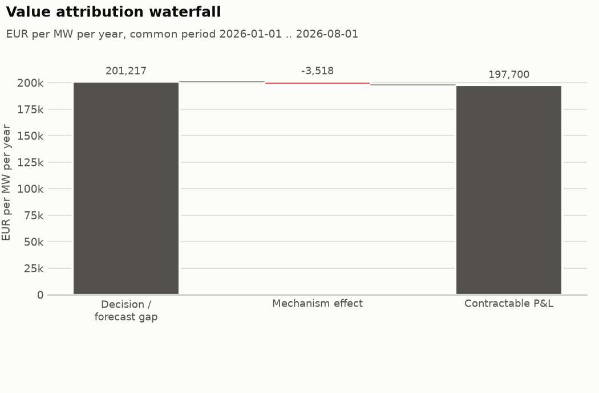
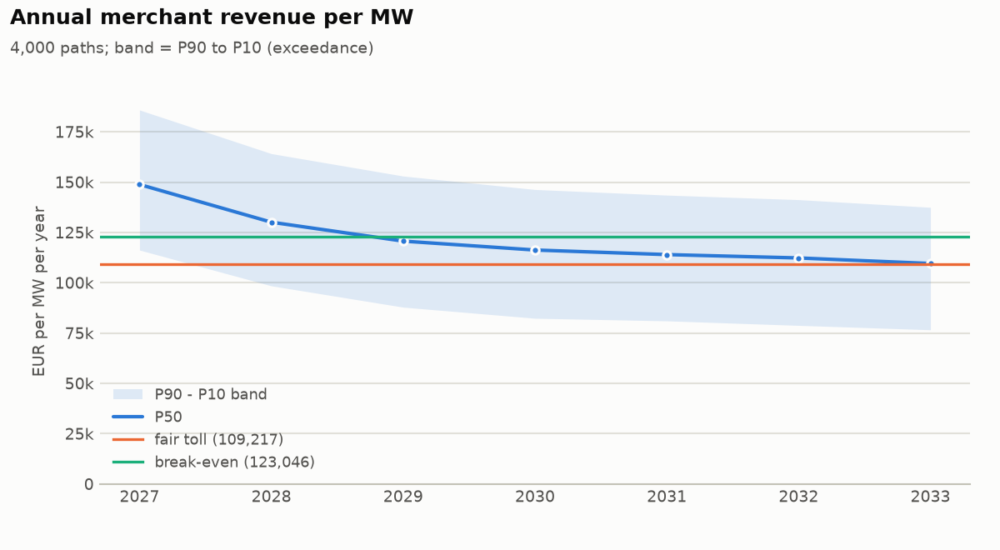
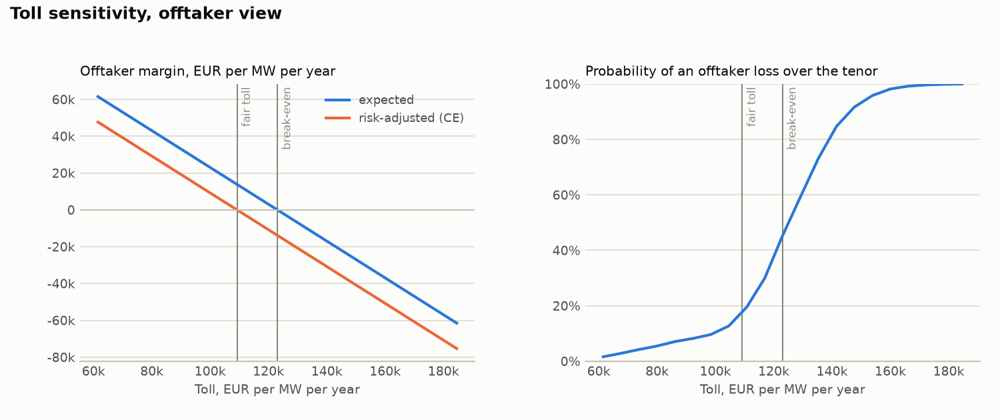

# Belgian 1 MW / 2 MWh battery: toll on the aFRR + implicit-balancing stack (latest 12 months)

## Headline numbers

- Fair flat toll (offtaker certainty equivalent): **109,217 EUR/MW/yr** (9.10 EUR/kW/month); risk-neutral break-even 123,046; owner reservation 95,387; deal zone 95,387 .. 109,217.
- At the fair toll the offtaker expects 13,830 EUR/MW/yr margin, loses money over the tenor on 17.2 % of paths and in 32.7 % of contract years.
- Revenue floor at 80,000 EUR/MW/yr: fair premium 4,940 EUR/MW/yr; zero-premium alternative: owner gives 57.4 % of revenue above 123,000.
- Partial toll (50 % fixed, owner keeps 80 % of the merchant half): fair toll on the fixed share 131,060 EUR/MW/yr.
- Revenue swap on `index`: fair fixed leg 118,635 EUR/MW/yr, hedge effectiveness 99.1 %.
- Value attribution: oracle 201,217 -> contractable 197,700 EUR/MW/yr (98.3 % of the oracle).

## Inputs

| role | source | market | mechanism | strategy | battery | publication lag | wear cost | fleet MW | availability |
| --- | --- | --- | --- | --- | --- | --- | --- | --- | ---: |
| current | artifacts/valuation_inputs/stack/be_current_afrr_implicit_forecast_split.parquet | BE | current | afrr_implicit_forecast_split | 1 MW / 2 MWh | - | 8 EUR/MWh | 0 | 100% |
| new2026 | artifacts/valuation_inputs/stack/be_new2026_afrr_implicit_forecast_split.parquet | BE | new2026 | afrr_implicit_forecast_split | 1 MW / 2 MWh | - | 8 EUR/MWh | 0 | 100% |
| index | artifacts/valuation_inputs/stack/be_index_afrr_fixed_100.parquet | BE | current | afrr_fixed_100 | 1 MW / 2 MWh | - | 8 EUR/MWh | 0 | 100% |

## 1. Historical revenue per ledger

Complete local delivery days only (coverage >= 98 %); EUR per MW of battery power.

| ledger | mechanism | period (local days) | days | net EUR/MW/yr | gross EUR/MW/yr | wear EUR/MW/yr | season-weighted net | daily mean / std | daily P05 | neg. days | top-10% days share | cycles/day |
| --- | --- | --- | ---: | ---: | ---: | ---: | ---: | ---: | ---: | ---: | ---: | ---: |
| current | current | 2025-11-02 .. 2026-10-24 | 357 | 172,814 | 177,237 | 4,423 | 171,809 | 473 / 222 | 167 | 0.6 % | 19.8 % | 0.76 |
| new2026 | new2026 | 2026-01-02 .. 2026-07-31 | 211 | 198,404 | 202,781 | 4,376 | n/a | 543 / 230 | 199 | 0.0 % | 19.5 % | 0.75 |
| index | current | 2025-11-02 .. 2026-10-24 | 357 | 187,340 | 191,151 | 3,811 | 186,733 | 513 / 224 | 209 | 0.3 % | 19.1 % | 0.65 |

## 2. Value attribution

Sequential waterfall: each step re-runs the same battery with one more factor, so each effect is conditional on the steps before it.

Basis: net (P&L net of wear); common period 2026-01-01 .. 2026-08-01 (Europe/Brussels delivery days; 2026-01-01T00:00:00+00:00 to 2026-08-01T00:00:00+00:00 UTC; 20,352 intervals of 15 min, 0.58 years); power 1 MW.

| step | kind | source | effect EUR/MW/yr | level EUR/MW/yr | share of anchor | days with negative effect |
| --- | --- | --- | ---: | ---: | ---: | ---: |
| Decision / forecast gap | anchor | ledger |  | 201,217 | 100.0 % |  |
| Mechanism effect | effect | ledger | -3,518 | 197,700 | -1.7 % | 59.2 % |
| Contractable P&L | total | derived |  | 197,700 | 98.3 % |  |

Notes:
- anchor is `strategy` because no `oracle` ledger was given
- ledgers were aligned on their common intervals; see dropped_intervals

Levels are annualised over the common period of all ledgers (no seasonal adjustment); a period shorter than a year inherits its seasons.



## 3. Revenue scenarios

The `new2026` ledger covers only 211 complete days, so the `new2026` regime history is the `current` history scaled by the paired-overlap ratio 0.982 (211 common days, 2026-01-02 .. 2026-07-31; observed `new2026` days are kept as observed).

Skill share 0.0 % = 1 - (benchmark index P&L / strategy P&L) on the `current` history. The index is resampled jointly with the asset (same days); under `new2026` it is scaled by the same mechanism ratio (0.982) as the asset.

- Series: `asset`; tenor 2027-2033 (7 years), 4,000 paths, seed 20261124.
- Bootstrap: block, block 7 days, seasonal window +/- 30 days, weekday-aligned: True.
- Regimes (share of path-years): `current` 10.0 %, `new2026` 90.0 %; persistence 1.0.
- Saturation: curve current: capacity_value_curve[current], new2026: capacity_value_curve[new2026]; reference fleet 500 MW; fleet path 2027=800, 2028=1,300, 2029=1,700, 2030=2,000, 2033=2,400 MW (path log-sigma 0.25, year log-sigma 0).
- Skill decay: none.
- Capacity fade 0.0 % per year; availability factor 1; market-level shock log-sigma 0.15 (persistence 0.5).
- Pooled annual revenue P90 / P50 / P10: 87,087 / 120,464 / 158,479 EUR/MW/yr; tenor-average P90 / P50 / P10: 97,695 / 123,051 / 143,254.

| year | mean | std | P90 | P50 | P10 | saturation x | fleet MW (mean) |
| --- | ---: | ---: | ---: | ---: | ---: | ---: | ---: |
| 2027 | 150,040 | 27,423 | 116,233 | 148,828 | 185,848 | 0.888 | 799 |
| 2028 | 130,754 | 26,701 | 98,454 | 130,090 | 164,165 | 0.773 | 1,299 |
| 2029 | 120,429 | 26,801 | 87,863 | 120,697 | 153,019 | 0.711 | 1,698 |
| 2030 | 115,201 | 26,395 | 82,347 | 116,268 | 146,328 | 0.676 | 1,998 |
| 2031 | 112,554 | 26,357 | 81,049 | 113,996 | 143,539 | 0.663 | 2,131 |
| 2032 | 110,779 | 26,398 | 78,804 | 112,324 | 141,283 | 0.652 | 2,264 |
| 2033 | 107,815 | 25,670 | 76,620 | 109,571 | 137,484 | 0.641 | 2,397 |

P90 / P50 / P10 follow the exceedance convention: P90 is exceeded with 90 % probability.



## 4. Contracts

Offtaker: mean-CVaR (weight 0.3 on CVaR 10%), discount rate 8.0%. Owner: mean-CVaR (weight 0.6 on CVaR 10%), discount rate 8.0%. Prices in EUR per MW per year; present values use mid-year discounting.

### 4.1 Fixed toll

*Fixed toll: owner receives a fixed fee, offtaker takes the merchant revenue.* Series `asset`, 2027-2033, deal size 1 MW.

| item | value |
| --- | --- |
| terms | toll 109,217 EUR/MW/yr; escalation per year 0.0 %; owner capture if merchant 100.0 %; deal size MW 1 |
| fair toll | 109,217 EUR/MW/yr (9.10 EUR/kW/month) |
| break-even (risk-neutral, zero expected offtaker margin) | 123,046 EUR/MW/yr |
| offtaker reservation | 109,217 EUR/MW/yr |
| owner reservation | 95,387 EUR/MW/yr |
| deal zone | 95,387 .. 109,217 |
| price direction | offtaker pays (offtaker reservation = maximum, owner reservation = minimum) |
| expected offtaker margin | 13,830 EUR/MW/yr (annuity); PV 74,828 EUR for 1 MW |
| probability of offtaker loss (tenor PV) | 17.2 % |
| share of loss-making offtaker years | 32.7 % |

Both counterparties' views (per MW, present values at each party's discount rate):

|  | offtaker | owner |
| --- | --- | --- |
| risk preference | mean-CVaR (weight 0.3 on CVaR 10%), discount rate 8.0% | mean-CVaR (weight 0.6 on CVaR 10%), discount rate 8.0% |
| benchmark | no deal (zero cash) | merchant (100% capture of simulated revenue) |
| expected PV, EUR/MW | 74,828 | 590,929 |
| certainty-equivalent PV, EUR/MW | 0 | 590,929 |
| risk premium (E - CE), EUR/MW | 74,828 | 0 |
| CVaR of PV, EUR/MW | -174,598 | 590,929 |
| risk-adjusted gain vs benchmark, EUR/MW/yr | 0 | 13,830 |
| probability worse off than benchmark | 17.2 % | 82.8 % |
| annual cash P90 / P50 / P10, EUR/MW/yr | -22,130 / 11,248 / 49,262 | 109,217 / 109,217 / 109,217 |



A flat toll against declining merchant revenue loses money in late years. With a toll escalating at -6% per year the fair first-year toll is 128,064 EUR/MW/yr and the share of loss-making offtaker years falls from 32.7 % to 27.1 %.

### 4.2 Revenue floor

*Revenue floor: owner keeps merchant revenue, offtaker tops annual revenue up to the floor.* Series `asset`, 2027-2033, deal size 1 MW.

| item | value |
| --- | --- |
| terms | floor 80,000 EUR/MW/yr; premium 4,940 EUR/MW/yr; upside share 0.0 %; upside threshold 80,000 EUR/MW/yr; deal size MW 1 |
| fair floor premium | 4,940 EUR/MW/yr (0.41 EUR/kW/month) |
| break-even (risk-neutral, zero expected offtaker margin) | 1,352 EUR/MW/yr |
| offtaker reservation | 4,940 EUR/MW/yr |
| owner reservation | 8,281 EUR/MW/yr |
| deal zone | 4,940 .. 8,281 |
| price direction | owner pays (offtaker reservation = minimum premium, owner reservation = maximum premium) |
| expected offtaker margin | 3,588 EUR/MW/yr (annuity); PV 19,413 EUR for 1 MW |
| probability of offtaker loss (tenor PV) | 8.0 % |
| share of loss-making offtaker years | 6.2 % |
| probability the floor pays in a year | 7.4 % |
| expected floor payout | 1,491 EUR/MW/yr |
| expected upside paid to the provider | 0 EUR/MW/yr |
| largest annual floor payout | 63,467 EUR/MW/yr |

Both counterparties' views (per MW, present values at each party's discount rate):

|  | offtaker | owner |
| --- | --- | --- |
| risk preference | mean-CVaR (weight 0.3 on CVaR 10%), discount rate 8.0% | mean-CVaR (weight 0.6 on CVaR 10%), discount rate 8.0% |
| benchmark | no deal (zero cash) | merchant without floor |
| expected PV, EUR/MW | 19,413 | 646,343 |
| certainty-equivalent PV, EUR/MW | 0 | 534,174 |
| risk premium (E - CE), EUR/MW | 19,413 | 112,169 |
| CVaR of PV, EUR/MW | -45,298 | 459,395 |
| risk-adjusted gain vs benchmark, EUR/MW/yr | 0 | 3,340 |
| probability worse off than benchmark | 8.0 % | 92.0 % |
| annual cash P90 / P50 / P10, EUR/MW/yr | 4,940 / 4,940 / 4,940 | 82,146 / 115,524 / 153,539 |

Zero-premium version (upside sharing pays for the floor):

*Revenue floor: owner keeps merchant revenue, offtaker tops annual revenue up to the floor.* Series `asset`, 2027-2033, deal size 1 MW.

| item | value |
| --- | --- |
| terms | floor 80,000 EUR/MW/yr; premium 0 EUR/MW/yr; upside share 57.4 %; upside threshold 123,000 EUR/MW/yr; deal size MW 1 |
| fair floor premium | 0 EUR/MW/yr (-0.00 EUR/kW/month) |
| break-even (risk-neutral, zero expected offtaker margin) | -5,305 EUR/MW/yr |
| offtaker reservation | 0 EUR/MW/yr |
| owner reservation | 5,238 EUR/MW/yr |
| deal zone | 0 .. 5,238 |
| price direction | owner pays (offtaker reservation = minimum premium, owner reservation = maximum premium) |
| expected offtaker margin | 5,305 EUR/MW/yr (annuity); PV 28,702 EUR for 1 MW |
| probability of offtaker loss (tenor PV) | 12.6 % |
| share of loss-making offtaker years | 54.0 % |
| probability the floor pays in a year | 7.4 % |
| expected floor payout | 1,491 EUR/MW/yr |
| expected upside paid to the provider | 6,009 EUR/MW/yr |
| largest annual floor payout | 63,467 EUR/MW/yr |

Both counterparties' views (per MW, present values at each party's discount rate):

|  | offtaker | owner |
| --- | --- | --- |
| risk preference | mean-CVaR (weight 0.3 on CVaR 10%), discount rate 8.0% | mean-CVaR (weight 0.6 on CVaR 10%), discount rate 8.0% |
| benchmark | no deal (zero cash) | merchant without floor |
| expected PV, EUR/MW | 28,702 | 637,055 |
| certainty-equivalent PV, EUR/MW | 0 | 544,440 |
| risk premium (E - CE), EUR/MW | 28,702 | 92,615 |
| CVaR of PV, EUR/MW | -66,971 | 482,697 |
| risk-adjusted gain vs benchmark, EUR/MW/yr | 0 | 5,238 |
| probability worse off than benchmark | 12.6 % | 87.4 % |
| annual cash P90 / P50 / P10, EUR/MW/yr | 0 / 0 / 20,380 | 87,087 / 120,464 / 138,099 |

### 4.3 Partial toll

*Partial toll: 50% of capacity at a fixed toll, 50% merchant with the owner keeping 80% of that merchant revenue.* Series `asset`, 2027-2033, deal size 1 MW.

| item | value |
| --- | --- |
| terms | fixed share of capacity 50.0 %; owner share of merchant revenue 80.0 %; toll 131,060 EUR/MW/yr; escalation per year 0.0 %; owner capture if merchant 100.0 %; deal size MW 1 |
| fair toll on the fixed share | 131,060 EUR/MW/yr (10.92 EUR/kW/month) |
| break-even (risk-neutral, zero expected offtaker margin) | 147,656 EUR/MW/yr |
| offtaker reservation | 131,060 EUR/MW/yr |
| owner reservation | 114,464 EUR/MW/yr |
| deal zone | 114,464 .. 131,060 |
| price direction | offtaker pays (offtaker reservation = maximum, owner reservation = minimum) |
| expected offtaker margin | 8,298 EUR/MW/yr (annuity); PV 44,897 EUR for 1 MW |
| probability of offtaker loss (tenor PV) | 17.2 % |
| share of loss-making offtaker years | 32.7 % |
| fixed share of the owner's expected cash | 57.5 % |

Both counterparties' views (per MW, present values at each party's discount rate):

|  | offtaker | owner |
| --- | --- | --- |
| risk preference | mean-CVaR (weight 0.3 on CVaR 10%), discount rate 8.0% | mean-CVaR (weight 0.6 on CVaR 10%), discount rate 8.0% |
| benchmark | no deal (zero cash) | merchant (100% capture of simulated revenue) |
| expected PV, EUR/MW | 44,897 | 620,860 |
| certainty-equivalent PV, EUR/MW | 0 | 560,998 |
| risk premium (E - CE), EUR/MW | 44,897 | 59,862 |
| CVaR of PV, EUR/MW | -104,759 | 521,090 |
| risk-adjusted gain vs benchmark, EUR/MW/yr | 0 | 8,298 |
| probability worse off than benchmark | 17.2 % | 82.8 % |
| annual cash P90 / P50 / P10, EUR/MW/yr | -13,278 / 6,749 / 29,557 | 100,365 / 113,716 / 128,922 |

The toll per *tolled* MW exceeds the full toll because the offtaker also keeps 20 % of the merchant half; in its valuation that fee income subsidises the fixed payment. If the fee only covers trading costs, raise the offtaker's required margin instead.

### 4.4 Revenue swap

*Revenue swap on 100% notional: owner pays the `index` revenue index and receives a fixed amount.* Series `asset`, 2027-2033, deal size 1 MW.

| item | value |
| --- | --- |
| terms | notional 100.0 %; fixed leg 118,635 EUR/MW/yr; reference index index; owner capture if merchant 100.0 %; deal size MW 1 |
| fair fixed leg | 118,635 EUR/MW/yr (9.89 EUR/kW/month) |
| break-even (risk-neutral, zero expected offtaker margin) | 133,658 EUR/MW/yr |
| offtaker reservation | 118,635 EUR/MW/yr |
| owner reservation | 107,834 EUR/MW/yr |
| deal zone | 107,834 .. 118,635 |
| price direction | offtaker pays (offtaker reservation = maximum, owner reservation = minimum) |
| expected offtaker margin | 15,022 EUR/MW/yr (annuity); PV 81,281 EUR for 1 MW |
| probability of offtaker loss (tenor PV) | 17.2 % |
| share of loss-making offtaker years | 32.5 % |
| hedge effectiveness (PV variance reduction) | 99.1 % |
| annual correlation, index vs asset | 0.998 |
| basis risk (std of asset minus index) | 3,141 EUR/MW/yr |

Both counterparties' views (per MW, present values at each party's discount rate):

|  | offtaker | owner |
| --- | --- | --- |
| risk preference | mean-CVaR (weight 0.3 on CVaR 10%), discount rate 8.0% | mean-CVaR (weight 0.6 on CVaR 10%), discount rate 8.0% |
| benchmark | no deal (zero cash) | merchant (100% capture of `asset`) |
| expected PV, EUR/MW | 81,281 | 584,476 |
| certainty-equivalent PV, EUR/MW | 0 | 574,541 |
| risk premium (E - CE), EUR/MW | 81,281 | 9,935 |
| CVaR of PV, EUR/MW | -189,655 | 567,918 |
| risk-adjusted gain vs benchmark, EUR/MW/yr | 0 | 10,801 |
| probability worse off than benchmark | 17.2 % | 82.8 % |
| annual cash P90 / P50 / P10, EUR/MW/yr | -23,947 / 12,380 / 53,290 | 104,188 / 108,366 / 111,973 |

## Assumptions and limitations

- Revenue paths resample *historical days* of the ledgers; they cannot contain market states that never occurred in the history. The market-level shock (log-sigma 0.15, persistence 0.5) is an explicit, uncalibrated allowance for inter-annual spread uncertainty.
- Saturation scales all days of a year by the capacity-value ratio V(Q)/V(Q_ref); curve source: be_nash_capacity_curve.csv (one curve per formula: current, new2026). Fleet path 2027=800, 2028=1,300, 2029=1,700, 2030=2,000, 2033=2,400 MW (reference 500 MW) is an assumption to replace.
- Regime weights current=0.1,new2026=0.9: probability that the realised behaviour of each settlement regime applies for the whole tenor (persistence 1).
- Contract values are on net P&L (`pnl_eur`: revenue minus the ledger's degradation charge), i.e. a toll with a throughput charge at the ledger's EUR/MWh wear rate; use the CLI `--value revenue` for gross.
- No credit risk, collateral, tax, inflation indexation or operating costs; the risk profiles are illustrative, not calibrated to any company.

## Reproduce

```bash
.venv/bin/python scripts/research/valuation_demo.py <ledger arguments>
```

Seed 20261124; 4,000 paths; tenor 2027-2033.

## Inputs and judgement calls of this run

Built by `scripts/research/valuation_belgium.py` from committed ledgers in `reports/ledgers/`:

- revenue scope: aFRR capacity + aFRR energy + implicit balancing (reserve forecast split, threshold implicit layer); current-regime history from 2025-11-01;
- ledgers: current: reserve_forecast_current_2025 + reserve_forecast_current_2026YTD, new2026: reserve_forecast_new2026_2026-01_2026-07, index: reserve_fixed_100_current_2025 + reserve_fixed_100_current_2026YTD;
- the new-formula ledger covers Jan-Jul 2026 (Elia's simulation) and is stretched over the current history by
  the paired-overlap ratio;
- saturation: symmetric-Nash per-MW value versus total implicitly reacting MW (four fleets, Jan-Jul 2026,
  `reports/impact.md`), one curve per formula; applied to the whole stack here, which is conservative for the aFRR part (its capacity prices already collapsed once as batteries entered, and that history is in the ledgers).

Judgement calls (not data): implicitly reacting Belgian fleet 500 MW in 2026 and 2027=800, 2028=1300, 2029=1700, 2030=2000, 2033=2400 MW afterwards (about half of an
operational fleet growing from ~1 GW towards ~4 GW by 2030); regime weights current=0.1, new2026=0.9 for the tenor. Change them on the command line before quoting a number.
