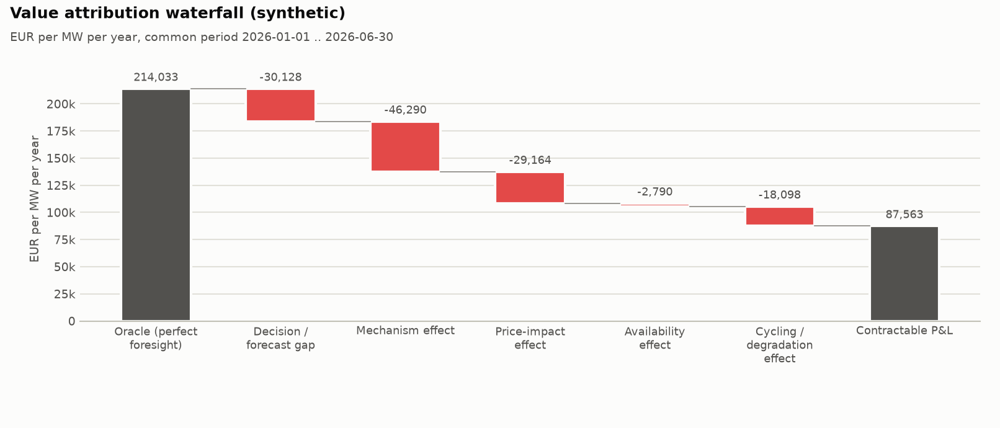
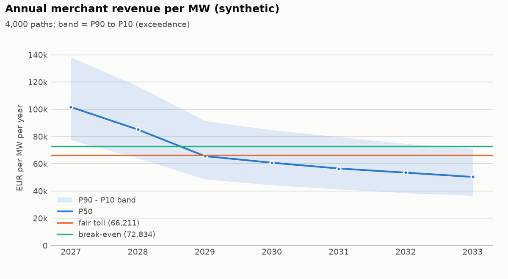
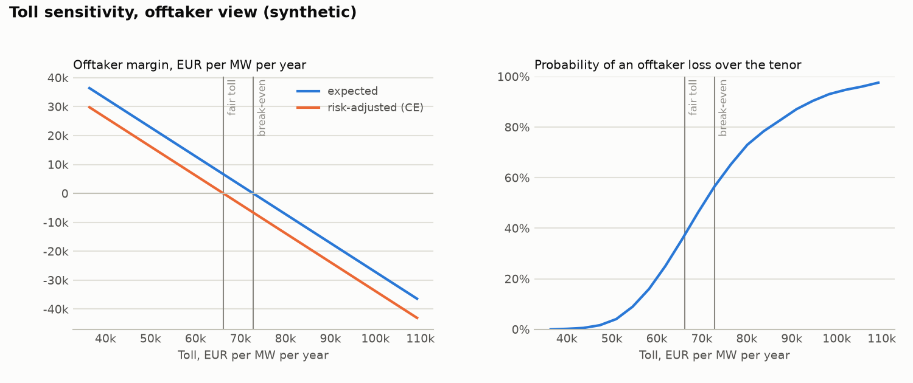
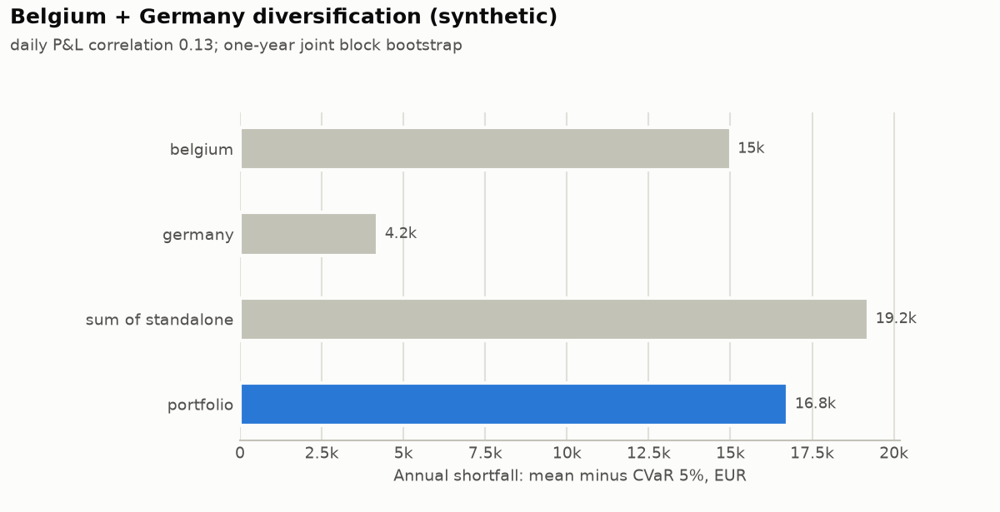

# Contract valuation demo - SYNTHETIC DATA

> **Synthetic inputs - not market evidence.** Every ledger in this report comes from the seeded toy generator in `euroflex_bess_lab.valuation.synthetic` (synthetic imbalance-like prices and a toy daily-arbitrage dispatch). The numbers demonstrate the method and the report layout only. The capacity-value curve is a placeholder and the fleet path is illustrative.

## Headline numbers

- Fair flat toll (offtaker certainty equivalent): **66,211 EUR/MW/yr** (5.52 EUR/kW/month); risk-neutral break-even 72,834; owner reservation 59,589; deal zone 59,589 .. 66,211.
- At the fair toll the offtaker expects 6,623 EUR/MW/yr margin, loses money over the tenor on 37.6 % of paths and in 52.1 % of contract years.
- Revenue floor at 47,000 EUR/MW/yr: fair premium 2,133 EUR/MW/yr; zero-premium alternative: owner gives 27.2 % of revenue above 73,000.
- Partial toll (50 % fixed, owner keeps 80 % of the merchant half): fair toll on the fixed share 79,454 EUR/MW/yr.
- Revenue swap on `index`: fair fixed leg 43,036 EUR/MW/yr, hedge effectiveness 87.9 %.
- Value attribution: oracle 214,033 -> contractable 87,563 EUR/MW/yr (40.9 % of the oracle).
- Belgium + Germany: daily P&L correlation 0.13; diversification cuts the one-year shortfall (mean minus CVaR 5 %) by 12.8 %.

## Inputs

| role | source | market | mechanism | strategy | battery | publication lag | wear cost | fleet MW | availability |
| --- | --- | --- | --- | --- | --- | --- | --- | --- | ---: |
| oracle | SYNTHETIC (seeded toy generator, not market data) | BE | current | oracle (perfect foresight) | 1 MW / 2 MWh | n/a (synthetic toy dispatch with a noisy day-level forecast) | 8 EUR/MWh | 0 | 100% |
| current | SYNTHETIC (seeded toy generator, not market data) | BE | current | toy forecast strategy | 1 MW / 2 MWh | n/a (synthetic toy dispatch with a noisy day-level forecast) | 8 EUR/MWh | 0 | 100% |
| new2026 | SYNTHETIC (seeded toy generator, not market data) | BE | new2026 | toy forecast strategy | 1 MW / 2 MWh | n/a (synthetic toy dispatch with a noisy day-level forecast) | 8 EUR/MWh | 0 | 100% |
| impact | SYNTHETIC (seeded toy generator, not market data) | BE | new2026 | toy forecast strategy (impact-aware) | 1 MW / 2 MWh | n/a (synthetic toy dispatch with a noisy day-level forecast) | 8 EUR/MWh | 1,500 | 100% |
| availability | SYNTHETIC (seeded toy generator, not market data) | BE | new2026 | toy forecast strategy (impact-aware) | 1 MW / 2 MWh | n/a (synthetic toy dispatch with a noisy day-level forecast) | 8 EUR/MWh | 1,500 | 97% |
| degradation | SYNTHETIC (seeded toy generator, not market data) | BE | new2026 | toy forecast strategy (impact-aware), 1 cycle/day cap | 1 MW / 2 MWh | n/a (synthetic toy dispatch with a noisy day-level forecast) | 8 EUR/MWh | 1,500 | 97% |
| index | SYNTHETIC (seeded toy generator, not market data) | BE | current | toy benchmark index (crude forecast) | 1 MW / 2 MWh | n/a (synthetic toy dispatch with a noisy day-level forecast) | 8 EUR/MWh | 0 | 100% |
| germany | SYNTHETIC (seeded toy generator, not market data) | DE-LU | - | toy day-ahead arbitrage | 1 MW / 2 MWh | n/a (synthetic toy dispatch with a noisy day-level forecast) | 8 EUR/MWh | 0 | 100% |

## 1. Historical revenue per ledger

Complete local delivery days only (coverage >= 98 %); EUR per MW of battery power.

| ledger | mechanism | period (local days) | days | net EUR/MW/yr | gross EUR/MW/yr | wear EUR/MW/yr | season-weighted net | daily mean / std | daily P05 | neg. days | top-10% days share | cycles/day |
| --- | --- | --- | ---: | ---: | ---: | ---: | ---: | ---: | ---: | ---: | ---: | ---: |
| oracle | current | 2024-07-02 .. 2026-06-30 | 729 | 193,652 | 200,081 | 6,429 | 193,584 | 530 / 219 | 230 | 0.0 % | 18.5 % | 1.10 |
| current | current | 2024-07-02 .. 2026-06-30 | 729 | 161,022 | 167,450 | 6,428 | 160,951 | 441 / 230 | 140 | 0.1 % | 20.7 % | 1.10 |
| new2026 | new2026 | 2026-01-01 .. 2026-06-30 | 181 | 137,616 | 144,042 | 6,426 | n/a | 377 / 183 | 101 | 0.0 % | 20.2 % | 1.10 |
| impact | new2026 | 2024-07-02 .. 2026-06-30 | 729 | 91,274 | 97,703 | 6,428 | 91,222 | 250 / 184 | 7 | 3.8 % | 25.1 % | 1.10 |
| availability | new2026 | 2024-07-02 .. 2026-06-30 | 729 | 88,858 | 95,014 | 6,155 | 88,806 | 243 / 188 | -1 | 5.3 % | 25.8 % | 1.05 |
| degradation | new2026 | 2024-07-02 .. 2026-06-30 | 729 | 75,303 | 79,611 | 4,309 | 75,261 | 206 / 155 | 0 | 4.0 % | 25.8 % | 0.74 |
| index | current | 2024-07-02 .. 2026-06-30 | 729 | 104,737 | 111,165 | 6,428 | 104,679 | 287 / 205 | 29 | 1.8 % | 25.4 % | 1.10 |
| germany | - | 2024-07-02 .. 2026-06-30 | 729 | 47,805 | 52,304 | 4,500 | 47,789 | 131 / 78 | 28 | 2.1 % | 22.0 % | 0.77 |

## 2. Value attribution

Sequential waterfall: each step re-runs the same battery with one more factor, so each effect is conditional on the steps before it.

Basis: net (P&L net of wear); common period 2026-01-01 .. 2026-06-30 (Europe/Brussels delivery days; 2025-12-31T23:00:00+00:00 to 2026-06-30T22:00:00+00:00 UTC; 17,372 intervals of 15 min, 0.50 years); power 1 MW.

| step | kind | source | effect EUR/MW/yr | level EUR/MW/yr | share of anchor | days with negative effect |
| --- | --- | --- | ---: | ---: | ---: | ---: |
| Oracle (perfect foresight) | anchor | ledger |  | 214,033 | 100.0 % |  |
| Decision / forecast gap | effect | ledger | -30,128 | 183,906 | -14.1 % | 97.8 % |
| Mechanism effect | effect | ledger | -46,290 | 137,616 | -21.6 % | 99.4 % |
| Price-impact effect | effect | ledger | -29,164 | 108,451 | -13.6 % | 100.0 % |
| Availability effect | effect | ledger | -2,790 | 105,662 | -1.3 % | 5.0 % |
| Cycling / degradation effect | effect | ledger | -18,098 | 87,563 | -8.5 % | 85.1 % |
| Contractable P&L | total | derived |  | 87,563 | 40.9 % |  |

Notes:
- ledgers were aligned on their common intervals; see dropped_intervals

Levels are annualised over the common period of all ledgers (no seasonal adjustment); a period shorter than a year inherits its seasons.



Mechanism effect split into *repricing* (same dispatch settled at new-formula prices) and *re-optimisation* (strategy re-run under the new formula):

Basis: net (P&L net of wear); common period 2026-01-01 .. 2026-06-30 (Europe/Brussels delivery days; 2025-12-31T23:00:00+00:00 to 2026-06-30T22:00:00+00:00 UTC; 17,372 intervals of 15 min, 0.50 years); power 1 MW.

| step | kind | source | effect EUR/MW/yr | level EUR/MW/yr | share of anchor | days with negative effect |
| --- | --- | --- | ---: | ---: | ---: | ---: |
| Strategy under the current formula | anchor | ledger |  | 183,906 | 100.0 % |  |
| Repricing effect (same dispatch, new-formula prices) | effect | ledger | -38,318 | 145,588 | -20.8 % | 99.4 % |
| Re-optimisation effect (strategy run under the new formula) | effect | ledger | -7,972 | 137,616 | -4.3 % | 80.1 % |
| Strategy under the new formula | total | derived |  | 137,616 | 74.8 % |  |

Notes:
- ledgers were aligned on their common intervals; see dropped_intervals

## 3. Revenue scenarios

The `new2026` ledger covers only 181 complete days, so the `new2026` regime history is the `current` history scaled by the paired-overlap ratio 0.748 (181 common days, 2026-01-01 .. 2026-06-30; observed `new2026` days are kept as observed).

Skill share 35.0 % = 1 - (benchmark index P&L / strategy P&L) on the `current` history. The index is resampled jointly with the asset (same days); under `new2026` it is scaled by the same mechanism ratio (0.748) as the asset.

- Series: `asset`; tenor 2027-2033 (7 years), 4,000 paths, seed 20261124.
- Bootstrap: block, block 7 days, seasonal window +/- 30 days, weekday-aligned: True.
- Regimes (share of path-years): `current` 29.6 %, `new2026` 70.3 %; persistence 1.0.
- Saturation: curve placeholder_hyperbolic_half_value_1500mw (PLACEHOLDER); reference fleet 400 MW; fleet path 2027=900, 2028=1,300, 2029=2,000, 2030=2,200, 2033=2,600 MW (path log-sigma 0.25, year log-sigma 0).
- Skill decay: share 35%, 10% per year.
- Capacity fade 0.0 % per year; availability factor 1; market-level shock log-sigma 0.15 (persistence 0.5).
- Pooled annual revenue P90 / P50 / P10: 42,991 / 64,905 / 105,345 EUR/MW/yr; tenor-average P90 / P50 / P10: 53,257 / 67,955 / 90,904.

| year | mean | std | P90 | P50 | P10 | saturation x | fleet MW (mean) |
| --- | ---: | ---: | ---: | ---: | ---: | ---: | ---: |
| 2027 | 105,209 | 24,441 | 77,432 | 101,672 | 138,291 | 0.797 | 899 |
| 2028 | 88,366 | 21,311 | 64,080 | 85,134 | 116,962 | 0.686 | 1,299 |
| 2029 | 68,260 | 17,162 | 48,673 | 65,633 | 91,578 | 0.552 | 1,998 |
| 2030 | 62,875 | 16,095 | 44,364 | 60,797 | 84,761 | 0.523 | 2,198 |
| 2031 | 58,928 | 15,334 | 41,400 | 56,573 | 79,821 | 0.505 | 2,331 |
| 2032 | 55,437 | 14,495 | 38,566 | 53,498 | 74,770 | 0.489 | 2,464 |
| 2033 | 52,417 | 13,717 | 36,649 | 50,370 | 71,169 | 0.473 | 2,597 |

P90 / P50 / P10 follow the exceedance convention: P90 is exceeded with 90 % probability.



## 4. Contracts

Offtaker: mean-CVaR (weight 0.3 on CVaR 10%), discount rate 8.0%. Owner: mean-CVaR (weight 0.6 on CVaR 10%), discount rate 8.0%. Prices in EUR per MW per year; present values use mid-year discounting.

### 4.1 Fixed toll

*Fixed toll: owner receives a fixed fee, offtaker takes the merchant revenue.* Series `asset`, 2027-2033, deal size 1 MW.

| item | value |
| --- | --- |
| terms | toll 66,211 EUR/MW/yr; escalation per year 0.0 %; owner capture if merchant 100.0 %; deal size MW 1 |
| fair toll | 66,211 EUR/MW/yr (5.52 EUR/kW/month) |
| break-even (risk-neutral, zero expected offtaker margin) | 72,834 EUR/MW/yr |
| offtaker reservation | 66,211 EUR/MW/yr |
| owner reservation | 59,589 EUR/MW/yr |
| deal zone | 59,589 .. 66,211 |
| price direction | offtaker pays (offtaker reservation = maximum, owner reservation = minimum) |
| expected offtaker margin | 6,623 EUR/MW/yr (annuity); PV 35,834 EUR for 1 MW |
| probability of offtaker loss (tenor PV) | 37.6 % |
| share of loss-making offtaker years | 52.1 % |

Both counterparties' views (per MW, present values at each party's discount rate):

|  | offtaker | owner |
| --- | --- | --- |
| risk preference | mean-CVaR (weight 0.3 on CVaR 10%), discount rate 8.0% | mean-CVaR (weight 0.6 on CVaR 10%), discount rate 8.0% |
| benchmark | no deal (zero cash) | merchant (100% capture of simulated revenue) |
| expected PV, EUR/MW | 35,834 | 358,245 |
| certainty-equivalent PV, EUR/MW | 0 | 358,245 |
| risk premium (E - CE), EUR/MW | 35,834 | 0 |
| CVaR of PV, EUR/MW | -83,613 | 358,245 |
| risk-adjusted gain vs benchmark, EUR/MW/yr | 0 | 6,623 |
| probability worse off than benchmark | 37.6 % | 62.4 % |
| annual cash P90 / P50 / P10, EUR/MW/yr | -23,220 / -1,307 / 39,134 | 66,211 / 66,211 / 66,211 |



A flat toll against declining merchant revenue loses money in late years. With a toll escalating at -6% per year the fair first-year toll is 77,637 EUR/MW/yr and the share of loss-making offtaker years falls from 52.1 % to 47.5 %.

### 4.2 Revenue floor

*Revenue floor: owner keeps merchant revenue, offtaker tops annual revenue up to the floor.* Series `asset`, 2027-2033, deal size 1 MW.

| item | value |
| --- | --- |
| terms | floor 47,000 EUR/MW/yr; premium 2,133 EUR/MW/yr; upside share 0.0 %; upside threshold 47,000 EUR/MW/yr; deal size MW 1 |
| fair floor premium | 2,133 EUR/MW/yr (0.18 EUR/kW/month) |
| break-even (risk-neutral, zero expected offtaker margin) | 897 EUR/MW/yr |
| offtaker reservation | 2,133 EUR/MW/yr |
| owner reservation | 2,863 EUR/MW/yr |
| deal zone | 2,133 .. 2,863 |
| price direction | owner pays (offtaker reservation = minimum premium, owner reservation = maximum premium) |
| expected offtaker margin | 1,236 EUR/MW/yr (annuity); PV 6,688 EUR for 1 MW |
| probability of offtaker loss (tenor PV) | 15.3 % |
| share of loss-making offtaker years | 12.8 % |
| probability the floor pays in a year | 16.2 % |
| expected floor payout | 1,041 EUR/MW/yr |
| expected upside paid to the provider | 0 EUR/MW/yr |
| largest annual floor payout | 24,412 EUR/MW/yr |

Both counterparties' views (per MW, present values at each party's discount rate):

|  | offtaker | owner |
| --- | --- | --- |
| risk preference | mean-CVaR (weight 0.3 on CVaR 10%), discount rate 8.0% | mean-CVaR (weight 0.6 on CVaR 10%), discount rate 8.0% |
| benchmark | no deal (zero cash) | merchant without floor |
| expected PV, EUR/MW | 6,688 | 387,391 |
| certainty-equivalent PV, EUR/MW | 0 | 326,363 |
| risk premium (E - CE), EUR/MW | 6,688 | 61,028 |
| CVaR of PV, EUR/MW | -15,605 | 285,678 |
| risk-adjusted gain vs benchmark, EUR/MW/yr | 0 | 730 |
| probability worse off than benchmark | 15.3 % | 84.7 % |
| annual cash P90 / P50 / P10, EUR/MW/yr | -1,876 / 2,133 / 2,133 | 44,867 / 62,772 / 103,213 |

Zero-premium version (upside sharing pays for the floor):

*Revenue floor: owner keeps merchant revenue, offtaker tops annual revenue up to the floor.* Series `asset`, 2027-2033, deal size 1 MW.

| item | value |
| --- | --- |
| terms | floor 47,000 EUR/MW/yr; premium 0 EUR/MW/yr; upside share 27.2 %; upside threshold 73,000 EUR/MW/yr; deal size MW 1 |
| fair floor premium | 0 EUR/MW/yr (0.00 EUR/kW/month) |
| break-even (risk-neutral, zero expected offtaker margin) | -1,917 EUR/MW/yr |
| offtaker reservation | 0 EUR/MW/yr |
| owner reservation | 1,609 EUR/MW/yr |
| deal zone | 0 .. 1,609 |
| price direction | owner pays (offtaker reservation = minimum premium, owner reservation = maximum premium) |
| expected offtaker margin | 1,917 EUR/MW/yr (annuity); PV 10,371 EUR for 1 MW |
| probability of offtaker loss (tenor PV) | 24.7 % |
| share of loss-making offtaker years | 16.2 % |
| probability the floor pays in a year | 16.2 % |
| expected floor payout | 1,041 EUR/MW/yr |
| expected upside paid to the provider | 2,408 EUR/MW/yr |
| largest annual floor payout | 24,412 EUR/MW/yr |

Both counterparties' views (per MW, present values at each party's discount rate):

|  | offtaker | owner |
| --- | --- | --- |
| risk preference | mean-CVaR (weight 0.3 on CVaR 10%), discount rate 8.0% | mean-CVaR (weight 0.6 on CVaR 10%), discount rate 8.0% |
| benchmark | no deal (zero cash) | merchant without floor |
| expected PV, EUR/MW | 10,371 | 383,708 |
| certainty-equivalent PV, EUR/MW | 0 | 331,118 |
| risk premium (E - CE), EUR/MW | 10,371 | 52,591 |
| CVaR of PV, EUR/MW | -24,198 | 296,057 |
| risk-adjusted gain vs benchmark, EUR/MW/yr | 0 | 1,609 |
| probability worse off than benchmark | 24.7 % | 75.3 % |
| annual cash P90 / P50 / P10, EUR/MW/yr | -4,009 / 0 / 8,813 | 47,000 / 64,905 / 96,533 |

### 4.3 Partial toll

*Partial toll: 50% of capacity at a fixed toll, 50% merchant with the owner keeping 80% of that merchant revenue.* Series `asset`, 2027-2033, deal size 1 MW.

| item | value |
| --- | --- |
| terms | fixed share of capacity 50.0 %; owner share of merchant revenue 80.0 %; toll 79,454 EUR/MW/yr; escalation per year 0.0 %; owner capture if merchant 100.0 %; deal size MW 1 |
| fair toll on the fixed share | 79,454 EUR/MW/yr (6.62 EUR/kW/month) |
| break-even (risk-neutral, zero expected offtaker margin) | 87,401 EUR/MW/yr |
| offtaker reservation | 79,454 EUR/MW/yr |
| owner reservation | 71,506 EUR/MW/yr |
| deal zone | 71,506 .. 79,454 |
| price direction | offtaker pays (offtaker reservation = maximum, owner reservation = minimum) |
| expected offtaker margin | 3,974 EUR/MW/yr (annuity); PV 21,500 EUR for 1 MW |
| probability of offtaker loss (tenor PV) | 37.6 % |
| share of loss-making offtaker years | 52.1 % |
| fixed share of the owner's expected cash | 58.6 % |

Both counterparties' views (per MW, present values at each party's discount rate):

|  | offtaker | owner |
| --- | --- | --- |
| risk preference | mean-CVaR (weight 0.3 on CVaR 10%), discount rate 8.0% | mean-CVaR (weight 0.6 on CVaR 10%), discount rate 8.0% |
| benchmark | no deal (zero cash) | merchant (100% capture of simulated revenue) |
| expected PV, EUR/MW | 21,500 | 372,578 |
| certainty-equivalent PV, EUR/MW | 0 | 343,911 |
| risk premium (E - CE), EUR/MW | 21,500 | 28,667 |
| CVaR of PV, EUR/MW | -50,168 | 324,800 |
| risk-adjusted gain vs benchmark, EUR/MW/yr | 0 | 3,974 |
| probability worse off than benchmark | 37.6 % | 62.4 % |
| annual cash P90 / P50 / P10, EUR/MW/yr | -13,932 / -784 / 23,480 | 56,923 / 65,689 / 81,865 |

The toll per *tolled* MW exceeds the full toll because the offtaker also keeps 20 % of the merchant half; in its valuation that fee income subsidises the fixed payment. If the fee only covers trading costs, raise the offtaker's required margin instead.

### 4.4 Revenue swap

*Revenue swap on 100% notional: owner pays the `index` revenue index and receives a fixed amount.* Series `asset`, 2027-2033, deal size 1 MW.

| item | value |
| --- | --- |
| terms | notional 100.0 %; fixed leg 43,036 EUR/MW/yr; reference index index; owner capture if merchant 100.0 %; deal size MW 1 |
| fair fixed leg | 43,036 EUR/MW/yr (3.59 EUR/kW/month) |
| break-even (risk-neutral, zero expected offtaker margin) | 47,357 EUR/MW/yr |
| offtaker reservation | 43,036 EUR/MW/yr |
| owner reservation | 38,731 EUR/MW/yr |
| deal zone | 38,731 .. 43,036 |
| price direction | offtaker pays (offtaker reservation = maximum, owner reservation = minimum) |
| expected offtaker margin | 4,321 EUR/MW/yr (annuity); PV 23,377 EUR for 1 MW |
| probability of offtaker loss (tenor PV) | 37.4 % |
| share of loss-making offtaker years | 52.1 % |
| hedge effectiveness (PV variance reduction) | 87.9 % |
| annual correlation, index vs asset | 0.999 |
| basis risk (std of asset minus index) | 8,834 EUR/MW/yr |

Both counterparties' views (per MW, present values at each party's discount rate):

|  | offtaker | owner |
| --- | --- | --- |
| risk preference | mean-CVaR (weight 0.3 on CVaR 10%), discount rate 8.0% | mean-CVaR (weight 0.6 on CVaR 10%), discount rate 8.0% |
| benchmark | no deal (zero cash) | merchant (100% capture of `asset`) |
| expected PV, EUR/MW | 23,377 | 370,701 |
| certainty-equivalent PV, EUR/MW | 0 | 345,705 |
| risk premium (E - CE), EUR/MW | 23,377 | 24,996 |
| CVaR of PV, EUR/MW | -54,547 | 329,041 |
| risk-adjusted gain vs benchmark, EUR/MW/yr | 0 | 4,305 |
| probability worse off than benchmark | 37.4 % | 62.6 % |
| annual cash P90 / P50 / P10, EUR/MW/yr | -15,214 / -844 / 25,615 | 58,118 / 65,688 / 79,845 |

## 5. Portfolio: Belgium + Germany

- Common complete days: 729 (2024-07-02 .. 2026-06-30).
- Diversification benefit, annual shortfall: 2,467 EUR (12.8 % of the standalone sum); daily shortfall: 78 EUR (16.4 %).
- Concentration: HHI of expected P&L 0.647 (effective assets 1.55); HHI of annual shortfall contributions 0.773; top-10 % days carry 18.8 % of portfolio P&L.

| daily P&L correlation | belgium | germany |
| --- | ---: | ---: |
| belgium | 1.00 | 0.13 |
| germany | 0.13 | 1.00 |

| asset | horizon | mean | std | VaR 5% | CVaR 5% | shortfall (mean - CVaR) | P(negative) |
| --- | --- | ---: | ---: | ---: | ---: | ---: | ---: |
| belgium | daily | 441 | 230 | 140 | 99 | 342 | 0.1 % |
| germany | daily | 131 | 78 | 28 | -5 | 135 | 2.1 % |
| portfolio | daily | 572 | 252 | 230 | 173 | 399 | 0.1 % |
| belgium | annual | 160,326 | 7,360 | 148,335 | 145,317 | 15,009 | 0.0 % |
| germany | annual | 47,786 | 2,014 | 44,431 | 43,569 | 4,217 | 0.0 % |
| portfolio | annual | 208,112 | 8,153 | 194,785 | 191,353 | 16,759 | 0.0 % |

| asset | weight | share of expected P&L | share of variance | annual shortfall contribution | share of shortfall |
| --- | ---: | ---: | ---: | ---: | ---: |
| belgium | 1 | 77.1 % | 86.8 % | 14,569 | 86.9 % |
| germany | 1 | 22.9 % | 13.2 % | 2,190 | 13.1 % |



## Assumptions and limitations

- Revenue paths resample *historical days* of the ledgers; they cannot contain market states that never occurred in the history. The market-level shock (log-sigma 0.15, persistence 0.5) is an explicit, uncalibrated allowance for inter-annual spread uncertainty.
- Saturation scales all days of a year by the capacity-value ratio V(Q)/V(Q_ref); the curve used here is the documented PLACEHOLDER V(Q) = 1 / (1 + Q / 1500 MW), not an estimate. Fleet path 2027=900, 2028=1,300, 2029=2,000, 2030=2,200, 2033=2,600 MW (reference 400 MW) is an assumption to replace.
- Regime weights current=0.3,new2026=0.7: probability that the realised behaviour of each settlement regime applies for the whole tenor (persistence 1).
- Contract values are on net P&L (`pnl_eur`: revenue minus the ledger's degradation charge), i.e. a toll with a throughput charge at the ledger's EUR/MWh wear rate; use the CLI `--value revenue` for gross.
- No credit risk, collateral, tax, inflation indexation or operating costs; the risk profiles are illustrative, not calibrated to any company.

## Reproduce

```bash
.venv/bin/python scripts/research/valuation_demo.py
```

Seed 20261124; 4,000 paths; tenor 2027-2033.
